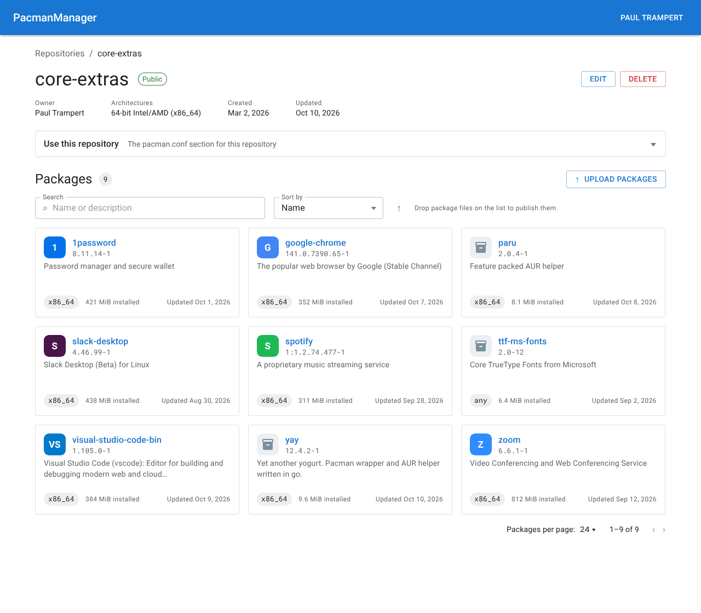
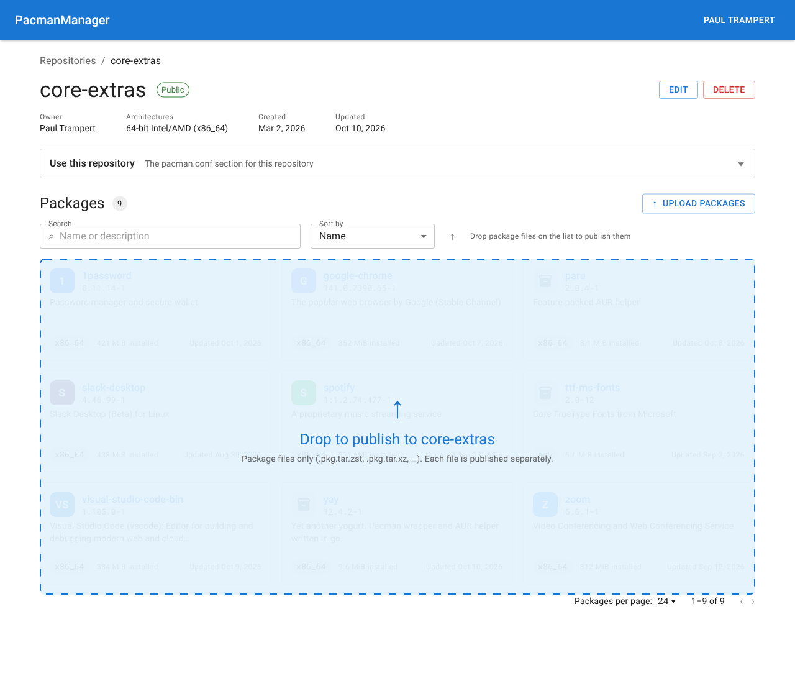
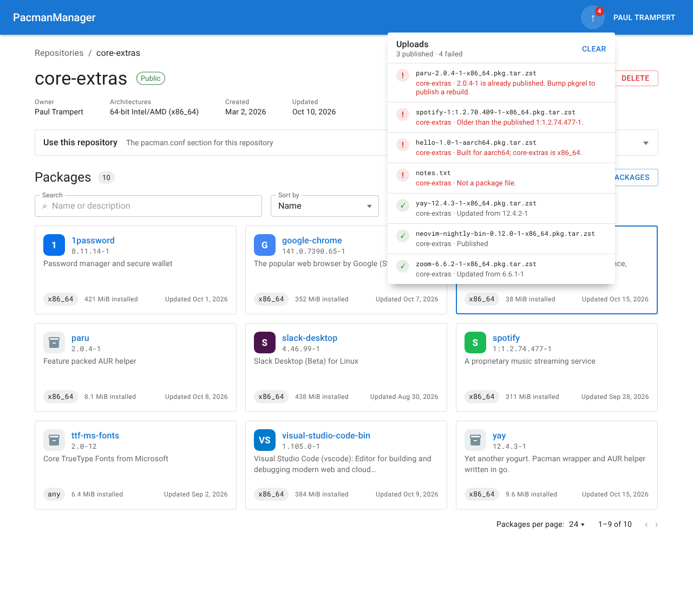
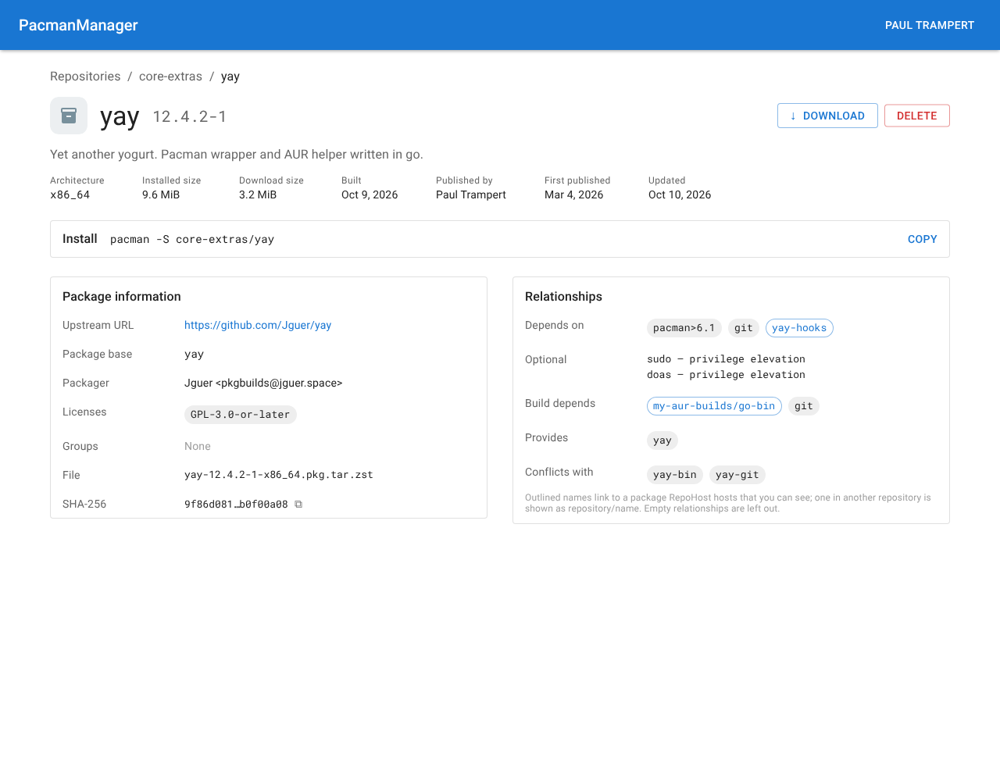
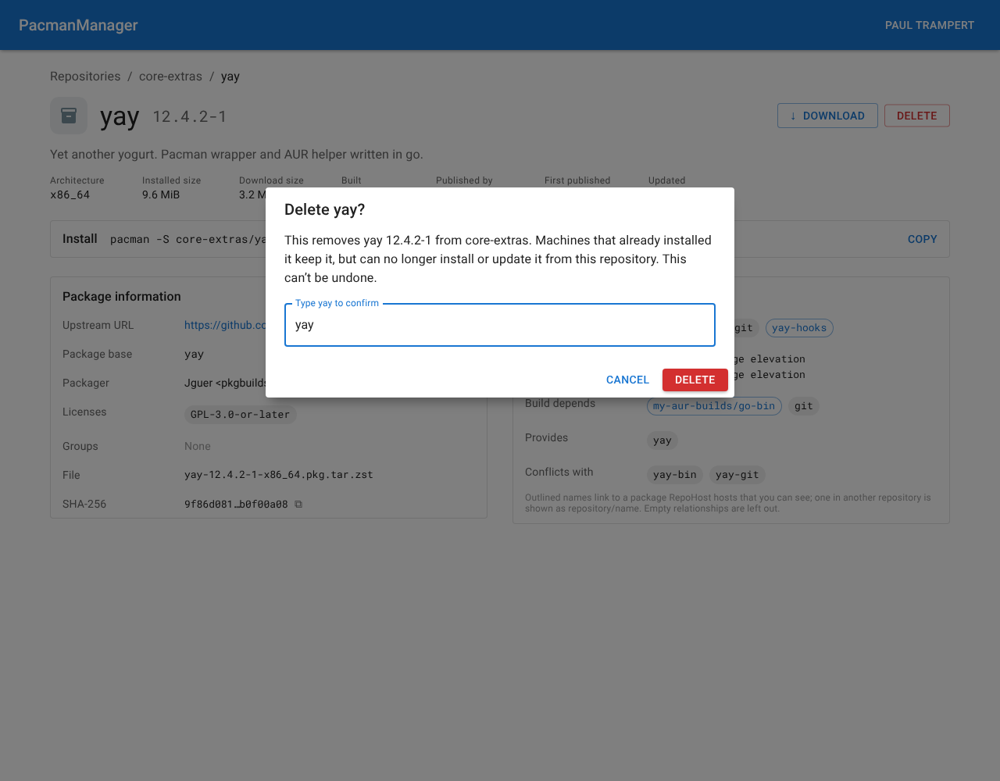

# Web UI: Packages

Status: **design**. This document is the source the **Web UI: Packages** issues are cut from. It
builds its screens on [Web UI Architecture](../web-ui-architecture/web-ui-architecture.md) and on
the components and patterns [Web UI: Repositories](../web-ui-repositories/web-ui-repositories.md)
built, and does not re-decide anything either document fixes. The API it calls is the one
[Packages API](../package-management-api/packages-api.md) describes.

**How to read it.** The plan states what will be built. The argument for each decision — including
what was considered and rejected — is in the [Appendix](#appendix), and each section ends with a
**Why** footer linking the entries that bear on it. Once this document is on `main` the whole plan
is settled, whether or not a given detail has a Why entry: implement it as written and raise an
issue rather than re-deciding it.

Deviating from the plan during implementation is allowed, but never quietly. A deviation **must**
have sign-off from a project owner, and **must** carry all three of:

* the plan updated to say what is actually being built;
* an Appendix entry recording why it changed;
* every dependent issue updated to match.

It depends on the **Web UI: Repositories** milestone being complete: the repository page, its
header, `PageHeader`, `EmptyState`, `Dialog`, `CopyableCodeBlock`, `ProblemDetailsAlert`, the typed
fixture builders and the applied-sort echo are all used here as they stand.

## Goals

* Anyone who can see a repository can browse its packages as cards on the repository page, and
  search and order them by everything the API supports.
* Anyone who can see a package can open it, read all the metadata the API returns, follow its
  dependencies to other packages RepoHost hosts, copy the command that installs it, and download
  its file.
* A user allowed to publish to a repository can drop package files on its list, or choose them, and
  follow every file's upload to the end — including why any file was refused — from anywhere in the
  app.
* A user allowed to delete a package can delete it, after being told what that does to machines
  that already installed it.
* A package's card and page show the application's own icon where the package carries one.
* The UI never decides for itself whether a caller may publish or delete; it shows the controls the
  API's answer permits, and reports the API's own reasons when it refuses.

## Non-goals for this work

Recorded here so the issues stay bounded; each has a follow-up in
[Deferred work](#deferred-work).

* **A package search across repositories.** Packages are browsed inside one repository; there is no
  `/packages` page.
* **Resolving a dependency through what packages `provides`, or checking its version constraint.**
  A dependency links to a package of exactly its name, whatever version that package is.
* **Reverse dependencies** ("required by").
* **Package signatures.** A `.sig` file dropped on the list is uploaded like any other file, and the
  API refuses it.
* **Resuming uploads** after the tab is closed or reloaded, or uploading several files at once.
* **Icons for packages published before this milestone.** A package gains an icon when it is next
  published.
* **Responsive layout and dark mode** — the **Web UI: Polish** milestone.

---

## Wireframes

The wireframes are drawn in Penpot, on the **Packages** page of the *Wireframes* file, and exported
to [`wireframes/`](wireframes/); each wireframe is linked twice, to its committed PNG and to its
board in Penpot. The PNGs are the record of what was agreed; the Penpot boards are where the design
is edited, and need a Penpot account with access to the file. Their font is Roboto; the exports may
render it in a serif fallback, so judge them by layout, sizes, weights and colours, not typeface.

| Area | Wireframes |
| :--- | :--- |
| Package list | [list-owner](wireframes/list-owner.png) ([Penpot](https://penpot.ptrampert.com/#/workspace?team-id=b3c486d2-18f5-8110-8003-4b706524565b&file-id=b49e4a3b-0a79-8163-8008-c775230cef42&page-id=c21b2e44-1343-80a7-8008-cb5dc3221d37&board-id=c21b2e44-1343-80a7-8008-cb5e75dd3e7f)), [list-cannot-publish](wireframes/list-cannot-publish.png) ([Penpot](https://penpot.ptrampert.com/#/workspace?team-id=b3c486d2-18f5-8110-8003-4b706524565b&file-id=b49e4a3b-0a79-8163-8008-c775230cef42&page-id=c21b2e44-1343-80a7-8008-cb5dc3221d37&board-id=c21b2e44-1343-80a7-8008-cb5e7983e294)), [list-searching](wireframes/list-searching.png) ([Penpot](https://penpot.ptrampert.com/#/workspace?team-id=b3c486d2-18f5-8110-8003-4b706524565b&file-id=b49e4a3b-0a79-8163-8008-c775230cef42&page-id=c21b2e44-1343-80a7-8008-cb5dc3221d37&board-id=c21b2e44-1343-80a7-8008-cb5e85900b7e)), [list-loading](wireframes/list-loading.png) ([Penpot](https://penpot.ptrampert.com/#/workspace?team-id=b3c486d2-18f5-8110-8003-4b706524565b&file-id=b49e4a3b-0a79-8163-8008-c775230cef42&page-id=c21b2e44-1343-80a7-8008-cb5dc3221d37&board-id=c21b2e44-1343-80a7-8008-cb5e8037f09f)) |
| Empty list | [list-empty-owner](wireframes/list-empty-owner.png) ([Penpot](https://penpot.ptrampert.com/#/workspace?team-id=b3c486d2-18f5-8110-8003-4b706524565b&file-id=b49e4a3b-0a79-8163-8008-c775230cef42&page-id=c21b2e44-1343-80a7-8008-cb5dc3221d37&board-id=c21b2e44-1343-80a7-8008-cb5e9197f5e5)), [list-empty-cannot-publish](wireframes/list-empty-cannot-publish.png) ([Penpot](https://penpot.ptrampert.com/#/workspace?team-id=b3c486d2-18f5-8110-8003-4b706524565b&file-id=b49e4a3b-0a79-8163-8008-c775230cef42&page-id=c21b2e44-1343-80a7-8008-cb5dc3221d37&board-id=c21b2e44-1343-80a7-8008-cb5e9613d886)), [list-empty-search](wireframes/list-empty-search.png) ([Penpot](https://penpot.ptrampert.com/#/workspace?team-id=b3c486d2-18f5-8110-8003-4b706524565b&file-id=b49e4a3b-0a79-8163-8008-c775230cef42&page-id=c21b2e44-1343-80a7-8008-cb5dc3221d37&board-id=c21b2e44-1343-80a7-8008-cb5e8bc6ea13)) |
| Dropping files | [upload-dragging](wireframes/upload-dragging.png) ([Penpot](https://penpot.ptrampert.com/#/workspace?team-id=b3c486d2-18f5-8110-8003-4b706524565b&file-id=b49e4a3b-0a79-8163-8008-c775230cef42&page-id=c21b2e44-1343-80a7-8008-cb5dc3221d37&board-id=c21b2e44-1343-80a7-8008-cb5ed684de62)), [upload-dragging-empty](wireframes/upload-dragging-empty.png) ([Penpot](https://penpot.ptrampert.com/#/workspace?team-id=b3c486d2-18f5-8110-8003-4b706524565b&file-id=b49e4a3b-0a79-8163-8008-c775230cef42&page-id=c21b2e44-1343-80a7-8008-cb5dc3221d37&board-id=c21b2e44-1343-80a7-8008-cb5ef2a4c684)) |
| Uploads | [upload-in-progress](wireframes/upload-in-progress.png) ([Penpot](https://penpot.ptrampert.com/#/workspace?team-id=b3c486d2-18f5-8110-8003-4b706524565b&file-id=b49e4a3b-0a79-8163-8008-c775230cef42&page-id=c21b2e44-1343-80a7-8008-cb5dc3221d37&board-id=c21b2e44-1343-80a7-8008-cb67672a6f88)), [upload-in-progress-details](wireframes/upload-in-progress-details.png) ([Penpot](https://penpot.ptrampert.com/#/workspace?team-id=b3c486d2-18f5-8110-8003-4b706524565b&file-id=b49e4a3b-0a79-8163-8008-c775230cef42&page-id=c21b2e44-1343-80a7-8008-cb5dc3221d37&board-id=c21b2e44-1343-80a7-8008-cb67772d6fd0)), [upload-all-succeeded](wireframes/upload-all-succeeded.png) ([Penpot](https://penpot.ptrampert.com/#/workspace?team-id=b3c486d2-18f5-8110-8003-4b706524565b&file-id=b49e4a3b-0a79-8163-8008-c775230cef42&page-id=c21b2e44-1343-80a7-8008-cb5dc3221d37&board-id=c21b2e44-1343-80a7-8008-cb67dfec3ad8)), [upload-some-failed](wireframes/upload-some-failed.png) ([Penpot](https://penpot.ptrampert.com/#/workspace?team-id=b3c486d2-18f5-8110-8003-4b706524565b&file-id=b49e4a3b-0a79-8163-8008-c775230cef42&page-id=c21b2e44-1343-80a7-8008-cb5dc3221d37&board-id=c21b2e44-1343-80a7-8008-cb678e641f2c)), [upload-some-failed-details](wireframes/upload-some-failed-details.png) ([Penpot](https://penpot.ptrampert.com/#/workspace?team-id=b3c486d2-18f5-8110-8003-4b706524565b&file-id=b49e4a3b-0a79-8163-8008-c775230cef42&page-id=c21b2e44-1343-80a7-8008-cb5dc3221d37&board-id=c21b2e44-1343-80a7-8008-cb67b5c2f23d)) |
| Package page | [package-can-delete](wireframes/package-can-delete.png) ([Penpot](https://penpot.ptrampert.com/#/workspace?team-id=b3c486d2-18f5-8110-8003-4b706524565b&file-id=b49e4a3b-0a79-8163-8008-c775230cef42&page-id=c21b2e44-1343-80a7-8008-cb5dc3221d37&board-id=c21b2e44-1343-80a7-8008-cb5f3e753e9f)), [package-cannot-delete](wireframes/package-cannot-delete.png) ([Penpot](https://penpot.ptrampert.com/#/workspace?team-id=b3c486d2-18f5-8110-8003-4b706524565b&file-id=b49e4a3b-0a79-8163-8008-c775230cef42&page-id=c21b2e44-1343-80a7-8008-cb5dc3221d37&board-id=c21b2e44-1343-80a7-8008-cb5f43086bbf)) |
| Delete | [delete-dialog-open](wireframes/delete-dialog-open.png) ([Penpot](https://penpot.ptrampert.com/#/workspace?team-id=b3c486d2-18f5-8110-8003-4b706524565b&file-id=b49e4a3b-0a79-8163-8008-c775230cef42&page-id=c21b2e44-1343-80a7-8008-cb5dc3221d37&board-id=c21b2e44-1343-80a7-8008-cb6d59bb4dd3)), [delete-name-typed](wireframes/delete-name-typed.png) ([Penpot](https://penpot.ptrampert.com/#/workspace?team-id=b3c486d2-18f5-8110-8003-4b706524565b&file-id=b49e4a3b-0a79-8163-8008-c775230cef42&page-id=c21b2e44-1343-80a7-8008-cb5dc3221d37&board-id=c21b2e44-1343-80a7-8008-cb6d5b390140)), [delete-failed](wireframes/delete-failed.png) ([Penpot](https://penpot.ptrampert.com/#/workspace?team-id=b3c486d2-18f5-8110-8003-4b706524565b&file-id=b49e4a3b-0a79-8163-8008-c775230cef42&page-id=c21b2e44-1343-80a7-8008-cb5dc3221d37&board-id=c21b2e44-1343-80a7-8008-cb6d5cf37b79)), [delete-succeeded](wireframes/delete-succeeded.png) ([Penpot](https://penpot.ptrampert.com/#/workspace?team-id=b3c486d2-18f5-8110-8003-4b706524565b&file-id=b49e4a3b-0a79-8163-8008-c775230cef42&page-id=c21b2e44-1343-80a7-8008-cb5dc3221d37&board-id=c21b2e44-1343-80a7-8008-cb5f74e30437)) |

The wireframes' sample data — package names, sizes, dates and the wording of upload failures — is
illustrative. The specification below is authoritative where a wireframe and the text disagree.

### Storyboards

The main flows are storyboarded on the **Packages – Storyboards** page of the same file, from the
wireframes above: [storyboard-key](wireframes/storyboard-key.png) ([Penpot](https://penpot.ptrampert.com/#/workspace?team-id=b3c486d2-18f5-8110-8003-4b706524565b&file-id=b49e4a3b-0a79-8163-8008-c775230cef42&page-id=27f120be-10e8-80f0-8008-cb7a0fb9a0fe&board-id=27f120be-10e8-80f0-8008-cb7a1082e608)) explains the markings,
and each flow's shared steps run along the top until a split, after which the path where everything
works continues along the top and the error path drops to the row below.

| Flow | Storyboard |
| :--- | :--- |
| Publishing packages, with some files refused | [storyboard-publish](wireframes/storyboard-publish.png) ([Penpot](https://penpot.ptrampert.com/#/workspace?team-id=b3c486d2-18f5-8110-8003-4b706524565b&file-id=b49e4a3b-0a79-8163-8008-c775230cef42&page-id=27f120be-10e8-80f0-8008-cb7a0fb9a0fe&board-id=27f120be-10e8-80f0-8008-cb7d768d984e)) |
| Deleting a package, with the delete failing | [storyboard-delete](wireframes/storyboard-delete.png) ([Penpot](https://penpot.ptrampert.com/#/workspace?team-id=b3c486d2-18f5-8110-8003-4b706524565b&file-id=b49e4a3b-0a79-8163-8008-c775230cef42&page-id=27f120be-10e8-80f0-8008-cb7a0fb9a0fe&board-id=27f120be-10e8-80f0-8008-cb7d78370366)) |
| Searching for a package, then downloading it | [storyboard-search-download](wireframes/storyboard-search-download.png) ([Penpot](https://penpot.ptrampert.com/#/workspace?team-id=b3c486d2-18f5-8110-8003-4b706524565b&file-id=b49e4a3b-0a79-8163-8008-c775230cef42&page-id=27f120be-10e8-80f0-8008-cb7a0fb9a0fe&board-id=27f120be-10e8-80f0-8008-cb7a57610412)) |

---

## API changes

RepoHost gains the following. Each is additive, so none of them breaks the committed OpenAPI
document, but each regenerates it so the web app can use what it adds.

### `Repository.permissions.publish`

`Repository.permissions` gains a third field:

```jsonc
"permissions": { "update": true, "delete": true, "publish": true }
```

| Field | `true` exactly when |
| :--- | :--- |
| `publish` | `PackageAccessPolicy.CheckPublish(repository, actor)` is `Allowed` |

* It is **always present**, `false` included, and listed in `RepositoryPermissions`' `required`.
* It comes from the **same policy call** `PublishAsync` enforces with, so ownership and the
  credential's `pacman-manager:packages:create` scope both count. It is never derived from `update`.
* Like `update` and `delete`, it is set on the materialised `Repository` after the query, never in
  `Repository.Projection`, and adds no query.

### `Package.permissions`

Every `Package` RepoHost returns — the listings, both `GET` routes, and the publish response —
carries what the caller may do to it:

```jsonc
{ "id": "0197…", "name": "yay", /* …existing fields… */ "permissions": { "delete": true } }
```

| Field | `true` exactly when |
| :--- | :--- |
| `delete` | `PackageAccessPolicy.CheckDelete(package's repository, actor)` is `Allowed` |

* Always present, `false` included; `permissions` is in `Package`'s `required` and `delete` in its
  own.
* Computed per response for the actor making the request, after the query, and never stored. It
  adds no query: the repository's owner and visibility come from the same projection.

### `Package.hasIcon` and `GET /api/v1/Packages/{packageId}/icon`

A package carries an icon when one was found in it at publish time, by the rules in
[Package icons](#package-icons).

| Method | Path | Auth | Success | Errors |
| :--- | :--- | :--- | :--- | :--- |
| `GET` | `/api/v1/Packages/{packageId}/icon` | Anonymous | `200`, the image | `404` |

* `Package` gains a required `hasIcon: boolean`.
* `200` carries the stored image with its own content type, `image/png` or `image/svg+xml`, and
  nothing else is ever served from this route.
* `404` when the package is not visible to the caller, or has no icon. Visibility is the package's,
  exactly as for its content.
* **Every `200` carries `Content-Disposition: attachment`** with a file name, and
  `X-Content-Type-Options: nosniff`. A browser following the URL directly saves the file rather than
  rendering it; an `` still renders it.
* It carries `Cache-Control: private, max-age=86400`. The web app requests it as
  `…/icon?v=<updatedAt>`, so a republished package's new icon is never hidden by the cache; the
  query parameter is ignored by RepoHost.

### An exact `names` filter on package listings

`GET /api/v1/Packages` and `GET /api/v1/repositories/{repositoryId}/packages` gain a `names` query
parameter: comma-separated, bound like `repositoryIds`, matching a package whose `Name` equals one of
them **exactly**, case included. It is ANDed with every other filter, so it never widens what the
caller sees. It accepts at most 100 names; more is a `400`.

### The publish request body is declared

`POST /api/v1/repositories/{repositoryId}/packages` declares its request body in the OpenAPI
document as `application/octet-stream`, a binary string, required. The route's behaviour does not
change: it still reads the raw body and enforces no content type.

### A refused delete says "delete"

A `403` from deleting a package is titled "You may not delete packages in this repository." with the
detail "The current user may not delete packages in repository '{id}'." Publishing keeps its own
wording. `PackageForbiddenException` carries which action was refused, and
`AuthorizationExceptionHandler` chooses the title from it.

**Why:**

* [publish and delete permissions come from the API](#why-publish-and-delete-permissions-come-from-the-api)
* [the icon is served as an attachment](#why-the-icon-is-served-as-an-attachment)
* [dependencies link by exact name](#why-dependencies-link-by-exact-name)

---

## Package icons

When a package is published, RepoHost looks for its application icon, first inside the package file
and then in Arch Linux's own AppStream data, and stores the first it finds.

**1. Inside the package.** RepoHost lists the archive's entries with `bsdtar`, run through
`PacmanManager.CliTools`, and reads only the entries named below:

1. **Find the icon name.** In order, the first that gives one:
   1. An AppStream metainfo file, `usr/share/metainfo/*.metainfo.xml` or `*.appdata.xml` (also under
      `usr/share/appdata/`): its `<icon type="stock">` value; failing that, its
      `<launchable type="desktop-id">`'s desktop file.
   2. A desktop file, `usr/share/applications/*.desktop` — the launchable's, or else the first in
      ordinal order: its `[Desktop Entry]` `Icon=` value.
2. **Resolve the name to a file in the archive.** An `Icon=` that is an absolute path names the file
   directly. Otherwise, in order, the first that exists:
   1. `usr/share/icons/hicolor/scalable/apps/<name>.svg`;
   2. `usr/share/icons/hicolor/<N>x<N>/apps/<name>.png`, taking the smallest `N` of at least 128,
      or failing that the largest;
   3. `usr/share/pixmaps/<name>.svg`, then `usr/share/pixmaps/<name>.png`.
3. **Accept it** only when it is at most **256 KiB** and its bytes are a PNG (by signature) or an
   SVG (an XML document whose root element is `svg`). Anything else is treated as not found.

**2. Arch Linux's AppStream data.** The RepoHost image installs `archlinux-appstream-data`. When the
package itself yields no icon, RepoHost looks for a catalogue component whose `<pkgname>` equals the
package's name and takes its `<icon type="cached">` at 128×128, from the catalogue's icon directory,
under the same acceptance rule. The catalogue is read once per process and indexed by package name.

**Storing it.**

* The icon is written to `{DATA_DIR}/icons/{packageId}` and its content type stored on the package
  row, in a new nullable `IconContentType` column. `hasIcon` is `IconContentType != null`.
* It is written in the same publish, after the package file, under the same per-repository lock;
  a republish replaces it or, finding none, removes the old one. Deleting the package removes it.
* **Looking for an icon never fails a publish.** A `bsdtar` failure, a malformed metainfo or desktop
  file, or an unreadable catalogue is logged at warning, and the package is published without one.

**Why:**

* [icons are extracted when a package is published](#why-icons-are-extracted-when-a-package-is-published)
* [archives are read with `bsdtar`](#why-archives-are-read-with-bsdtar)
* [the icon is served as an attachment](#why-the-icon-is-served-as-an-attachment)

---

## Routes and navigation

| Path | Who | Shows |
| :--- | :--- | :--- |
| `/repositories/$repositoryId` | anyone who can see it | the repository page, now with its [package list](#the-package-list) |
| `/repositories/$repositoryId/packages/$packageName` | anyone who can see it | the [package page](#the-package-page) |

* A package is addressed by its repository's **id** and its own **name**, and loaded with
  `GET /v1/repositories/{repositoryId}/packages/{name}`. A `404` is the route's not-found component.
* The package page's breadcrumbs are **Repositories / *the repository's name* / *the package's
  name***, the repository's name from `repositoryQuery(id)`.
* The shell's `AppBar` gains the [uploads button](#uploads-in-the-app-bar) to the left of the session
  control. There is still no navigation menu.
* `src/queries/packages/` holds `packageKeys`, `packageListQuery`, `packageQuery`,
  `packagesByNameQuery` and `useDeletePackage`. Keys follow the `[resource, "list", search]` /
  `[resource, "detail", id]` layout: a list's search includes its `repositoryId`, and a detail's id
  is `{ repositoryId, name }`.

**Why:**

* [a package is addressed by name](#why-a-package-is-addressed-by-name)
* [the list lives on the repository page](#why-the-list-lives-on-the-repository-page)

---

## The package list



Below the `pacman.conf` section, the repository page shows one page of
`GET /v1/repositories/{repositoryId}/packages`. Its search params are the API's, on the repository
page's own route:

| Search param | Sent as | Default |
| :--- | :--- | :--- |
| `search` | the same | absent |
| `sortBy` | the same | absent (`Name`) |
| `direction` | the same | absent (the field's default) |
| `offset` | the same | `0` |
| `pageSize` | the same | `24` |

Top to bottom, the section has:

1. a heading row: **Packages** as an `h2`, a chip with the response's `total`, and, only when the
   repository's `permissions.publish` is `true`, an outlined **Upload packages** button on the right;
2. a toolbar: a **Search** field (placeholder "Name or description", a clear button while it has
   text), a **Sort by** select (**Name**, **Updated**, **Created**, **Installed size**), a
   direction toggle, and — only with `permissions.publish` — the hint "Drop package files on the
   list to publish them";
3. the cards, in a grid of three columns;
4. pagination: "Packages per page" with **24, 48 or 96**, the range shown, and previous and next.

* `pageSize` accepts only 24, 48 or 96; anything else is dropped by `validateSearch`, as the
  repository list does with its own sizes.
* The search updates the URL **300 ms after typing stops**. Changing the search, the sort or the page
  size resets `offset` to `0`.
* The select and the direction toggle show the response's applied [`sort`](../web-ui-repositories/web-ui-repositories.md#6-echo-the-applied-sort-on-paginated-responses--minor),
  never the URL's. Choosing a field sets `sortBy` and removes `direction`; the toggle reverses the
  applied direction. Its accessible name says the current direction ("Sorted ascending").
* Loading follows the [repository list](../web-ui-repositories/web-ui-repositories.md#loading): the
  route prefetches without awaiting, the list is read with `useQuery` and `keepPreviousData`, and a
  request in flight dims the previous cards under a spinner. With no previous cards, six skeleton
  cards stand in for them. An error is shown in place of the grid with **Try again**.
* A page past the end is clamped to the last page with a history-replacing navigation, as on the
  repository list.

Wireframes: [list-owner](wireframes/list-owner.png) ([Penpot](https://penpot.ptrampert.com/#/workspace?team-id=b3c486d2-18f5-8110-8003-4b706524565b&file-id=b49e4a3b-0a79-8163-8008-c775230cef42&page-id=c21b2e44-1343-80a7-8008-cb5dc3221d37&board-id=c21b2e44-1343-80a7-8008-cb5e75dd3e7f)), [list-cannot-publish](wireframes/list-cannot-publish.png) ([Penpot](https://penpot.ptrampert.com/#/workspace?team-id=b3c486d2-18f5-8110-8003-4b706524565b&file-id=b49e4a3b-0a79-8163-8008-c775230cef42&page-id=c21b2e44-1343-80a7-8008-cb5dc3221d37&board-id=c21b2e44-1343-80a7-8008-cb5e7983e294)), [list-searching](wireframes/list-searching.png) ([Penpot](https://penpot.ptrampert.com/#/workspace?team-id=b3c486d2-18f5-8110-8003-4b706524565b&file-id=b49e4a3b-0a79-8163-8008-c775230cef42&page-id=c21b2e44-1343-80a7-8008-cb5dc3221d37&board-id=c21b2e44-1343-80a7-8008-cb5e85900b7e)), [list-loading](wireframes/list-loading.png) ([Penpot](https://penpot.ptrampert.com/#/workspace?team-id=b3c486d2-18f5-8110-8003-4b706524565b&file-id=b49e4a3b-0a79-8163-8008-c775230cef42&page-id=c21b2e44-1343-80a7-8008-cb5dc3221d37&board-id=c21b2e44-1343-80a7-8008-cb5e8037f09f)).

**Why:**

* [packages are cards, not a table](#why-packages-are-cards-not-a-table)
* [sort has a select, not column headers](#why-sort-has-a-select-not-column-headers)

### Package cards

Each card is **one link** to the package's page, labelled by the package's name, holding:

| Part | Shows |
| :--- | :--- |
| icon | the [package icon](#package-icons) at 40 px, or the default icon |
| name | the name, in the link colour |
| version | `version`, monospace |
| description | `description`, clamped to two lines with an ellipsis; nothing when absent |
| footer | an `architecture` chip (monospace), "*installed size* installed", and "Updated *date*" on the right |

* Sizes are binary units with one decimal place — `9.6 MiB`, `812 MiB`, `1.2 GiB` — from one shared
  `formatBytes`.
* **The default icon** is a neutral package glyph on a grey square; it is shown when `hasIcon` is
  `false`, while the image loads, and if it fails to load.
* A card for a package that an upload in the [uploads list](#uploads-in-the-app-bar) published as
  **new** (`201`) carries a **New** chip beside the name and a primary-coloured border, until that
  upload is cleared from the list.

### Empty states

| Situation | Heading | Message | Action |
| :--- | :--- | :--- | :--- |
| `search` set, no results | No packages match | Nothing in *repository* matches "*search*". | **Clear search**, removing `search` |
| no `search`, no packages, `permissions.publish` | No packages yet | Drag package files here to publish them to *repository*, or | **Choose files**, opening the file picker |
| no `search`, no packages, no `permissions.publish` | No packages yet | Nothing has been published to *repository*. | none |

* The toolbar is hidden when the repository has no packages and no `search` is set.
* The publishing empty state is drawn with a dashed border and is the [drop target](#dropping-files).
* An empty state is shown only when `total` is 0.

Wireframes: [list-empty-search](wireframes/list-empty-search.png) ([Penpot](https://penpot.ptrampert.com/#/workspace?team-id=b3c486d2-18f5-8110-8003-4b706524565b&file-id=b49e4a3b-0a79-8163-8008-c775230cef42&page-id=c21b2e44-1343-80a7-8008-cb5dc3221d37&board-id=c21b2e44-1343-80a7-8008-cb5e8bc6ea13)), [list-empty-owner](wireframes/list-empty-owner.png) ([Penpot](https://penpot.ptrampert.com/#/workspace?team-id=b3c486d2-18f5-8110-8003-4b706524565b&file-id=b49e4a3b-0a79-8163-8008-c775230cef42&page-id=c21b2e44-1343-80a7-8008-cb5dc3221d37&board-id=c21b2e44-1343-80a7-8008-cb5e9197f5e5)), [list-empty-cannot-publish](wireframes/list-empty-cannot-publish.png) ([Penpot](https://penpot.ptrampert.com/#/workspace?team-id=b3c486d2-18f5-8110-8003-4b706524565b&file-id=b49e4a3b-0a79-8163-8008-c775230cef42&page-id=c21b2e44-1343-80a7-8008-cb5dc3221d37&board-id=c21b2e44-1343-80a7-8008-cb5e9613d886)).

---

## Publishing packages

Publishing is offered **only** where `permissions.publish` is `true`. Files reach the uploads list in
two ways, and nothing else on the page changes until an upload finishes.

### Dropping files



* The package section, from the toolbar's bottom edge to the pagination, is the drop target. While
  files are dragged over it, an overlay covers it: a dashed primary border on a light primary tint,
  an upload glyph, "Drop to publish to *repository*", and "Package files only (.pkg.tar.zst,
  .pkg.tar.xz, …). Each file is published separately."
* The overlay appears only for a drag that carries files, and leaves when the drag leaves the
  target, ends, or is dropped.
* Dropping adds each dropped **file** to the uploads list, in the order given, for this repository.
  A dropped folder is skipped.
* **A file dropped anywhere else in the app does nothing.** The app prevents the browser's default
  of opening a dropped file, so a near miss never navigates away from the page — or abandons the
  uploads in progress.
* **Upload packages** and the empty state's **Choose files** open the browser's file picker with
  `multiple`; the chosen files are added exactly as dropped ones are.
* The web app does not judge a file by its name or size. Every file is uploaded, and the API decides.

Wireframes: [upload-dragging](wireframes/upload-dragging.png) ([Penpot](https://penpot.ptrampert.com/#/workspace?team-id=b3c486d2-18f5-8110-8003-4b706524565b&file-id=b49e4a3b-0a79-8163-8008-c775230cef42&page-id=c21b2e44-1343-80a7-8008-cb5dc3221d37&board-id=c21b2e44-1343-80a7-8008-cb5ed684de62)), [upload-dragging-empty](wireframes/upload-dragging-empty.png) ([Penpot](https://penpot.ptrampert.com/#/workspace?team-id=b3c486d2-18f5-8110-8003-4b706524565b&file-id=b49e4a3b-0a79-8163-8008-c775230cef42&page-id=c21b2e44-1343-80a7-8008-cb5dc3221d37&board-id=c21b2e44-1343-80a7-8008-cb5ef2a4c684)).

**Why:**

* [the UI uploads every file and lets the API judge](#why-the-ui-uploads-every-file-and-lets-the-api-judge)
* [a drop outside the list does nothing](#why-a-drop-outside-the-list-does-nothing)

### The uploads list

The uploads list is **app-wide** state, held above the router, so it survives navigating between
pages. Each entry is one file, with its repository and a status:

| Status | Shown as | Means |
| :--- | :--- | :--- |
| Waiting | "Waiting" | not yet sent |
| Uploading | a progress bar and "*n*% of *size*" | being sent |
| Published | "Published *version*" | the API answered `201` |
| Updated | "Updated to *version*" | the API answered `200` |
| Failed | the problem's `detail`, in the error colour | the API refused it, or the request failed |
| Cancelled | "Cancelled" | cancelled before it finished |

* **Files are sent one at a time**, in the order they were added, whichever repository they are for.
  A file added while others are in flight joins the end of the queue.
* Each file is one `POST /v1/repositories/{repositoryId}/packages`, its body the file's bytes with
  `Content-Type: application/octet-stream`, sent with `XMLHttpRequest` so its progress can be shown,
  and carrying the `X-XSRF-TOKEN` header as every other mutation does.
* *version* is the `version` of the `Package` the API answered with. The version it replaced is not
  shown: the API's answer does not carry it.
* **A failure's text is the problem details' `detail`**, verbatim. A response with none shows its
  `title`; a network failure shows "The upload could not be sent." A `401` fails that file with
  "Your session has expired. Sign in again to upload." and cancels the rest; it does not redirect.
* **Once a file finishes**, successfully or not, the next starts. On a success, the web app
  invalidates that repository's package lists, the repository's detail query (its **Updated** date
  changes) and that package's detail query. **The package appears in the list only then** — no card
  is drawn for a file still uploading.
* While anything is waiting or uploading, closing or reloading the tab asks the browser to confirm
  leaving.

**Why:**

* [uploads are tracked app-wide, in the app bar](#why-uploads-are-tracked-app-wide-in-the-app-bar)
* [files upload one at a time](#why-files-upload-one-at-a-time)
* [uploads use `XMLHttpRequest`](#why-uploads-use-xmlhttprequest)
* [failure reasons are the API's own words](#why-failure-reasons-are-the-apis-own-words)
* [a package appears only when its upload finishes](#why-a-package-appears-only-when-its-upload-finishes)

### Uploads in the app bar



While the uploads list has any entry, the app bar shows an **uploads button** — an upload glyph —
to the left of the session control. It is not shown otherwise.

| State | Button |
| :--- | :--- |
| anything waiting or uploading | a determinate ring of the bytes sent across the whole list, and a white badge counting files not yet finished |
| finished, some failed | a red badge counting the failures |
| finished, none failed | a green badge with a tick |

* Clicking it opens a **popover**, 420 px wide, anchored below it: the heading **Uploads**, a
  summary ("2 of 7 done" while running; "3 published · 4 failed" when finished), one action, and a
  row per file — a status icon, the file name in monospace (truncated with an ellipsis, the full
  name as its title), and "*repository* · *status*", with a progress bar while uploading.
* Rows are in upload order while anything is running. Once everything has finished, failed rows come
  first.
* The action is **Cancel remaining** while anything is waiting or uploading — it aborts the request
  in flight and marks it and every waiting file **Cancelled** — and **Clear** once everything has
  finished, emptying the list, which removes the button.
* Clicking outside the popover or pressing **Escape** closes it.

When the last file finishes, a **notice** appears at the bottom left for six seconds:

| Outcome | Notice | Action |
| :--- | :--- | :--- |
| none failed, one repository | Published *n* packages to *repository* (or "Published *name*" for one) | none |
| none failed, several repositories | Published *n* packages | none |
| some failed | *p* of *n* uploads published; *f* failed | **Details**, opening the popover |

Notices are shown by one app-wide notification provider, which the [delete](#deleting-a-package)
also uses.

Wireframes: [upload-in-progress](wireframes/upload-in-progress.png) ([Penpot](https://penpot.ptrampert.com/#/workspace?team-id=b3c486d2-18f5-8110-8003-4b706524565b&file-id=b49e4a3b-0a79-8163-8008-c775230cef42&page-id=c21b2e44-1343-80a7-8008-cb5dc3221d37&board-id=c21b2e44-1343-80a7-8008-cb67672a6f88)), [upload-in-progress-details](wireframes/upload-in-progress-details.png) ([Penpot](https://penpot.ptrampert.com/#/workspace?team-id=b3c486d2-18f5-8110-8003-4b706524565b&file-id=b49e4a3b-0a79-8163-8008-c775230cef42&page-id=c21b2e44-1343-80a7-8008-cb5dc3221d37&board-id=c21b2e44-1343-80a7-8008-cb67772d6fd0)), [upload-all-succeeded](wireframes/upload-all-succeeded.png) ([Penpot](https://penpot.ptrampert.com/#/workspace?team-id=b3c486d2-18f5-8110-8003-4b706524565b&file-id=b49e4a3b-0a79-8163-8008-c775230cef42&page-id=c21b2e44-1343-80a7-8008-cb5dc3221d37&board-id=c21b2e44-1343-80a7-8008-cb67dfec3ad8)), [upload-some-failed](wireframes/upload-some-failed.png) ([Penpot](https://penpot.ptrampert.com/#/workspace?team-id=b3c486d2-18f5-8110-8003-4b706524565b&file-id=b49e4a3b-0a79-8163-8008-c775230cef42&page-id=c21b2e44-1343-80a7-8008-cb5dc3221d37&board-id=c21b2e44-1343-80a7-8008-cb678e641f2c)), [upload-some-failed-details](wireframes/upload-some-failed-details.png) ([Penpot](https://penpot.ptrampert.com/#/workspace?team-id=b3c486d2-18f5-8110-8003-4b706524565b&file-id=b49e4a3b-0a79-8163-8008-c775230cef42&page-id=c21b2e44-1343-80a7-8008-cb5dc3221d37&board-id=c21b2e44-1343-80a7-8008-cb67b5c2f23d)).

**Why:**

* [uploads are tracked app-wide, in the app bar](#why-uploads-are-tracked-app-wide-in-the-app-bar)
* [notices come from one provider](#why-notices-come-from-one-provider)

---

## The package page



`/repositories/$repositoryId/packages/$packageName` loads `packageQuery({ repositoryId, name })` and
`repositoryQuery(repositoryId)`. Top to bottom:

1. the [breadcrumbs](#routes-and-navigation);
2. a title row: the [package icon](#package-icons) at 48 px, the name as the page's `h1`, the
   version beside it in monospace, and on the right
   * an outlined **Download** button: a plain link to
     `/api/pacmanmanager/v1/Packages/{packageId}/content` with the `download` attribute, for anyone
     who can see the page;
   * an outlined, error-coloured **Delete** button opening the [delete dialog](#deleting-a-package),
     only when the package's `permissions.delete` is `true`;
3. the `description`, when there is one;
4. one row of label-over-value details: **Architecture**, **Installed size**, **Download size**
   (`compressedSize`), **Built**, **Published by** (the publisher's display name), **First
   published** (`createdAt`) and **Updated** (`updatedAt`);
5. an **Install** block: a `CopyableCodeBlock` holding exactly `pacman -S <repository name>/<package
   name>`;
6. two cards side by side, **Package information** and **Relationships**.

**Package information** lists, label beside value:

| Label | Value |
| :--- | :--- |
| Upstream URL | `url`, as a link opening in a new tab with `rel="noopener noreferrer"` — **only when it is an `http:` or `https:` URL**; otherwise as plain text |
| Package base | `base` |
| Packager | `packager` |
| Licenses | a chip per licence |
| Groups | a chip per group |
| File | `fileName`, monospace |
| SHA-256 | `sha256Sum`, monospace, shortened to its first and last eight characters with a copy button that copies the whole value |

A field the package does not have shows "None" in the disabled text colour.

**Relationships** lists, in this order and **only those that are not empty**: **Depends on**
(`depends`), **Optional** (`optDepends`), **Build depends** (`makeDepends`), **Check depends**
(`checkDepends`), **Provides**, **Conflicts with** (`conflicts`) and **Replaces**. Each entry is a
monospace chip of the value as pacman spells it, except **Optional**, which is a line per entry
("*name* — *reason*"). When every one is empty the card says "No dependencies or other
relationships." [Dependency links](#dependency-links) make some chips links.

Wireframes: [package-can-delete](wireframes/package-can-delete.png) ([Penpot](https://penpot.ptrampert.com/#/workspace?team-id=b3c486d2-18f5-8110-8003-4b706524565b&file-id=b49e4a3b-0a79-8163-8008-c775230cef42&page-id=c21b2e44-1343-80a7-8008-cb5dc3221d37&board-id=c21b2e44-1343-80a7-8008-cb5f3e753e9f)), [package-cannot-delete](wireframes/package-cannot-delete.png) ([Penpot](https://penpot.ptrampert.com/#/workspace?team-id=b3c486d2-18f5-8110-8003-4b706524565b&file-id=b49e4a3b-0a79-8163-8008-c775230cef42&page-id=c21b2e44-1343-80a7-8008-cb5dc3221d37&board-id=c21b2e44-1343-80a7-8008-cb5f43086bbf)).

**Why:**

* [the install command names the repository](#why-the-install-command-names-the-repository)
* [download is a plain link](#why-download-is-a-plain-link)

### Dependency links

A relationship entry links to a package RepoHost hosts, **that the caller can see**, whose name is
exactly the entry's name:

* The entry's **name** is its value up to the first `<`, `>`, `=` or `:`, with surrounding spaces
  trimmed (`pacman>6.1` → `pacman`; `sudo: privilege elevation` → `sudo`). Any version constraint is
  ignored.
* The page looks every name up in **one** `packagesByNameQuery(names)` — `GET /v1/Packages` with the
  exact [`names` filter](#an-exact-names-filter-on-package-listings), at most 100 names, the
  page's own package excluded — after the page has rendered; the page never waits for it.
* A name matched in the **same repository** links to that package, and its chip reads as before.
* Otherwise, a name matched in **another repository** links to the match in the repository whose
  name sorts first, and its chip reads `repository/name`, as pacman spells it.
* An unmatched name, or one whose lookup failed, is a plain chip. A linked chip is outlined in the
  primary colour; a plain one is filled grey.

**Why:**

* [dependencies link by exact name](#why-dependencies-link-by-exact-name)

---

## Deleting a package



**Delete** on the package page opens a dialog titled **Delete *name*?** that:

* says "This removes *name* *version* from *repository*. Machines that already installed it keep it,
  but can no longer install or update it from this repository. This can't be undone.";
* has one text field labelled **Type *name* to confirm**, focused and empty each time the dialog
  opens;
* has the actions **Cancel** (text) and **Delete** (contained, error colour). **Delete** is disabled
  until the typed text equals the name **exactly**, case included, and while the request is pending;
* while the request is pending, stays open with its actions disabled;
* on success, navigates to the repository page and shows the notice "Deleted *name* *version* from
  *repository*";
* on **failure, closes**, and the package page shows a dismissible `ProblemDetailsAlert` above its
  breadcrumbs, titled "*name* was not deleted", with the response's `detail`. Retrying means opening
  the dialog and typing the name again.

The delete is `DELETE /v1/Packages/{packageId}`. On success the web app invalidates the repository's
package lists and its detail query, and removes the package's detail query only after the navigation
has settled, as `useDeleteRepository` does.

Wireframes: [delete-dialog-open](wireframes/delete-dialog-open.png) ([Penpot](https://penpot.ptrampert.com/#/workspace?team-id=b3c486d2-18f5-8110-8003-4b706524565b&file-id=b49e4a3b-0a79-8163-8008-c775230cef42&page-id=c21b2e44-1343-80a7-8008-cb5dc3221d37&board-id=c21b2e44-1343-80a7-8008-cb6d59bb4dd3)), [delete-name-typed](wireframes/delete-name-typed.png) ([Penpot](https://penpot.ptrampert.com/#/workspace?team-id=b3c486d2-18f5-8110-8003-4b706524565b&file-id=b49e4a3b-0a79-8163-8008-c775230cef42&page-id=c21b2e44-1343-80a7-8008-cb5dc3221d37&board-id=c21b2e44-1343-80a7-8008-cb6d5b390140)), [delete-failed](wireframes/delete-failed.png) ([Penpot](https://penpot.ptrampert.com/#/workspace?team-id=b3c486d2-18f5-8110-8003-4b706524565b&file-id=b49e4a3b-0a79-8163-8008-c775230cef42&page-id=c21b2e44-1343-80a7-8008-cb5dc3221d37&board-id=c21b2e44-1343-80a7-8008-cb6d5cf37b79)), [delete-succeeded](wireframes/delete-succeeded.png) ([Penpot](https://penpot.ptrampert.com/#/workspace?team-id=b3c486d2-18f5-8110-8003-4b706524565b&file-id=b49e4a3b-0a79-8163-8008-c775230cef42&page-id=c21b2e44-1343-80a7-8008-cb5dc3221d37&board-id=c21b2e44-1343-80a7-8008-cb5f74e30437)).

**Why:**

* [deleting asks for the name](#why-deleting-asks-for-the-name)
* [a dialog closes on failure](../web-ui-repositories/web-ui-repositories.md#why-a-dialog-closes-on-failure)
* [the type-to-confirm dialog is generic](#why-the-type-to-confirm-dialog-is-generic)

---

## Implementation plan

One issue per heading. Dependencies are noted; anything without a dependency can start immediately.

The work is in the same six layers as **Web UI: Repositories**, and an issue depends only on issues
in earlier layers, except that each page depends on the route stub at the head of its own:

1. **API** — RepoHost's additions.
2. **Groundwork** — generic components, hooks and helpers that know nothing about packages.
3. **Package components** — the components the wireframes show, built from the groundwork.
4. **Queries, mutations and uploads** — under `src/queries` and `src/uploads`.
5. **Pages** — a stub of the new route, then each page assembled from components and queries.
6. **Behaviour** — each page's interactions wired to the URL, the mutations, the uploads list and
   navigation.

Every component is **presentational**, takes the generated `Package` or `Repository` type rather than
restating its fields, and is built in stories through the typed fixture builders. Each component
issue's acceptance is a story per state its wireframes show, with a `play` function for each
interaction. Each issue that builds or changes a component or page names the
[wireframes](#wireframes) it implements.

**API**

### 1. `Repository.permissions.publish` — MINOR

`publish` on `RepositoryPermissions`, from `PackageAccessPolicy.CheckPublish`, and the regenerated
`openapi/v1.json`. See [`Repository.permissions.publish`](#repositorypermissionspublish).

*Constraints:* the value comes from the policy call `PublishAsync` enforces with; it is never derived
from `update`, even though both currently follow ownership.

*Acceptance:* service tests assert `publish` for the owner, another user (public repository), an
anonymous caller, and a token lacking `pacman-manager:packages:create`. An E2E test asserts the field,
`false` included, in the raw JSON of the listing and `GET` by id. The regenerated document lists it
in `RepositoryPermissions.required`.

*Depends on:* nothing.

**Why:**

* [publish and delete permissions come from the API](#why-publish-and-delete-permissions-come-from-the-api)

### 2. `Package.permissions` — MINOR

`permissions.delete` on `Package`, from `PackageAccessPolicy.CheckDelete`, set after the query on
every route that returns a `Package`, and the regenerated `openapi/v1.json`. See
[`Package.permissions`](#packagepermissions).

*Constraints:* no second implementation of the rule, and no extra query.

*Acceptance:* service tests for the owner, another user, an anonymous caller and a token lacking
`pacman-manager:packages:delete`; an E2E test asserts the raw JSON of both listings, both `GET`s and
a publish response.

*Depends on:* nothing.

**Why:**

* [publish and delete permissions come from the API](#why-publish-and-delete-permissions-come-from-the-api)

### 3. An exact `names` filter on package listings — MINOR

`names` on `PackageFilter`, bound comma-separated, with its 100-name limit, and the regenerated
`openapi/v1.json`. See [An exact `names` filter](#an-exact-names-filter-on-package-listings).

*Acceptance:* unit tests assert an exact match, no match for a name differing only in case or by a
prefix, the AND with `repositoryIds`, and a `400` at 101 names; an E2E test asserts a private
repository's package is not returned to another user by name.

*Depends on:* nothing.

**Why:**

* [dependencies link by exact name](#why-dependencies-link-by-exact-name)

### 4. Declare the publish request body — PATCH

The `application/octet-stream` request body on the publish operation in the OpenAPI document, by
an operation filter or attribute, and the regenerated `openapi/v1.json`. See
[The publish request body is declared](#the-publish-request-body-is-declared).

*Acceptance:* the regenerated document declares the body as required binary
`application/octet-stream`; the existing publish E2E tests pass unchanged.

*Depends on:* nothing.

### 5. A refused delete says "delete" — PATCH

`PackageForbiddenException` records the refused action, and `AuthorizationExceptionHandler` titles a
refused delete as [A refused delete says "delete"](#a-refused-delete-says-delete) sets out.

*Acceptance:* an E2E test deletes another user's package in a public repository and asserts the
`403`'s title and detail in the raw JSON; the refused-publish test's assertions are unchanged.

*Depends on:* nothing.

### 6. Reading package archives with `bsdtar` — MINOR

An `IPackageArchive` in RepoHost, over `ICliToolRunner`, that lists a package file's entries and
reads one entry's bytes up to a size limit, with `bsdtar` from the RepoHost image. See
[Package icons](#package-icons).

*Constraints:* an entry is read by its exact path and never extracted to disk; reading stops at the
limit rather than buffering the entry.

*Constraints:* `bsdtar` is also needed wherever the unit tests run: the toolchain action
`.github/actions/setup-toolchain` and `.claude/hooks/session-start.sh` install it (`libarchive-tools` on
Ubuntu).

*Acceptance:* unit tests against small committed package fixtures in each supported compression, built by
`test-fixtures/packages/build-fixture.sh`, assert the listing, a read, a missing entry, and an entry over
the limit.

*Depends on:* nothing.

**Why:**

* [archives are read with `bsdtar`](#why-archives-are-read-with-bsdtar)

### 7. Finding a package's icon — MINOR

`PackageIconFinder`: given an archive's entry list and a way to read an entry, returns the icon's
bytes and content type, or none, by the in-package rules in [Package icons](#package-icons). It
depends on nothing else, so each rule is a unit test.

*Acceptance:* unit tests for each step and its fallbacks — a metainfo stock icon, a launchable's
desktop file, a bare desktop file, an absolute `Icon=` path, scalable before PNG, the size choice
among PNGs, `pixmaps`, an icon over 256 KiB, bytes that are neither PNG nor SVG, and malformed XML and
desktop files.

*Depends on:* nothing.

### 8. Storing and serving icons — MINOR

The `IconContentType` column with its migration (`AddColumn_PacmanPackage_IconContentType`),
`hasIcon` on `Package`, the icon written, replaced and removed with the package, and
`GET /api/v1/Packages/{packageId}/icon`, with the regenerated `openapi/v1.json`. See
[Package icons](#package-icons) and [`Package.hasIcon`](#packagehasicon-and-get-apiv1packagespackageidicon).

*Constraints:* looking for an icon never fails a publish. Every `200` carries
`Content-Disposition: attachment` and `nosniff`.

*Acceptance:* E2E tests publish a package carrying an SVG icon and one carrying none, and assert
`hasIcon`, the icon's bytes, content type and headers in the raw response, and `404` for the second;
republishing without an icon removes it; deleting the package removes the file; another user gets
`404` for a private repository's icon.

*Depends on:* 6, 7.

**Why:**

* [icons are extracted when a package is published](#why-icons-are-extracted-when-a-package-is-published)
* [the icon is served as an attachment](#why-the-icon-is-served-as-an-attachment)

### 9. Icons from Arch Linux's AppStream data — MINOR

`archlinux-appstream-data` in the RepoHost image, and a catalogue reader consulted when the package
itself yields no icon, as [Package icons](#package-icons) sets out.

*Constraints:* the catalogue is read once and indexed; a missing or unreadable catalogue is a warning,
never a failed publish.

*Acceptance:* unit tests read a small committed catalogue fixture and find a package's cached icon,
miss an absent one, and survive a malformed file; an E2E test publishes a package named after a
catalogue entry, with no icon of its own, and gets `hasIcon: true`.

*Depends on:* 8.

**Groundwork**

### 10. Typed fixtures for packages — PATCH

`aPackage(overrides?)` in `src/mocks/fixtures.ts`, and `aPage` accepting packages, with the default
sort for a page of packages `Name`, `Ascending`.

*Acceptance:* a unit test asserts `aPackage`'s default satisfies the generated `Package` type with
every required field, and that `aPage([aPackage()])` defaults its sort to `Name`.

*Depends on:* 1, 2, 8.

### 11. `formatBytes` — PATCH

`formatBytes(bytes)` in `src/format`: binary units (`B`, `KiB`, `MiB`, `GiB`, `TiB`) with one decimal
place above bytes.

*Acceptance:* unit tests at each unit's boundary, `0`, and a value just below the next unit.

*Depends on:* nothing.

### 12. A generic type-to-confirm dialog — PATCH

`ConfirmByTypingDialog`: a `Dialog` whose confirm action is enabled only when a text field equals a
given value exactly, emptied each time it opens. `DeleteRepositoryDialog` is rebuilt on it, keeping
its text and behaviour.

*Acceptance:* stories for open, typed and pending; `play` functions assert the exact, case-sensitive
match and that reopening empties the field. `DeleteRepositoryDialog`'s existing stories pass
unchanged.

*Depends on:* nothing.

**Why:**

* [the type-to-confirm dialog is generic](#why-the-type-to-confirm-dialog-is-generic)

### 13. Notices — PATCH

`NotificationsProvider` in `AppProviders` and `useNotify()`: one MUI `Snackbar` at the bottom left,
showing a message and an optional action for six seconds; a new notice replaces the current one.

*Acceptance:* unit tests of `useNotify` through the provider; stories for a plain notice and one with
an action, with a `play` function asserting the action's callback.

*Depends on:* nothing.

**Why:**

* [notices come from one provider](#why-notices-come-from-one-provider)

### 14. `FileDropZone` — PATCH

A wrapper that accepts dropped files: it shows a given overlay while a drag carrying files is over it,
reports the dropped files (folders skipped) in order, and ignores drags without files. With it,
`usePreventStrayDrops()`, which stops the browser opening a file dropped anywhere else.

*Acceptance:* stories with a `play` function dispatching drag and drop events with a `DataTransfer`
of two files and a folder, asserting the overlay appears and leaves, and the callback receives the two
files in order; a drag of text shows no overlay. A unit test asserts a stray drop's default is
prevented.

*Depends on:* nothing.

**Why:**

* [a drop outside the list does nothing](#why-a-drop-outside-the-list-does-nothing)

### 15. `uploadFile` — PATCH

`uploadFile(path, file, { onProgress, signal })` in `src/api`, over `XMLHttpRequest`: it fetches the
antiforgery token as the client's middleware does, sends the file with
`Content-Type: application/octet-stream`, reports upload progress, aborts on the signal, and resolves
with the parsed JSON and status or rejects with the same `ApiError` that `unwrap` throws, problem
details included.

*Constraints:* it does not go through `client`, so it adds `X-XSRF-TOKEN` itself; a `401` rejects
with an `ApiError`, and does not redirect to sign in.

*Acceptance:* unit tests against a fake `XMLHttpRequest` assert the headers and body, progress
callbacks, a `201` and a `200` resolving, a `409`'s problem details on the `ApiError`, a network
error, a `401`, and an abort.

*Depends on:* nothing.

**Why:**

* [uploads use `XMLHttpRequest`](#why-uploads-use-xmlhttprequest)

**Package components**

### 16. `PackageIcon` — PATCH

The package's icon at a given size from `…/icon?v=<updatedAt>` when `hasIcon` is `true`, or the
default icon — also while loading and after an error. See [Package cards](#package-cards).

*Wireframes:* [list-owner](wireframes/list-owner.png) ([Penpot](https://penpot.ptrampert.com/#/workspace?team-id=b3c486d2-18f5-8110-8003-4b706524565b&file-id=b49e4a3b-0a79-8163-8008-c775230cef42&page-id=c21b2e44-1343-80a7-8008-cb5dc3221d37&board-id=c21b2e44-1343-80a7-8008-cb5e75dd3e7f)), [package-can-delete](wireframes/package-can-delete.png) ([Penpot](https://penpot.ptrampert.com/#/workspace?team-id=b3c486d2-18f5-8110-8003-4b706524565b&file-id=b49e4a3b-0a79-8163-8008-c775230cef42&page-id=c21b2e44-1343-80a7-8008-cb5dc3221d37&board-id=c21b2e44-1343-80a7-8008-cb5f3e753e9f)).

*Acceptance:* stories for an icon, no icon, and an icon that fails to load; the image has an empty
`alt`, since the name beside it labels it.

*Depends on:* 10.

### 17. `PackageCard` — PATCH

One card, as [Package cards](#package-cards) sets out, taking a `Package`, its link and an optional
**New** flag.

*Wireframes:* [list-owner](wireframes/list-owner.png) ([Penpot](https://penpot.ptrampert.com/#/workspace?team-id=b3c486d2-18f5-8110-8003-4b706524565b&file-id=b49e4a3b-0a79-8163-8008-c775230cef42&page-id=c21b2e44-1343-80a7-8008-cb5dc3221d37&board-id=c21b2e44-1343-80a7-8008-cb5e75dd3e7f)), [upload-all-succeeded](wireframes/upload-all-succeeded.png) ([Penpot](https://penpot.ptrampert.com/#/workspace?team-id=b3c486d2-18f5-8110-8003-4b706524565b&file-id=b49e4a3b-0a79-8163-8008-c775230cef42&page-id=c21b2e44-1343-80a7-8008-cb5dc3221d37&board-id=c21b2e44-1343-80a7-8008-cb67dfec3ad8)).

*Acceptance:* stories for a full package, one with no description, a long description clamped to two
lines, an `any` package, and a new one; a `play` function asserts the whole card is one link named by
the package.

*Depends on:* 10, 11, 16.

### 18. `PackageGrid` — PATCH

Cards in a three-column grid with pagination (24, 48, 96 per page), the dimmed-and-spinner state while
loading with previous cards, and six skeleton cards with none. It takes the page, the offset, the page
size and callbacks.

*Wireframes:* [list-owner](wireframes/list-owner.png) ([Penpot](https://penpot.ptrampert.com/#/workspace?team-id=b3c486d2-18f5-8110-8003-4b706524565b&file-id=b49e4a3b-0a79-8163-8008-c775230cef42&page-id=c21b2e44-1343-80a7-8008-cb5dc3221d37&board-id=c21b2e44-1343-80a7-8008-cb5e75dd3e7f)), [list-loading](wireframes/list-loading.png) ([Penpot](https://penpot.ptrampert.com/#/workspace?team-id=b3c486d2-18f5-8110-8003-4b706524565b&file-id=b49e4a3b-0a79-8163-8008-c775230cef42&page-id=c21b2e44-1343-80a7-8008-cb5dc3221d37&board-id=c21b2e44-1343-80a7-8008-cb5e8037f09f)).

*Acceptance:* stories for a full page, a second page, loading with and without previous cards; `play`
functions assert changing the page size reports offset `0`.

*Depends on:* 17.

### 19. `PackageListToolbar` — PATCH

The section's heading row and toolbar, as [The package list](#the-package-list) sets out: the count,
**Upload packages** and the drop hint when publishing is allowed, the debounced search with its clear
button, the sort select and the direction toggle, drawn from an applied sort.

*Wireframes:* [list-owner](wireframes/list-owner.png) ([Penpot](https://penpot.ptrampert.com/#/workspace?team-id=b3c486d2-18f5-8110-8003-4b706524565b&file-id=b49e4a3b-0a79-8163-8008-c775230cef42&page-id=c21b2e44-1343-80a7-8008-cb5dc3221d37&board-id=c21b2e44-1343-80a7-8008-cb5e75dd3e7f)), [list-cannot-publish](wireframes/list-cannot-publish.png) ([Penpot](https://penpot.ptrampert.com/#/workspace?team-id=b3c486d2-18f5-8110-8003-4b706524565b&file-id=b49e4a3b-0a79-8163-8008-c775230cef42&page-id=c21b2e44-1343-80a7-8008-cb5dc3221d37&board-id=c21b2e44-1343-80a7-8008-cb5e7983e294)), [list-searching](wireframes/list-searching.png) ([Penpot](https://penpot.ptrampert.com/#/workspace?team-id=b3c486d2-18f5-8110-8003-4b706524565b&file-id=b49e4a3b-0a79-8163-8008-c775230cef42&page-id=c21b2e44-1343-80a7-8008-cb5dc3221d37&board-id=c21b2e44-1343-80a7-8008-cb5e85900b7e)).

*Acceptance:* stories with and without publishing, and with a search; `play` functions assert the
debounce, the clear button, that choosing a field reports no direction, and that the toggle reverses
the applied direction.

*Depends on:* 10.

**Why:**

* [sort has a select, not column headers](#why-sort-has-a-select-not-column-headers)

### 20. `UploadsButton` and `UploadsPopover` — PATCH

The app bar's uploads button in each [state](#uploads-in-the-app-bar), and the popover it opens,
taking the uploads list's entries and its callbacks.

*Wireframes:* [upload-in-progress](wireframes/upload-in-progress.png) ([Penpot](https://penpot.ptrampert.com/#/workspace?team-id=b3c486d2-18f5-8110-8003-4b706524565b&file-id=b49e4a3b-0a79-8163-8008-c775230cef42&page-id=c21b2e44-1343-80a7-8008-cb5dc3221d37&board-id=c21b2e44-1343-80a7-8008-cb67672a6f88)), [upload-in-progress-details](wireframes/upload-in-progress-details.png) ([Penpot](https://penpot.ptrampert.com/#/workspace?team-id=b3c486d2-18f5-8110-8003-4b706524565b&file-id=b49e4a3b-0a79-8163-8008-c775230cef42&page-id=c21b2e44-1343-80a7-8008-cb5dc3221d37&board-id=c21b2e44-1343-80a7-8008-cb67772d6fd0)), [upload-some-failed](wireframes/upload-some-failed.png) ([Penpot](https://penpot.ptrampert.com/#/workspace?team-id=b3c486d2-18f5-8110-8003-4b706524565b&file-id=b49e4a3b-0a79-8163-8008-c775230cef42&page-id=c21b2e44-1343-80a7-8008-cb5dc3221d37&board-id=c21b2e44-1343-80a7-8008-cb678e641f2c)), [upload-some-failed-details](wireframes/upload-some-failed-details.png) ([Penpot](https://penpot.ptrampert.com/#/workspace?team-id=b3c486d2-18f5-8110-8003-4b706524565b&file-id=b49e4a3b-0a79-8163-8008-c775230cef42&page-id=c21b2e44-1343-80a7-8008-cb5dc3221d37&board-id=c21b2e44-1343-80a7-8008-cb67b5c2f23d)), [upload-all-succeeded](wireframes/upload-all-succeeded.png) ([Penpot](https://penpot.ptrampert.com/#/workspace?team-id=b3c486d2-18f5-8110-8003-4b706524565b&file-id=b49e4a3b-0a79-8163-8008-c775230cef42&page-id=c21b2e44-1343-80a7-8008-cb5dc3221d37&board-id=c21b2e44-1343-80a7-8008-cb67dfec3ad8)).

*Acceptance:* stories for running, finished with failures and finished cleanly, closed and open;
`play` functions assert the badges, the action's label in each state, failed rows first once
finished, and a long file name truncated with its full name as the title.

*Depends on:* 11.

### 21. `PackageHeader` — PATCH

The package page's breadcrumbs, title row, description and details row, as
[The package page](#the-package-page) sets out, taking the package, its repository and its links.

*Wireframes:* [package-can-delete](wireframes/package-can-delete.png) ([Penpot](https://penpot.ptrampert.com/#/workspace?team-id=b3c486d2-18f5-8110-8003-4b706524565b&file-id=b49e4a3b-0a79-8163-8008-c775230cef42&page-id=c21b2e44-1343-80a7-8008-cb5dc3221d37&board-id=c21b2e44-1343-80a7-8008-cb5f3e753e9f)), [package-cannot-delete](wireframes/package-cannot-delete.png) ([Penpot](https://penpot.ptrampert.com/#/workspace?team-id=b3c486d2-18f5-8110-8003-4b706524565b&file-id=b49e4a3b-0a79-8163-8008-c775230cef42&page-id=c21b2e44-1343-80a7-8008-cb5dc3221d37&board-id=c21b2e44-1343-80a7-8008-cb5f43086bbf)).

*Acceptance:* stories with and without `permissions.delete`, with and without a description; a `play`
function asserts **Download**'s `href` and `download` attribute.

*Depends on:* 10, 11, 16.

### 22. `PackageInformation` — PATCH

The **Package information** card, including the `http`/`https` rule for the upstream URL and the
shortened SHA-256 with its copy button.

*Wireframes:* [package-can-delete](wireframes/package-can-delete.png) ([Penpot](https://penpot.ptrampert.com/#/workspace?team-id=b3c486d2-18f5-8110-8003-4b706524565b&file-id=b49e4a3b-0a79-8163-8008-c775230cef42&page-id=c21b2e44-1343-80a7-8008-cb5dc3221d37&board-id=c21b2e44-1343-80a7-8008-cb5f3e753e9f)).

*Acceptance:* stories for a full package and one missing every optional field; `play` functions
assert a `javascript:` URL is plain text, an `https:` URL opens in a new tab with
`noopener noreferrer`, and copying the SHA-256 writes the whole value.

*Depends on:* 10.

### 23. `PackageRelationships` — PATCH

The **Relationships** card, taking the package and a map from dependency name to a link and label,
with the name parsing in [Dependency links](#dependency-links) as an exported, unit-tested function.

*Wireframes:* [package-can-delete](wireframes/package-can-delete.png) ([Penpot](https://penpot.ptrampert.com/#/workspace?team-id=b3c486d2-18f5-8110-8003-4b706524565b&file-id=b49e4a3b-0a79-8163-8008-c775230cef42&page-id=c21b2e44-1343-80a7-8008-cb5dc3221d37&board-id=c21b2e44-1343-80a7-8008-cb5f3e753e9f)).

*Acceptance:* unit tests of the name parsing for each operator and an optional dependency's reason;
stories for a package with every relationship, one with none, and one with links in the same and
another repository.

*Depends on:* 10.

### 24. `DeletePackageDialog` — PATCH

The package's delete dialog on `ConfirmByTypingDialog`, with the text in
[Deleting a package](#deleting-a-package).

*Wireframes:* [delete-dialog-open](wireframes/delete-dialog-open.png) ([Penpot](https://penpot.ptrampert.com/#/workspace?team-id=b3c486d2-18f5-8110-8003-4b706524565b&file-id=b49e4a3b-0a79-8163-8008-c775230cef42&page-id=c21b2e44-1343-80a7-8008-cb5dc3221d37&board-id=c21b2e44-1343-80a7-8008-cb6d59bb4dd3)), [delete-name-typed](wireframes/delete-name-typed.png) ([Penpot](https://penpot.ptrampert.com/#/workspace?team-id=b3c486d2-18f5-8110-8003-4b706524565b&file-id=b49e4a3b-0a79-8163-8008-c775230cef42&page-id=c21b2e44-1343-80a7-8008-cb5dc3221d37&board-id=c21b2e44-1343-80a7-8008-cb6d5b390140)).

*Acceptance:* stories for open, typed and pending.

*Depends on:* 10, 12.

**Queries, mutations and uploads**

Each query or mutation has a unit test against MSW asserting the request it sends and, for a
mutation, the cache it invalidates or removes.

### 25. `packageListQuery` — PATCH

`packageKeys`, and `packageListQuery({ repositoryId, ...search })` sending every parameter it is given
and no others.

*Depends on:* 10.

### 26. `packageQuery` — PATCH

`packageQuery({ repositoryId, name })`. A `404` is an `ApiError` the route turns into not-found.

*Depends on:* 25.

### 27. `packagesByNameQuery` — PATCH

`packagesByNameQuery(names)` over `GET /v1/Packages?names=…`, sorted names in its key, sending at most
100 names.

*Depends on:* 3, 25.

### 28. `useDeletePackage` — PATCH

Takes an optional hook-level `onDeleted`, and in its `onSuccess` invalidates the repository's package
lists and detail query, awaits `onDeleted`, then removes the package's detail query — the order
`useDeleteRepository` uses, for the same reason.

*Acceptance:* the detail query is removed only after `onDeleted` resolves.

*Depends on:* 25.

### 29. The uploads list — PATCH

`UploadsProvider` in `AppProviders` and `useUploads()` in `src/uploads`: the
[uploads list](#the-uploads-list) — adding files for a repository, the one-at-a-time queue through
`uploadFile`, progress, **Cancel remaining**, **Clear**, the invalidation on each success, the
`beforeunload` guard, the finishing notice through `useNotify`, and which packages were published
**new**.

*Constraints:* behaviour lives in a reducer and hooks with unit tests; the provider renders nothing of
its own.

*Acceptance:* unit tests with a fake `uploadFile` assert sending order across two repositories, a file
added mid-queue joining the end, a failure not stopping the queue, a `401` cancelling the rest,
**Cancel remaining** aborting the request in flight, the invalidated keys after each success, each
finishing notice, and the guard set only while anything is unfinished.

*Depends on:* 4, 13, 15, 25.

**Why:**

* [uploads are tracked app-wide, in the app bar](#why-uploads-are-tracked-app-wide-in-the-app-bar)
* [files upload one at a time](#why-files-upload-one-at-a-time)
* [a package appears only when its upload finishes](#why-a-package-appears-only-when-its-upload-finishes)

**Pages**

### 30. Stub the package route — PATCH

A file route for `/repositories/$repositoryId/packages/$packageName` rendering a placeholder, so pages
can write a typed link to it.

*Acceptance:* a route test asserts the path matches and a `linkOptions` link navigates to it.

*Depends on:* nothing.

### 31. The package list on the repository page — MINOR

The repository route's `validateSearch` over the list's [search params](#the-package-list) and its
prefetch, and `RepositoryPage` rendering `PackageListToolbar` and `PackageGrid` — each card given its
link to the package route — or the [empty state](#empty-states), below the `pacman.conf` section.

*Wireframes:* [list-owner](wireframes/list-owner.png) ([Penpot](https://penpot.ptrampert.com/#/workspace?team-id=b3c486d2-18f5-8110-8003-4b706524565b&file-id=b49e4a3b-0a79-8163-8008-c775230cef42&page-id=c21b2e44-1343-80a7-8008-cb5dc3221d37&board-id=c21b2e44-1343-80a7-8008-cb5e75dd3e7f)), [list-cannot-publish](wireframes/list-cannot-publish.png) ([Penpot](https://penpot.ptrampert.com/#/workspace?team-id=b3c486d2-18f5-8110-8003-4b706524565b&file-id=b49e4a3b-0a79-8163-8008-c775230cef42&page-id=c21b2e44-1343-80a7-8008-cb5dc3221d37&board-id=c21b2e44-1343-80a7-8008-cb5e7983e294)), [list-loading](wireframes/list-loading.png) ([Penpot](https://penpot.ptrampert.com/#/workspace?team-id=b3c486d2-18f5-8110-8003-4b706524565b&file-id=b49e4a3b-0a79-8163-8008-c775230cef42&page-id=c21b2e44-1343-80a7-8008-cb5dc3221d37&board-id=c21b2e44-1343-80a7-8008-cb5e8037f09f)), [list-empty-owner](wireframes/list-empty-owner.png) ([Penpot](https://penpot.ptrampert.com/#/workspace?team-id=b3c486d2-18f5-8110-8003-4b706524565b&file-id=b49e4a3b-0a79-8163-8008-c775230cef42&page-id=c21b2e44-1343-80a7-8008-cb5dc3221d37&board-id=c21b2e44-1343-80a7-8008-cb5e9197f5e5)), [list-empty-cannot-publish](wireframes/list-empty-cannot-publish.png) ([Penpot](https://penpot.ptrampert.com/#/workspace?team-id=b3c486d2-18f5-8110-8003-4b706524565b&file-id=b49e4a3b-0a79-8163-8008-c775230cef42&page-id=c21b2e44-1343-80a7-8008-cb5dc3221d37&board-id=c21b2e44-1343-80a7-8008-cb5e9613d886)).

*Acceptance:* stories of `RepositoryPage` for each wireframe; a route test that `?pageSize=7` is
dropped and the only request uses `pageSize=24`; a Playwright test publishes a package through the API
and sees its card, and opens it.

*Depends on:* 1, 10, 18, 19, 25, 30.

**Why:**

* [the list lives on the repository page](#why-the-list-lives-on-the-repository-page)

### 32. The package page — MINOR

`/repositories/$repositoryId/packages/$packageName`: `PackageHeader`, the install block,
`PackageInformation` and `PackageRelationships` (with no links yet); not-found on a `404`. It replaces
the stub. `PackagePage` is given the ids, the links its crumbs go to, and `onDeleted`, which it does
not yet call.

*Wireframes:* [package-can-delete](wireframes/package-can-delete.png) ([Penpot](https://penpot.ptrampert.com/#/workspace?team-id=b3c486d2-18f5-8110-8003-4b706524565b&file-id=b49e4a3b-0a79-8163-8008-c775230cef42&page-id=c21b2e44-1343-80a7-8008-cb5dc3221d37&board-id=c21b2e44-1343-80a7-8008-cb5f3e753e9f)), [package-cannot-delete](wireframes/package-cannot-delete.png) ([Penpot](https://penpot.ptrampert.com/#/workspace?team-id=b3c486d2-18f5-8110-8003-4b706524565b&file-id=b49e4a3b-0a79-8163-8008-c775230cef42&page-id=c21b2e44-1343-80a7-8008-cb5dc3221d37&board-id=c21b2e44-1343-80a7-8008-cb5f43086bbf)).

*Acceptance:* stories of `PackagePage` with and without delete permission; a route test for not-found;
a Playwright test downloads a package from its page through the web host and compares the bytes.

*Depends on:* 2, 10, 21, 22, 23, 26, 30.

**Behaviour**

Each issue connects a page's callbacks and carries a Playwright test against the compose stack,
signed in as the realm's `test` and `other` users as needed, with packages built by `e2e/packages.ts`.

### 33. Search, sort and paging — MINOR

The toolbar and grid read and write the URL; changes reset `offset`; **Clear search** removes
`search`; a page past the end is clamped.

*Wireframes:* [list-searching](wireframes/list-searching.png) ([Penpot](https://penpot.ptrampert.com/#/workspace?team-id=b3c486d2-18f5-8110-8003-4b706524565b&file-id=b49e4a3b-0a79-8163-8008-c775230cef42&page-id=c21b2e44-1343-80a7-8008-cb5dc3221d37&board-id=c21b2e44-1343-80a7-8008-cb5e85900b7e)), [list-empty-search](wireframes/list-empty-search.png) ([Penpot](https://penpot.ptrampert.com/#/workspace?team-id=b3c486d2-18f5-8110-8003-4b706524565b&file-id=b49e4a3b-0a79-8163-8008-c775230cef42&page-id=c21b2e44-1343-80a7-8008-cb5dc3221d37&board-id=c21b2e44-1343-80a7-8008-cb5e8bc6ea13)).

*Acceptance:* Playwright tests search by name and by description, sort by each field in both
directions, page through 30 packages at 24 per page, and reload to the same state.

*Depends on:* 31.

### 34. Uploads in the app bar — MINOR

`AppShell` shows `UploadsButton` and `UploadsPopover` from `useUploads()`, and the app installs
`usePreventStrayDrops`.

*Wireframes:* [upload-in-progress](wireframes/upload-in-progress.png) ([Penpot](https://penpot.ptrampert.com/#/workspace?team-id=b3c486d2-18f5-8110-8003-4b706524565b&file-id=b49e4a3b-0a79-8163-8008-c775230cef42&page-id=c21b2e44-1343-80a7-8008-cb5dc3221d37&board-id=c21b2e44-1343-80a7-8008-cb67672a6f88)), [upload-in-progress-details](wireframes/upload-in-progress-details.png) ([Penpot](https://penpot.ptrampert.com/#/workspace?team-id=b3c486d2-18f5-8110-8003-4b706524565b&file-id=b49e4a3b-0a79-8163-8008-c775230cef42&page-id=c21b2e44-1343-80a7-8008-cb5dc3221d37&board-id=c21b2e44-1343-80a7-8008-cb67772d6fd0)), [upload-some-failed](wireframes/upload-some-failed.png) ([Penpot](https://penpot.ptrampert.com/#/workspace?team-id=b3c486d2-18f5-8110-8003-4b706524565b&file-id=b49e4a3b-0a79-8163-8008-c775230cef42&page-id=c21b2e44-1343-80a7-8008-cb5dc3221d37&board-id=c21b2e44-1343-80a7-8008-cb678e641f2c)), [upload-some-failed-details](wireframes/upload-some-failed-details.png) ([Penpot](https://penpot.ptrampert.com/#/workspace?team-id=b3c486d2-18f5-8110-8003-4b706524565b&file-id=b49e4a3b-0a79-8163-8008-c775230cef42&page-id=c21b2e44-1343-80a7-8008-cb5dc3221d37&board-id=c21b2e44-1343-80a7-8008-cb67b5c2f23d)), [upload-all-succeeded](wireframes/upload-all-succeeded.png) ([Penpot](https://penpot.ptrampert.com/#/workspace?team-id=b3c486d2-18f5-8110-8003-4b706524565b&file-id=b49e4a3b-0a79-8163-8008-c775230cef42&page-id=c21b2e44-1343-80a7-8008-cb5dc3221d37&board-id=c21b2e44-1343-80a7-8008-cb67dfec3ad8)).

*Acceptance:* a story of `AppShell` with uploads running and finished; a unit test that a file dropped
outside any drop zone is not opened.

*Depends on:* 14, 20, 29.

### 35. Publishing from the repository page — MINOR

The package section becomes a `FileDropZone` with the [drop overlay](#dropping-files), and
**Upload packages** and **Choose files** open the file picker; both add files to the uploads list for
the repository, only when `permissions.publish` is `true`. Cards of packages published new carry
**New**.

*Wireframes:* [upload-dragging](wireframes/upload-dragging.png) ([Penpot](https://penpot.ptrampert.com/#/workspace?team-id=b3c486d2-18f5-8110-8003-4b706524565b&file-id=b49e4a3b-0a79-8163-8008-c775230cef42&page-id=c21b2e44-1343-80a7-8008-cb5dc3221d37&board-id=c21b2e44-1343-80a7-8008-cb5ed684de62)), [upload-dragging-empty](wireframes/upload-dragging-empty.png) ([Penpot](https://penpot.ptrampert.com/#/workspace?team-id=b3c486d2-18f5-8110-8003-4b706524565b&file-id=b49e4a3b-0a79-8163-8008-c775230cef42&page-id=c21b2e44-1343-80a7-8008-cb5dc3221d37&board-id=c21b2e44-1343-80a7-8008-cb5ef2a4c684)), [upload-all-succeeded](wireframes/upload-all-succeeded.png) ([Penpot](https://penpot.ptrampert.com/#/workspace?team-id=b3c486d2-18f5-8110-8003-4b706524565b&file-id=b49e4a3b-0a79-8163-8008-c775230cef42&page-id=c21b2e44-1343-80a7-8008-cb5dc3221d37&board-id=c21b2e44-1343-80a7-8008-cb67dfec3ad8)).

*Acceptance:* Playwright tests choose two valid packages and see both cards appear with a notice, and
a batch of a valid package, a repeat of a published version and a text file, and see the two failures
with the API's reasons in the popover; `other` sees no upload controls on `test`'s public repository.

*Depends on:* 31, 34.

### 36. Delete a package — MINOR

**Delete** opens `DeletePackageDialog`; confirming calls `useDeletePackage` with `onDeleted` navigating
to the repository page and showing the notice; a failure closes the dialog and shows the
"*name* was not deleted" alert.

*Wireframes:* [delete-dialog-open](wireframes/delete-dialog-open.png) ([Penpot](https://penpot.ptrampert.com/#/workspace?team-id=b3c486d2-18f5-8110-8003-4b706524565b&file-id=b49e4a3b-0a79-8163-8008-c775230cef42&page-id=c21b2e44-1343-80a7-8008-cb5dc3221d37&board-id=c21b2e44-1343-80a7-8008-cb6d59bb4dd3)), [delete-name-typed](wireframes/delete-name-typed.png) ([Penpot](https://penpot.ptrampert.com/#/workspace?team-id=b3c486d2-18f5-8110-8003-4b706524565b&file-id=b49e4a3b-0a79-8163-8008-c775230cef42&page-id=c21b2e44-1343-80a7-8008-cb5dc3221d37&board-id=c21b2e44-1343-80a7-8008-cb6d5b390140)), [delete-failed](wireframes/delete-failed.png) ([Penpot](https://penpot.ptrampert.com/#/workspace?team-id=b3c486d2-18f5-8110-8003-4b706524565b&file-id=b49e4a3b-0a79-8163-8008-c775230cef42&page-id=c21b2e44-1343-80a7-8008-cb5dc3221d37&board-id=c21b2e44-1343-80a7-8008-cb6d5cf37b79)), [delete-succeeded](wireframes/delete-succeeded.png) ([Penpot](https://penpot.ptrampert.com/#/workspace?team-id=b3c486d2-18f5-8110-8003-4b706524565b&file-id=b49e4a3b-0a79-8163-8008-c775230cef42&page-id=c21b2e44-1343-80a7-8008-cb5dc3221d37&board-id=c21b2e44-1343-80a7-8008-cb5f74e30437)).

*Acceptance:* a Playwright test deletes a package by typing its name and finds it gone from the list;
a story answers the `DELETE` with a `500` and asserts the dialog closes and the alert shows; a route
test asserts no request follows for the deleted package.

*Depends on:* 5, 24, 28, 32.

**Why:**

* [deleting asks for the name](#why-deleting-asks-for-the-name)

### 37. Dependency links — MINOR

`PackagePage` looks its relationships' names up with `packagesByNameQuery` after rendering, and gives
`PackageRelationships` the links, as [Dependency links](#dependency-links) sets out.

*Wireframes:* [package-can-delete](wireframes/package-can-delete.png) ([Penpot](https://penpot.ptrampert.com/#/workspace?team-id=b3c486d2-18f5-8110-8003-4b706524565b&file-id=b49e4a3b-0a79-8163-8008-c775230cef42&page-id=c21b2e44-1343-80a7-8008-cb5dc3221d37&board-id=c21b2e44-1343-80a7-8008-cb5f3e753e9f)).

*Acceptance:* stories for a dependency in the same repository, one in another, one in two others
(linking the first repository by name), and a failed lookup; a Playwright test publishes two packages,
one depending on the other, and follows the link.

*Depends on:* 23, 27, 32.

**Why:**

* [dependencies link by exact name](#why-dependencies-link-by-exact-name)

---

## Deferred work

Worth filing as issues, but explicitly out of scope for the work above.

* **A package search across repositories** — a `/packages` page over `GET /v1/Packages`, which
  already searches every visible repository. Additive: the cards and toolbar are reusable as they are.
* **Resolving dependencies through `provides`, and checking version constraints** — would need the
  `provides` values parsed into names and versions, and a query over them (`provides` is a `text[]`
  of pacman spellings today). Additive: the link rule gains a fallback after the exact name.
* **Reverse dependencies** ("Required by") — the inverse query, with the same parsing problem.
* **Icons for packages published before this milestone** — a one-off job running the icon lookup over
  stored package files. Additive: it writes the same column and file a publish does.
* **Package signatures** — the API's own deferred item; the drop target would then pair a `.sig` with
  its package.
* **Resumable and parallel uploads** — the queue is in memory; resuming needs the API to accept a
  partial upload.
* **Telling the uploader the size limit before sending** — would need the limit exposed by the API, so
  that an oversized file can fail before its bytes are sent rather than after.

---

## Appendix

The argument for each decision in the plan, including what was considered and rejected. Nothing
here adds a requirement — the plan above is the specification, and it is the plan, once merged,
that is settled. These entries are the supporting reasoning: if implementation suggests a different
choice, they are what to argue with, in an issue, rather than something to quietly depart from.
A deviation that is agreed to updates the plan, this Appendix and the dependent issues together, as
the **How to read it** paragraph at the top sets out.

### Why publish and delete permissions come from the API

The same argument as [permissions come from the API](../web-ui-repositories/web-ui-repositories.md#why-permissions-come-from-the-api)
for repositories. Today `publish` and a package's `delete` follow ownership exactly as the
repository's `update` and `delete` do, so the UI could reuse those — but `PackageAccessPolicy` says
the agreement is coincidental, and the scopes differ: a token can hold
`pacman-manager:repositories:update` without `pacman-manager:packages:create`. Reusing the
repository's fields would show an upload control that then fails with a `403`.

`delete` sits on each `Package`, not on the repository, so that a future rule depending on the
package (its publisher, say) needs no UI change. `publish` sits on the repository because there is no
package yet to carry it.

### Why packages are cards, not a table

Settled by the project owner when the milestone was scoped: packages are listed as cards. A card
carries what a table row would not fit — the icon and two lines of description — and a package list
is browsed for what is in it, where the repository list is scanned for one of a few named things.

### Why sort has a select, not column headers

Cards have no column headers to click, which is how the repository list sorts. A select of the API's
sort fields plus a direction toggle exposes exactly what the API supports and nothing more.

### Why the list lives on the repository page

The project owner set it there. The repository page was designed as
[a header for its packages](../web-ui-repositories/web-ui-repositories.md#why-the-repository-page-is-a-header-for-its-packages),
and a separate `/repositories/$id/packages` route would add a click between a repository and what it
holds. The list's search params live on the repository route, so the page's address still records the
search, the sort and the page.

### Why a package is addressed by name

A package's name never changes — a different name is a different package — and is unique within its
repository, so `/repositories/<id>/packages/yay` is stable and readable, and the API already has the
`(repositoryId, name)` routes. The package's id would also be stable (a republish keeps it), but an
id-only URL loses the readable name for nothing.

### Why uploads are tracked app-wide, in the app bar

The project owner chose it over an inline panel above the cards, which the first wireframes drew. Large
package files take minutes; a panel on the repository page would vanish when the user moved on, while
the uploads continued unseen or were abandoned. A button in the app bar is visible everywhere, and the
popover keeps the per-file detail one click away. Holding the list above the router is what lets it
survive navigation.

### Why files upload one at a time

Sequential uploads keep progress readable and the ring honest, give the user a stable order to follow,
and avoid several gigabyte-sized bodies competing for one uplink and for the per-repository publish
lock RepoHost takes anyway, under which parallel requests to one repository would only queue on the
server instead.

### Why uploads use `XMLHttpRequest`

`fetch` reports no upload progress, and streaming a request body with progress is not available across
browsers. `XMLHttpRequest.upload` reports progress everywhere. The cost is that the upload bypasses
`client`'s middleware, which is why `uploadFile` adds the antiforgery header itself.

### Why the UI uploads every file and lets the API judge

The API is the only judge of what it accepts — compression formats, architectures, versions — and a
check in the browser would either duplicate those rules or contradict them. A file the API refuses
costs one request and shows the API's reason. The exception worth having, refusing an oversized file
before sending it, needs the limit from the API, and is [deferred](#deferred-work).

### Why failure reasons are the API's own words

The API's problem details already say precisely what was wrong ("This repository already holds
'paru' 2.0.4-1 for 'x86_64', which is not older than the '2.0.4-1' offered. Publish a later version
instead."). Rewording them in the web app would mean mapping each status to text and drifting from the
API as it changes. The wireframes' shorter wordings illustrate the layout, not the text.

### Why a package appears only when its upload finishes

A package does not exist until the API has accepted it, and the API is the only source of its metadata:
the name and version are read from the file by RepoHost, not by the browser. A placeholder card for a
file in flight would have to guess them, and would have to be taken back if the file were refused. The
uploads list already shows the file in flight.

### Why a drop outside the list does nothing

By default a browser opens a dropped file, replacing the app — and the uploads list with it. Missing the
drop target by a few pixels should not cost the uploads in progress. Dropping anywhere on the page to
publish to *this* repository was rejected because the page is not always a repository page.

### Why deleting asks for the name

The project owner asked for the same type-the-name confirmation as deleting a repository. Deleting a
package stops every machine using the repository from installing or updating it, which is the same
kind of consequence a repository delete has, if narrower; asking for the same deliberate step keeps the
two deletes alike.

### Why the type-to-confirm dialog is generic

`DeleteRepositoryDialog`'s behaviour — enable the action when the typed text equals a value — knows
nothing about repositories; only its text does. Moving the behaviour into `ConfirmByTypingDialog`
leaves each delete dialog holding only its own words, instead of a second copy of the matching logic.

### Why notices come from one provider

Both an upload batch finishing and a successful delete need a transient message that outlives the page
that caused it — the delete's notice is shown on the page navigated to. A provider above the router is
the one place both can reach, and keeps a single snackbar on screen at a time.

### Why the install command names the repository

`pacman -S <repository>/<name>` installs the package from exactly this repository even when another
enabled repository has a package of the same name — the usual case for a private rebuild of an
official package, where a bare name would install the official one if its repository is listed first.
The project owner chose to keep the prefix. It relies on the `pacman.conf` section being named after
the repository, as [the snippet](../web-ui-repositories/web-ui-repositories.md#the-pacmanconf-section)
writes it. It pins only this install; later upgrades follow `pacman.conf` order.

### Why download is a plain link

The web host already streams `…/content` through with `Content-Disposition`
([#185](https://github.com/PaulTrampert/PacmanManager/issues/185)), so a link with `download` saves the
file under its own name, with the browser's own progress and no copy of the bytes in the page's memory.
Fetching it through `client` would buffer a possibly large file in JavaScript to no benefit.

### Why dependencies link by exact name

The project owner asked for links to packages in the same repository and, if simple, in other
repositories on RepoHost. An exact-name lookup is simple — one filter, one request per page — and covers
both. Resolving through `provides` is not: `provides` holds pacman spellings such as `foo=1.2` in a
`text[]`, which would need parsing into a new column to query. Ignoring the version constraint means a
link may lead to a version that would not satisfy it; the link still names the right package, and
checking the constraint is [deferred](#deferred-work) with `provides`.

Several repositories can hold the same name; which one pacman would use depends on the client's own
`pacman.conf` order, which RepoHost cannot know. The same repository wins because the install command
names it; otherwise the first repository by name is a deterministic choice, and the `repository/name`
label says which was chosen. Showing every match was rejected as clutter for a rare case.

### Why icons are extracted when a package is published

The icon is a property of the package file, so it is found once, when the file is read anyway, rather
than on every page view. Storing it makes serving it as cheap as serving the package. AppStream
metadata inside the package is the freedesktop standard for an application's icon; the desktop file is
the older convention many packages still rely on alone. Arch Linux's AppStream catalogue covers AUR
rebuilds of official applications, which often ship neither in a form the rules find. Fetching icons
from the internet at publish time was rejected: RepoHost should not reach out of the network to accept
a package.

### Why archives are read with `bsdtar`

Packages are tar archives compressed with zstd, xz, gzip or bzip2. `bsdtar` reads all four, is already
in the RepoHost image as part of pacman's own dependencies, and runs through `PacmanManager.CliTools` as
`repo-add` does. libalpm can list a package's files but not read them. No managed archive library is in use
in the solution, and those that exist cover zstd unevenly; adding one would be a new dependency for one
feature.

### Why the icon is served as an attachment

An icon may be an SVG from an uploaded package, and an SVG opened as a document runs its scripts — on
the web app's origin, where the user is signed in, since the web host proxies the API. Served with
`Content-Disposition: attachment` and `nosniff`, a directly opened icon is saved, not rendered, while
`` still shows it and never runs scripts. The web host already passes `Content-Disposition`
through; a `Content-Security-Policy` header would not survive the proxy without configuring it.
Rasterising SVGs to PNG was rejected as a further tool and a quality loss for the same protection.
