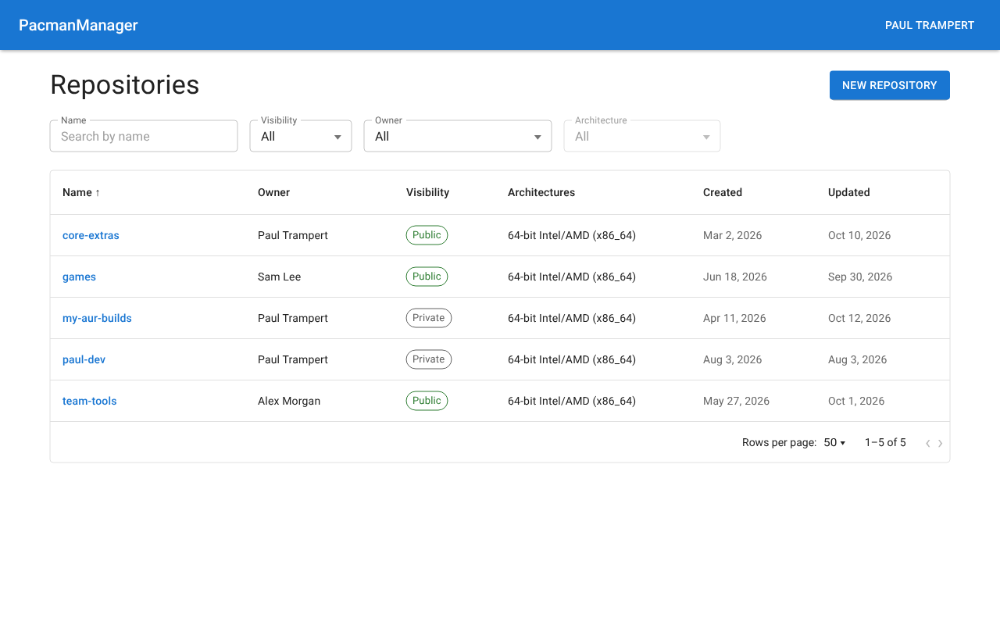
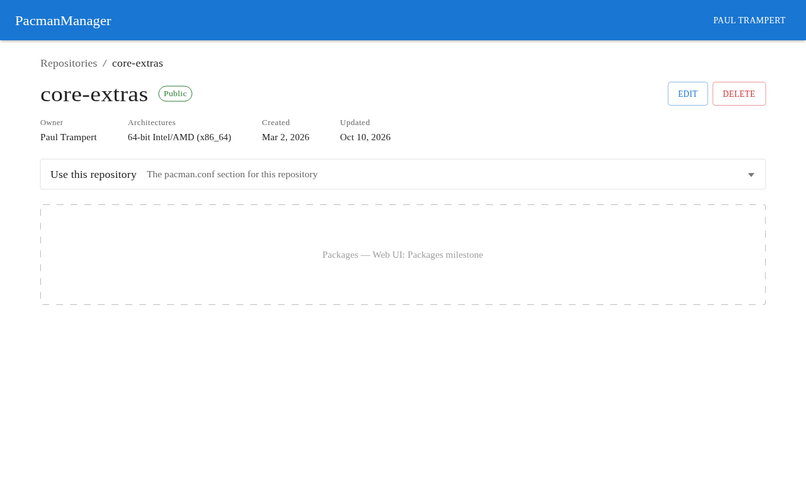
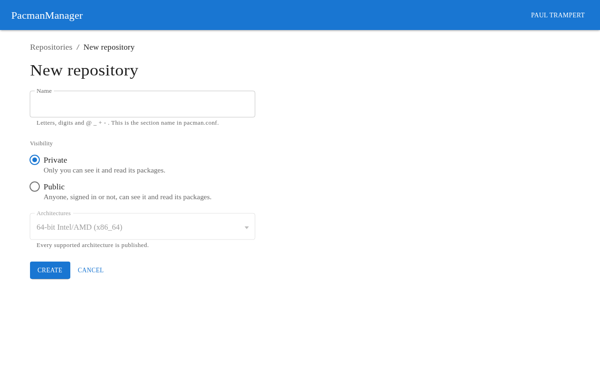
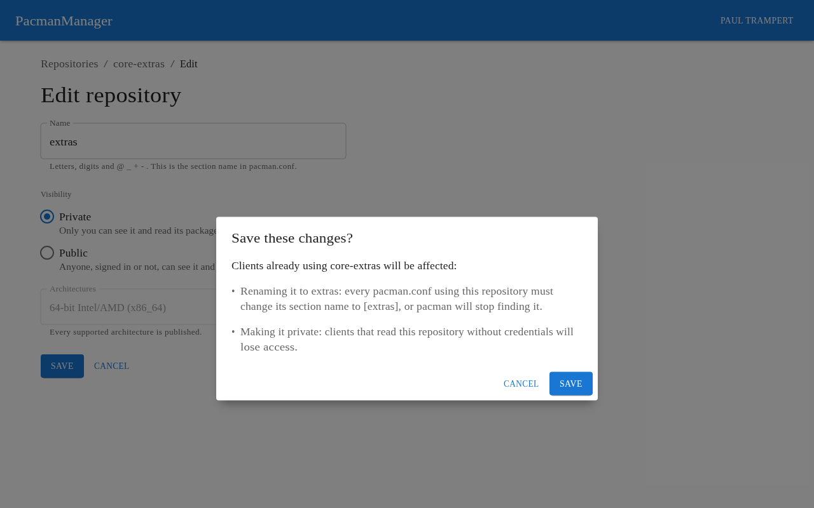
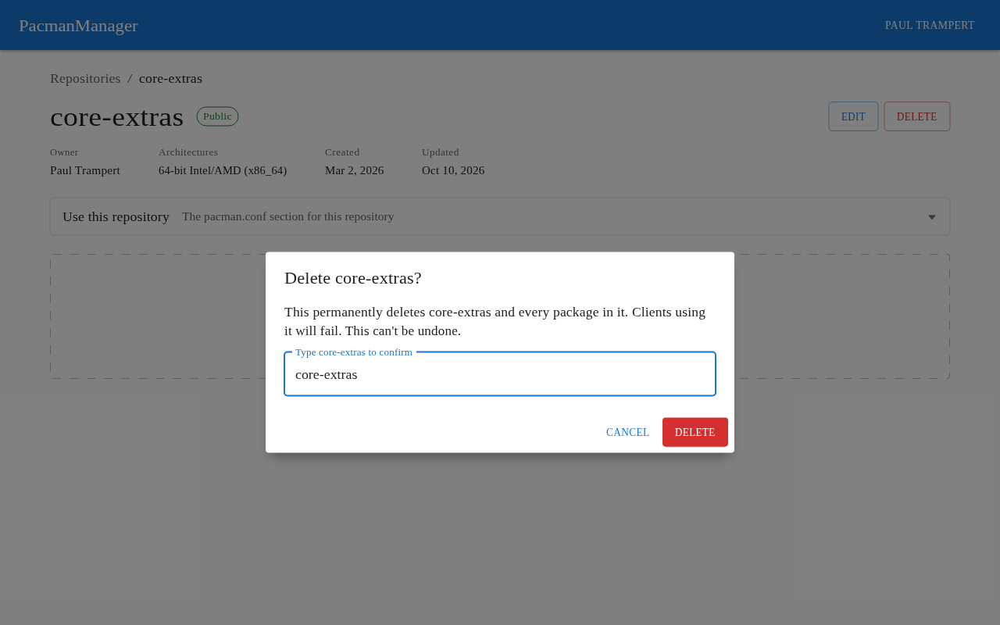

# Web UI: Repositories

Status: **design**. This document is the source the **Web UI: Repositories** issues are cut from. It
builds its screens on [Web UI Architecture](../web-ui-architecture/web-ui-architecture.md) and does
not re-decide anything that document fixes.

**How to read it.** The plan states what will be built. The argument for each decision — including
what was considered and rejected — is in the [Appendix](#appendix), and each section ends with a
**Why** footer linking the entries that bear on it. Once this document is on `main` the whole plan
is settled, whether or not a given detail has a Why entry: implement it as written and raise an
issue rather than re-deciding it.

Deviating from the plan during implementation is allowed, but never quietly. A deviation **must**
have sign-off from a project owner, and **must** carry all three of:

* the plan updated to say what is actually being built;
* an Appendix entry recording why it changed;
* every dependent issue updated to match.

It depends on the **Web UI: Walking Skeleton** milestone being complete: the generated client, the
session, `requireUser`, error handling and the app shell are all used here as they stand.

## Goals

* Anyone, signed in or not, can list the repositories they can see, and narrow and order that list
  by every filter and sort the API supports.
* Anyone can open a repository they can see, and copy a `pacman.conf` section that points a client
  at it through RepoHost's public address.
* A signed-in user can create a repository, choosing whether it is public or private.
* A user can rename a repository, change its visibility, or delete it, wherever the API says they
  may — and is told what each of those does to the clients already using it before it happens.
* The UI never decides for itself whether a caller may change a repository; it shows the controls
  the API's answer permits.

## Non-goals for this work

Recorded here so the issues stay bounded; each has a follow-up in
[Deferred work](#deferred-work).

* **Packages.** A repository's packages are not listed, uploaded or deleted here; that is the
  **Web UI: Packages** milestone.
* **Credentials in the `pacman.conf` snippet.** A private repository's snippet says that the client
  must authenticate, but carries no credentials and offers no way to make any.
* **Checking a name's availability before submitting.** A taken name is reported when the create or
  update is refused, not as it is typed.
* **Choosing architectures.** Every repository supports every supported architecture, as the API
  defaults it today; the UI shows the value but never sends a different one.
* **API changes beyond those [listed below](#api-changes).** In particular there is no server-side
  confirmation of a rename, a visibility change or a delete — those confirmations are the UI's
  alone.

**Why:**

* [confirmations live in the UI only](#why-confirmations-live-in-the-ui-only)

---

## Wireframes

The wireframes are drawn in Penpot, on the **Repositories** page of the *Wireframes* file, and
exported to [`wireframes/`](wireframes/); each wireframe is linked twice, to its committed PNG and to its board in
Penpot. The PNGs are the record of what was agreed; the Penpot boards are where the design is edited,
and need a Penpot account with access to the file. Their font is Roboto; the exports render it in a serif
fallback, so judge them by layout, sizes, weights and colours, not typeface.

| Area | Wireframes |
| :--- | :--- |
| Repository list | [list-signed-in](wireframes/list-signed-in.png) ([Penpot](https://penpot.ptrampert.com/#/workspace?team-id=b3c486d2-18f5-8110-8003-4b706524565b&file-id=b49e4a3b-0a79-8163-8008-c775230cef42&page-id=6c5c10cc-dc0c-80d5-8008-c7a0fdf50164&board-id=6c5c10cc-dc0c-80d5-8008-c7a3f616e001)), [list-anonymous](wireframes/list-anonymous.png) ([Penpot](https://penpot.ptrampert.com/#/workspace?team-id=b3c486d2-18f5-8110-8003-4b706524565b&file-id=b49e4a3b-0a79-8163-8008-c775230cef42&page-id=6c5c10cc-dc0c-80d5-8008-c7a0fdf50164&board-id=6c5c10cc-dc0c-80d5-8008-c7a3f8e58ebc)), [list-own-repositories](wireframes/list-own-repositories.png) ([Penpot](https://penpot.ptrampert.com/#/workspace?team-id=b3c486d2-18f5-8110-8003-4b706524565b&file-id=b49e4a3b-0a79-8163-8008-c775230cef42&page-id=6c5c10cc-dc0c-80d5-8008-c7a0fdf50164&board-id=6c5c10cc-dc0c-80d5-8008-c7a3fcb72b7a)), [list-single-user](wireframes/list-single-user.png) ([Penpot](https://penpot.ptrampert.com/#/workspace?team-id=b3c486d2-18f5-8110-8003-4b706524565b&file-id=b49e4a3b-0a79-8163-8008-c775230cef42&page-id=6c5c10cc-dc0c-80d5-8008-c7a0fdf50164&board-id=6c5c10cc-dc0c-80d5-8008-c7a401c9ab54)), [list-owner-dropdown-open](wireframes/list-owner-dropdown-open.png) ([Penpot](https://penpot.ptrampert.com/#/workspace?team-id=b3c486d2-18f5-8110-8003-4b706524565b&file-id=b49e4a3b-0a79-8163-8008-c775230cef42&page-id=6c5c10cc-dc0c-80d5-8008-c7a0fdf50164&board-id=6c5c10cc-dc0c-80d5-8008-c7a4131f7711)), [list-loading](wireframes/list-loading.png) ([Penpot](https://penpot.ptrampert.com/#/workspace?team-id=b3c486d2-18f5-8110-8003-4b706524565b&file-id=b49e4a3b-0a79-8163-8008-c775230cef42&page-id=6c5c10cc-dc0c-80d5-8008-c7a0fdf50164&board-id=6c5c10cc-dc0c-80d5-8008-c7e363bd4e7e)) |
| Empty list | [list-empty-signed-in](wireframes/list-empty-signed-in.png) ([Penpot](https://penpot.ptrampert.com/#/workspace?team-id=b3c486d2-18f5-8110-8003-4b706524565b&file-id=b49e4a3b-0a79-8163-8008-c775230cef42&page-id=6c5c10cc-dc0c-80d5-8008-c7a0fdf50164&board-id=6c5c10cc-dc0c-80d5-8008-c7a403ecb644)), [list-empty-filtered](wireframes/list-empty-filtered.png) ([Penpot](https://penpot.ptrampert.com/#/workspace?team-id=b3c486d2-18f5-8110-8003-4b706524565b&file-id=b49e4a3b-0a79-8163-8008-c775230cef42&page-id=6c5c10cc-dc0c-80d5-8008-c7a0fdf50164&board-id=6c5c10cc-dc0c-80d5-8008-c7a4064f4841)), [list-empty-anonymous](wireframes/list-empty-anonymous.png) ([Penpot](https://penpot.ptrampert.com/#/workspace?team-id=b3c486d2-18f5-8110-8003-4b706524565b&file-id=b49e4a3b-0a79-8163-8008-c775230cef42&page-id=6c5c10cc-dc0c-80d5-8008-c7a0fdf50164&board-id=6c5c10cc-dc0c-80d5-8008-c7a4089d6065)) |
| Repository page | [repository-owner-public](wireframes/repository-owner-public.png) ([Penpot](https://penpot.ptrampert.com/#/workspace?team-id=b3c486d2-18f5-8110-8003-4b706524565b&file-id=b49e4a3b-0a79-8163-8008-c775230cef42&page-id=6c5c10cc-dc0c-80d5-8008-c7a0fdf50164&board-id=6c5c10cc-dc0c-80d5-8008-c7a961d3aefd)), [repository-owner-private](wireframes/repository-owner-private.png) ([Penpot](https://penpot.ptrampert.com/#/workspace?team-id=b3c486d2-18f5-8110-8003-4b706524565b&file-id=b49e4a3b-0a79-8163-8008-c775230cef42&page-id=6c5c10cc-dc0c-80d5-8008-c7a0fdf50164&board-id=6c5c10cc-dc0c-80d5-8008-c7a962df47ba)), [repository-not-owner](wireframes/repository-not-owner.png) ([Penpot](https://penpot.ptrampert.com/#/workspace?team-id=b3c486d2-18f5-8110-8003-4b706524565b&file-id=b49e4a3b-0a79-8163-8008-c775230cef42&page-id=6c5c10cc-dc0c-80d5-8008-c7a0fdf50164&board-id=6c5c10cc-dc0c-80d5-8008-c7a963f7a770)), [repository-anonymous](wireframes/repository-anonymous.png) ([Penpot](https://penpot.ptrampert.com/#/workspace?team-id=b3c486d2-18f5-8110-8003-4b706524565b&file-id=b49e4a3b-0a79-8163-8008-c775230cef42&page-id=6c5c10cc-dc0c-80d5-8008-c7a0fdf50164&board-id=6c5c10cc-dc0c-80d5-8008-c7a9654e7812)) |
| `pacman.conf` section | [repository-snippet-expanded-public](wireframes/repository-snippet-expanded-public.png) ([Penpot](https://penpot.ptrampert.com/#/workspace?team-id=b3c486d2-18f5-8110-8003-4b706524565b&file-id=b49e4a3b-0a79-8163-8008-c775230cef42&page-id=6c5c10cc-dc0c-80d5-8008-c7a0fdf50164&board-id=6c5c10cc-dc0c-80d5-8008-c7a9674f4460)), [repository-snippet-expanded-private](wireframes/repository-snippet-expanded-private.png) ([Penpot](https://penpot.ptrampert.com/#/workspace?team-id=b3c486d2-18f5-8110-8003-4b706524565b&file-id=b49e4a3b-0a79-8163-8008-c775230cef42&page-id=6c5c10cc-dc0c-80d5-8008-c7a0fdf50164&board-id=6c5c10cc-dc0c-80d5-8008-c7a969ca1435)), [repository-snippet-copied](wireframes/repository-snippet-copied.png) ([Penpot](https://penpot.ptrampert.com/#/workspace?team-id=b3c486d2-18f5-8110-8003-4b706524565b&file-id=b49e4a3b-0a79-8163-8008-c775230cef42&page-id=6c5c10cc-dc0c-80d5-8008-c7a0fdf50164&board-id=6c5c10cc-dc0c-80d5-8008-c7a96c96d0f0)), [repository-copy-failed](wireframes/repository-copy-failed.png) ([Penpot](https://penpot.ptrampert.com/#/workspace?team-id=b3c486d2-18f5-8110-8003-4b706524565b&file-id=b49e4a3b-0a79-8163-8008-c775230cef42&page-id=6c5c10cc-dc0c-80d5-8008-c7a0fdf50164&board-id=6c5c10cc-dc0c-80d5-8008-c7e654139929)) |
| Create | [new-empty](wireframes/new-empty.png) ([Penpot](https://penpot.ptrampert.com/#/workspace?team-id=b3c486d2-18f5-8110-8003-4b706524565b&file-id=b49e4a3b-0a79-8163-8008-c775230cef42&page-id=6c5c10cc-dc0c-80d5-8008-c7a0fdf50164&board-id=6c5c10cc-dc0c-80d5-8008-c7af61beee92)), [new-filled-in](wireframes/new-filled-in.png) ([Penpot](https://penpot.ptrampert.com/#/workspace?team-id=b3c486d2-18f5-8110-8003-4b706524565b&file-id=b49e4a3b-0a79-8163-8008-c775230cef42&page-id=6c5c10cc-dc0c-80d5-8008-c7a0fdf50164&board-id=6c5c10cc-dc0c-80d5-8008-c7af635debd6)), [new-invalid-name](wireframes/new-invalid-name.png) ([Penpot](https://penpot.ptrampert.com/#/workspace?team-id=b3c486d2-18f5-8110-8003-4b706524565b&file-id=b49e4a3b-0a79-8163-8008-c775230cef42&page-id=6c5c10cc-dc0c-80d5-8008-c7a0fdf50164&board-id=6c5c10cc-dc0c-80d5-8008-c7af652f51ed)), [new-name-taken](wireframes/new-name-taken.png) ([Penpot](https://penpot.ptrampert.com/#/workspace?team-id=b3c486d2-18f5-8110-8003-4b706524565b&file-id=b49e4a3b-0a79-8163-8008-c775230cef42&page-id=6c5c10cc-dc0c-80d5-8008-c7a0fdf50164&board-id=6c5c10cc-dc0c-80d5-8008-c7af673c863b)), [new-required](wireframes/new-required.png) ([Penpot](https://penpot.ptrampert.com/#/workspace?team-id=b3c486d2-18f5-8110-8003-4b706524565b&file-id=b49e4a3b-0a79-8163-8008-c775230cef42&page-id=6c5c10cc-dc0c-80d5-8008-c7a0fdf50164&board-id=6c5c10cc-dc0c-80d5-8008-c7af6997c384)), [new-submitting](wireframes/new-submitting.png) ([Penpot](https://penpot.ptrampert.com/#/workspace?team-id=b3c486d2-18f5-8110-8003-4b706524565b&file-id=b49e4a3b-0a79-8163-8008-c775230cef42&page-id=6c5c10cc-dc0c-80d5-8008-c7a0fdf50164&board-id=6c5c10cc-dc0c-80d5-8008-c7af6c30cd81)) |
| Edit | [edit-unchanged](wireframes/edit-unchanged.png) ([Penpot](https://penpot.ptrampert.com/#/workspace?team-id=b3c486d2-18f5-8110-8003-4b706524565b&file-id=b49e4a3b-0a79-8163-8008-c775230cef42&page-id=6c5c10cc-dc0c-80d5-8008-c7a0fdf50164&board-id=6c5c10cc-dc0c-80d5-8008-c7b0c019c630)), [edit-changed](wireframes/edit-changed.png) ([Penpot](https://penpot.ptrampert.com/#/workspace?team-id=b3c486d2-18f5-8110-8003-4b706524565b&file-id=b49e4a3b-0a79-8163-8008-c775230cef42&page-id=6c5c10cc-dc0c-80d5-8008-c7a0fdf50164&board-id=6c5c10cc-dc0c-80d5-8008-c7b0c298d064)), [edit-name-taken](wireframes/edit-name-taken.png) ([Penpot](https://penpot.ptrampert.com/#/workspace?team-id=b3c486d2-18f5-8110-8003-4b706524565b&file-id=b49e4a3b-0a79-8163-8008-c775230cef42&page-id=6c5c10cc-dc0c-80d5-8008-c7a0fdf50164&board-id=6c5c10cc-dc0c-80d5-8008-c7b0c55e036d)), [edit-confirm-changes](wireframes/edit-confirm-changes.png) ([Penpot](https://penpot.ptrampert.com/#/workspace?team-id=b3c486d2-18f5-8110-8003-4b706524565b&file-id=b49e4a3b-0a79-8163-8008-c775230cef42&page-id=6c5c10cc-dc0c-80d5-8008-c7a0fdf50164&board-id=6c5c10cc-dc0c-80d5-8008-c7b0c88c3da8)) |
| Delete | [delete-dialog-open](wireframes/delete-dialog-open.png) ([Penpot](https://penpot.ptrampert.com/#/workspace?team-id=b3c486d2-18f5-8110-8003-4b706524565b&file-id=b49e4a3b-0a79-8163-8008-c775230cef42&page-id=6c5c10cc-dc0c-80d5-8008-c7a0fdf50164&board-id=6c5c10cc-dc0c-80d5-8008-c7b0ccd6d1a3)), [delete-name-typed](wireframes/delete-name-typed.png) ([Penpot](https://penpot.ptrampert.com/#/workspace?team-id=b3c486d2-18f5-8110-8003-4b706524565b&file-id=b49e4a3b-0a79-8163-8008-c775230cef42&page-id=6c5c10cc-dc0c-80d5-8008-c7a0fdf50164&board-id=6c5c10cc-dc0c-80d5-8008-c7b0d182d3e0)), [delete-failed](wireframes/delete-failed.png) ([Penpot](https://penpot.ptrampert.com/#/workspace?team-id=b3c486d2-18f5-8110-8003-4b706524565b&file-id=b49e4a3b-0a79-8163-8008-c775230cef42&page-id=6c5c10cc-dc0c-80d5-8008-c7a0fdf50164&board-id=6c5c10cc-dc0c-80d5-8008-c7b0d6dd80b8)) |

The specification below is authoritative where a wireframe and the text disagree.

---

## API changes

RepoHost gains four small things. Each is additive, so none of them breaks the committed OpenAPI
document, but each one regenerates it so the web app can use what it adds.

### `Repository.permissions`

Every `Repository` RepoHost returns — the listing, `GET` by id, and the responses to `POST` and
`PUT` — carries what the caller may do to it:

```jsonc
{
  "id": "0197…",
  "name": "myrepo",
  // …existing fields…
  "permissions": { "update": true, "delete": true }
}
```

| Field | `true` exactly when |
| :--- | :--- |
| `update` | `RepositoryAccessPolicy.CheckUpdate(repository, actor)` is `Allowed` |
| `delete` | `RepositoryAccessPolicy.CheckDelete(repository, actor)` is `Allowed` |

* Both fields are **always present**, `false` included. An anonymous caller gets `false` for both.
* The OpenAPI document lists `permissions` in `Repository`'s `required`, and `update` and `delete`
  in its own, so the generated TypeScript types are not optional.
* The values come from the **same policy calls** `UpdateRepositoryAsync` and `DeleteRepositoryAsync`
  enforce with, so ownership and the credential's scope both count: a token without
  `pacman-manager:repositories:update` sees `update: false` on its own repositories.
* They are computed per response for the actor making the request, and **never stored**.
* `RepositoryAccessPolicy`'s ownership check gains a core taking
  `(Guid ownerId, bool isPublic, Actor actor, string action)`. `CheckUpdate(PacmanRepository, Actor)`
  and `CheckDelete(PacmanRepository, Actor)` become thin overloads over it, so there is still **one**
  rule.
* `RepositoryService` sets `permissions` **after** the query has run, calling that core for each
  projected `Repository` with its `Owner.Id` and `IsPublic`. Nothing about `permissions` is part of
  `Repository.Projection` or translated to SQL, and it adds no query.

**Why:**

* [permissions come from the API](#why-permissions-come-from-the-api)
* [`update` and `delete` are separate](#why-update-and-delete-are-separate)

### `Repository.serverUrl` and the `PublicUrl` setting

RepoHost gains a top-level `PublicUrl` setting: the absolute URL a `pacman` client reaches RepoHost
at, such as `https://packages.example.com/`.

| `PublicUrl` | Startup | `serverUrl` |
| :--- | :--- | :--- |
| absent or empty | starts | `{request root}pacman/$repo/$arch` |
| an absolute `http` or `https` URL | starts | `{PublicUrl}pacman/$repo/$arch` |
| anything else | **fails**, through options validation, naming the value | — |

* The **request root** is the current request's `Scheme`, `Host` and `PathBase`, read **after**
  `UseForwardedHeaders` — so a trusted proxy's `X-Forwarded-Proto` sets the scheme, but the host is
  always the one the request was addressed to.
* A configured `PublicUrl` always wins over the request root.
* Whichever root is used, it is normalised to end in exactly one `/` before `pacman/` is appended, so
  `https://example.com/pm` and `https://example.com/pm/` both give `https://example.com/pm/pacman/$repo/$arch`.
* `serverUrl` is therefore **always present**, and the OpenAPI document lists it in `Repository`'s
  `required`, so the generated TypeScript type is `serverUrl: string`.
* `$repo` and `$arch` are **literal** in the value, exactly as `pacman.conf` writes them; they are
  not replaced with the repository's name or an architecture.
* `serverUrl` is built **each time a repository is returned**. It is never stored, so changing
  `PublicUrl` changes every repository's `serverUrl` on the next request.
* `appsettings.json` carries `"PublicUrl": ""`, so the key is discoverable. `compose.yaml` sets
  `PublicUrl: "http://localhost:8082/"` on `pacmanmanager.repohost`.
* With `PublicUrl` set, `serverUrl` is the same for every caller, signed in or not. Without it, it
  depends on how the request reached RepoHost: a request proxied by SpaHost carries SpaHost's
  upstream address (`http://pacmanmanager.repohost:8080/` in compose), so a deployment the web UI is
  used from must set `PublicUrl` for the snippet to be usable.

**Why:**

* [`PublicUrl` is configured, with the request as a fallback](#why-publicurl-is-configured-with-the-request-as-a-fallback)
* [`serverUrl` is a field on `Repository`](#why-serverurl-is-a-field-on-repository)

### `GET /api/v1/Architectures`

| Method | Path | Auth | Success |
| :--- | :--- | :--- | :--- |
| `GET` | `/api/v1/Architectures` | Anonymous | `200` array of architectures |

```jsonc
[
  { "value": "x86_64", "displayValue": "64-bit Intel/AMD (x86_64)" }
]
```

* The response is a **plain JSON array**, not a `PaginatedResponse`, and the route takes no
  pagination, filter or sort parameters.
* It lists exactly `PacmanRepositoryValidationConstants.SupportedArchitectures`, in that order — the
  same list `[SupportedArchitecture]` validates against, so the two cannot disagree.
* `displayValue` is `<friendly name> (<value>)`. The friendly names live beside
  `SupportedArchitectures` in `PacmanManager.Entities`, and a supported architecture without one is a
  test failure.

**Why:**

* [architectures are a plain array](#why-architectures-are-a-plain-array)

### `409` is declared on create and update

`POST /api/v1/Repositories` and `PUT /api/v1/Repositories/{id}` already answer `409` when the name is
taken. Both gain `[ProducesResponseType(StatusCodes.Status409Conflict)]`, so the OpenAPI document and
the client's generated types know the response exists.

---

## Navigation


The walking skeleton's shell — an `AppBar` above a `Container` — is **unchanged**. There is no
navigation menu: no drawer, and no links in the app bar.

* The product name in the app bar links to `/`, which [redirects](#routes) to the repository list.
* Every page **below** the list shows MUI `Breadcrumbs` above its heading, starting from
  **Repositories**, which links to `/repositories`. The last crumb is the current page and is not a
  link.

  | Page | Breadcrumbs |
  | :--- | :--- |
  | `/repositories` | none |
  | `/repositories/new` | Repositories / New repository |
  | `/repositories/$repositoryId` | Repositories / *the repository's name* |
  | `/repositories/$repositoryId/edit` | Repositories / *the repository's name* / Edit |

* A crumb naming a repository shows its current name, from `repositoryQuery(id)`.

Wireframes: [repository-owner-public](wireframes/repository-owner-public.png) ([Penpot](https://penpot.ptrampert.com/#/workspace?team-id=b3c486d2-18f5-8110-8003-4b706524565b&file-id=b49e4a3b-0a79-8163-8008-c775230cef42&page-id=6c5c10cc-dc0c-80d5-8008-c7a0fdf50164&board-id=6c5c10cc-dc0c-80d5-8008-c7a961d3aefd)), [new-empty](wireframes/new-empty.png) ([Penpot](https://penpot.ptrampert.com/#/workspace?team-id=b3c486d2-18f5-8110-8003-4b706524565b&file-id=b49e4a3b-0a79-8163-8008-c775230cef42&page-id=6c5c10cc-dc0c-80d5-8008-c7a0fdf50164&board-id=6c5c10cc-dc0c-80d5-8008-c7af61beee92)), [edit-unchanged](wireframes/edit-unchanged.png) ([Penpot](https://penpot.ptrampert.com/#/workspace?team-id=b3c486d2-18f5-8110-8003-4b706524565b&file-id=b49e4a3b-0a79-8163-8008-c775230cef42&page-id=6c5c10cc-dc0c-80d5-8008-c7a0fdf50164&board-id=6c5c10cc-dc0c-80d5-8008-c7b0c019c630)).

**Why:**

* [there is no navigation menu yet](#why-there-is-no-navigation-menu-yet)

---

## Routes

| Path | Who | Shows |
| :--- | :--- | :--- |
| `/` | anyone | redirects to `/repositories` |
| `/repositories` | anyone | the [repository list](#the-repository-list) |
| `/repositories/new` | signed in (`requireUser`) | the [create form](#creating-a-repository) |
| `/repositories/$repositoryId` | anyone who can see it | the [repository page](#the-repository-page) |
| `/repositories/$repositoryId/edit` | signed in (`requireUser`) | the [edit form](#editing-a-repository) |

* A repository is addressed by **id**, so renaming it never changes its URL.
* Pages below the list carry [breadcrumbs](#navigation) back to it.
* `src/queries/repositories/` holds `repositoryListQuery(search)`, `repositoryQuery(id)` and the
  create, update and delete mutation hooks; `src/queries/architectures/` holds
  `architecturesQuery()`; `src/queries/users/` holds `userListQuery(search)` and `userQuery(id)`.
  Keys and invalidation follow [Routing and data](../web-ui-architecture/web-ui-architecture.md#routing-and-data).
* An edit page for a repository whose `permissions.update` is `false` shows the
  [`403` message](../web-ui-architecture/web-ui-architecture.md#error-handling) in place of the form.

**Why:**

* [repositories are addressed by id](#why-repositories-are-addressed-by-id)
* [`/` redirects to the list](#why--redirects-to-the-list)

---

## The repository list



`/repositories` shows one page of `GET /v1/Repositories`. Its search params are the API's, as the
architecture document requires:

| Search param | Sent as | Default |
| :--- | :--- | :--- |
| `nameContains` | the same | absent |
| `isPublic` | the same | see [Visibility](#filters) |
| `ownerId` | the same | absent |
| `architecture` | the same | absent |
| `sortBy` | the same | absent (`Name`) |
| `direction` | the same | absent (the field's default) |
| `offset` | the same | `0` |
| `pageSize` | the same | `50` |

* The list is a table with the columns **Name** (linking to the repository's page), **Owner** (the
  display name), **Visibility** (a Public or Private chip), **Architectures** (the
  `displayValue`s), **Created** and **Updated**.
* `pageSize` accepts only **25, 50 or 100**. Any other value, or one that is not a number, is
  dropped from the search params by `validateSearch`, so the page uses 50 and the URL never
  disagrees with it. This narrows only what the web app sends; the API still accepts 1 to 500.
* Changing a filter, the sort or the page size resets `offset` to `0`.
* The name search updates the URL **300 ms after typing stops**, not on every keystroke.
* A signed-in user sees a **New repository** button linking to `/repositories/new`. An anonymous
  visitor does not.

### Filters

Every filter follows one rule: **a filter with one possible value or none is shown disabled, set to
"All"**. The one exception is visibility for an anonymous visitor.

| Filter | Options | Disabled when | Shown while disabled |
| :--- | :--- | :--- | :--- |
| Name | free text | never | — |
| Visibility | All, Public, Private | the visitor is anonymous | **Public** |
| Owner | typeahead over users, the signed-in user first | `GET /v1/Users?pageSize=1` reports `total` ≤ 1 | **All** |
| Architecture | All, then each of `GET /v1/Architectures` by `displayValue` | that array has ≤ 1 entry | **All** |

* Every filter's unfiltered value reads **All**, in the normal text colour while the filter is
  enabled; there is no "Any …" placeholder.
* **Visibility.** Signed in, it defaults to **All** (`isPublic` absent). Anonymous, it is disabled on
  **Public** and sends **no** `isPublic`: the API already shows an anonymous caller public
  repositories only.
* **Owner.** An autocomplete that queries `GET /v1/Users?displayNameContains=<text>&pageSize=20`,
  300 ms after typing stops, and sets `ownerId` to the chosen user's id. There is no separate
  "mine" control.
* For a signed-in user, the autocomplete's **first option is always themselves**, labelled with
  their display name and "(you)" and followed by a divider, built from `session.user` rather than
  the API's answer:
  * with no text typed, it is shown above the API's first page of users;
  * with text typed, it is shown only when their display name contains the text, case-insensitively;
  * the signed-in user is removed from the API's results, so they never appear twice.
* Selecting it sets `ownerId` to `session.user.id`, and the field then shows the "(you)" label.
* When the page loads with an `ownerId`, the autocomplete shows that user's display name, fetched
  with `GET /v1/Users/{id}`. If that is a `404`, `ownerId` is removed from the search params.
* A disabled filter never sends a value. Its state is a consequence of the data, so the list still
  answers exactly as an unfiltered one would.
* A disabled filter's param is **removed from the URL**, never kept and ignored:
  * `architecture` when there are fewer than two architectures;
  * `ownerId` when there are fewer than two users;
  * `isPublic` for an anonymous visitor.

  The list route removes them in its `beforeLoad` (see [Loading](#loading)) by throwing a `redirect`
  to the same route without them, with `replace: true`, so the URL never shows a filter that the
  page shows as **All**, and **Back** never returns to it. `repositoryListQuery` itself sends exactly
  what it is given and knows nothing about disabled filters.

Wireframes: [list-anonymous](wireframes/list-anonymous.png) ([Penpot](https://penpot.ptrampert.com/#/workspace?team-id=b3c486d2-18f5-8110-8003-4b706524565b&file-id=b49e4a3b-0a79-8163-8008-c775230cef42&page-id=6c5c10cc-dc0c-80d5-8008-c7a0fdf50164&board-id=6c5c10cc-dc0c-80d5-8008-c7a3f8e58ebc)), [list-own-repositories](wireframes/list-own-repositories.png) ([Penpot](https://penpot.ptrampert.com/#/workspace?team-id=b3c486d2-18f5-8110-8003-4b706524565b&file-id=b49e4a3b-0a79-8163-8008-c775230cef42&page-id=6c5c10cc-dc0c-80d5-8008-c7a0fdf50164&board-id=6c5c10cc-dc0c-80d5-8008-c7a3fcb72b7a)), [list-single-user](wireframes/list-single-user.png) ([Penpot](https://penpot.ptrampert.com/#/workspace?team-id=b3c486d2-18f5-8110-8003-4b706524565b&file-id=b49e4a3b-0a79-8163-8008-c775230cef42&page-id=6c5c10cc-dc0c-80d5-8008-c7a0fdf50164&board-id=6c5c10cc-dc0c-80d5-8008-c7a401c9ab54)), [list-owner-dropdown-open](wireframes/list-owner-dropdown-open.png) ([Penpot](https://penpot.ptrampert.com/#/workspace?team-id=b3c486d2-18f5-8110-8003-4b706524565b&file-id=b49e4a3b-0a79-8163-8008-c775230cef42&page-id=6c5c10cc-dc0c-80d5-8008-c7a0fdf50164&board-id=6c5c10cc-dc0c-80d5-8008-c7a4131f7711)).

**Why:**

* [single-option filters are disabled, not hidden](#why-single-option-filters-are-disabled-not-hidden)

### Sorting and paging

* The **Name**, **Created** and **Updated** column headers sort the list, as MUI's
  `TableSortLabel`. Clicking the active header reverses `direction`; clicking another sets `sortBy`
  to it and removes `direction`, so the field's default applies. There is no other sort control.
* The active header and its arrow are drawn from the response's [`sort`](#6-echo-the-applied-sort-on-paginated-responses--minor),
  the sort the API applied with its defaults resolved — never from the URL, and never from defaults
  written in the web app. While the next page loads, the previous response's sort stays shown with
  the rest of the [dimmed previous state](#loading).
* Paging uses the response's `total` and `offset`, with page sizes 25, 50 and 100.
* **A page past the end** — a response with no results but `total > 0`, from a stale bookmark or
  after deleting the last repository on the last page — replaces the URL's `offset` with the last
  page's, `floor((total − 1) / pageSize) × pageSize`, with `replace: true`. Until that page arrives
  the table keeps the dimmed previous state under the spinner. `PaginatedTable` is never given a page
  beyond the last.

**Why:**

* [the list sorts from its column headers](#why-the-list-sorts-from-its-column-headers)
* [the arrow comes from the applied sort](#why-the-arrow-comes-from-the-applied-sort)

### Loading

* The list route's `beforeLoad`, which runs on every navigation to it, first awaits what decides the
  filters' state — `architecturesQuery()` and the user count (`userListQuery` with `pageSize=1`), in
  parallel, and cached after the first visit — then drops the params of
  [disabled filters](#filters). Only after that does its loader **prefetch**
  `repositoryListQuery(search)` with what is left, without awaiting it, and the list's search params are **not** in its `loaderDeps`, so changing a
  filter, the sort or the page never re-runs the loader or shows the route's pending component.
  The page, the filter bar included, stays mounted, and a name being typed is never lost.
* `RepositoryTable`'s data comes from `useQuery(repositoryListQuery(search))` with
  `placeholderData: keepPreviousData`, not `useSuspenseQuery`.
* While a request is in flight, the table's previous contents stay, dimmed, with an MUI
  `CircularProgress` centred over them. With no previous contents — the first load before the
  prefetch settles — the spinner is shown in the table's body.
* An error from the list query is shown as the root error component would show it, in place of the
  table, with **Try again** refetching the query.

Wireframe: [list-loading](wireframes/list-loading.png) ([Penpot](https://penpot.ptrampert.com/#/workspace?team-id=b3c486d2-18f5-8110-8003-4b706524565b&file-id=b49e4a3b-0a79-8163-8008-c775230cef42&page-id=6c5c10cc-dc0c-80d5-8008-c7a0fdf50164&board-id=6c5c10cc-dc0c-80d5-8008-c7e363bd4e7e)).

**Why:**

* [a paged list is read with `useQuery`](#why-a-paged-list-is-read-with-usequery)

### Empty states

An `EmptyState` component in `src/components` — a heading, a message and an optional action — is
used for every empty list:

| Situation | Heading | Action |
| :--- | :--- | :--- |
| Signed in, no filters applied, no repositories | No repositories yet | **Create a repository**, to `/repositories/new` |
| Any filter applied, no results | No repositories match | **Clear filters**, removing every filter search param |
| Anonymous, no filters applied, no repositories | No public repositories | none |

* An empty state is shown **only when `total` is 0**, never because a page past the end came back
  empty.
* "No filters applied" means `nameContains`, `isPublic`, `ownerId` and `architecture` are all
  absent. Disabled filters never count as applied.
* The component knows nothing about repositories; the list route chooses the text and the action.

Wireframes: [list-empty-signed-in](wireframes/list-empty-signed-in.png) ([Penpot](https://penpot.ptrampert.com/#/workspace?team-id=b3c486d2-18f5-8110-8003-4b706524565b&file-id=b49e4a3b-0a79-8163-8008-c775230cef42&page-id=6c5c10cc-dc0c-80d5-8008-c7a0fdf50164&board-id=6c5c10cc-dc0c-80d5-8008-c7a403ecb644)), [list-empty-filtered](wireframes/list-empty-filtered.png) ([Penpot](https://penpot.ptrampert.com/#/workspace?team-id=b3c486d2-18f5-8110-8003-4b706524565b&file-id=b49e4a3b-0a79-8163-8008-c775230cef42&page-id=6c5c10cc-dc0c-80d5-8008-c7a0fdf50164&board-id=6c5c10cc-dc0c-80d5-8008-c7a4064f4841)), [list-empty-anonymous](wireframes/list-empty-anonymous.png) ([Penpot](https://penpot.ptrampert.com/#/workspace?team-id=b3c486d2-18f5-8110-8003-4b706524565b&file-id=b49e4a3b-0a79-8163-8008-c775230cef42&page-id=6c5c10cc-dc0c-80d5-8008-c7a0fdf50164&board-id=6c5c10cc-dc0c-80d5-8008-c7a4089d6065)).

---

## The repository page



`/repositories/$repositoryId` loads `repositoryQuery(id)`. A `404` is the route's not-found
component, whatever the reason the API had.

The page is a compact header that the **Web UI: Packages** milestone's package list will sit
beneath. Top to bottom:

1. the [breadcrumbs](#navigation);
2. a title row: the name as the page's `h1` with a Public or Private chip beside it, and on the
   right
   * an outlined **Edit** button linking to `/repositories/$repositoryId/edit`, only when
     `permissions.update` is `true`;
   * an outlined, error-coloured **Delete** button opening the
     [delete dialog](#deleting-a-repository), only when `permissions.delete` is `true`;
3. one row of label-over-value details: **Owner** (display name), **Architectures** (the
   `displayValue`s), **Created** and **Updated**;
4. the [`pacman.conf` section](#the-pacmanconf-section), collapsed.

Wireframes: [repository-owner-public](wireframes/repository-owner-public.png) ([Penpot](https://penpot.ptrampert.com/#/workspace?team-id=b3c486d2-18f5-8110-8003-4b706524565b&file-id=b49e4a3b-0a79-8163-8008-c775230cef42&page-id=6c5c10cc-dc0c-80d5-8008-c7a0fdf50164&board-id=6c5c10cc-dc0c-80d5-8008-c7a961d3aefd)), [repository-owner-private](wireframes/repository-owner-private.png) ([Penpot](https://penpot.ptrampert.com/#/workspace?team-id=b3c486d2-18f5-8110-8003-4b706524565b&file-id=b49e4a3b-0a79-8163-8008-c775230cef42&page-id=6c5c10cc-dc0c-80d5-8008-c7a0fdf50164&board-id=6c5c10cc-dc0c-80d5-8008-c7a962df47ba)), [repository-not-owner](wireframes/repository-not-owner.png) ([Penpot](https://penpot.ptrampert.com/#/workspace?team-id=b3c486d2-18f5-8110-8003-4b706524565b&file-id=b49e4a3b-0a79-8163-8008-c775230cef42&page-id=6c5c10cc-dc0c-80d5-8008-c7a0fdf50164&board-id=6c5c10cc-dc0c-80d5-8008-c7a963f7a770)), [repository-anonymous](wireframes/repository-anonymous.png) ([Penpot](https://penpot.ptrampert.com/#/workspace?team-id=b3c486d2-18f5-8110-8003-4b706524565b&file-id=b49e4a3b-0a79-8163-8008-c775230cef42&page-id=6c5c10cc-dc0c-80d5-8008-c7a0fdf50164&board-id=6c5c10cc-dc0c-80d5-8008-c7a9654e7812)).

**Why:**

* [the repository page is a header for its packages](#why-the-repository-page-is-a-header-for-its-packages)

### The `pacman.conf` section

An MUI `Accordion` titled **Use this repository**, with the secondary text "The pacman.conf section
for this repository". It is **collapsed** each time the page loads; its state is not remembered.
Expanded, it shows an instruction to add the section to `/etc/pacman.conf` and run `pacman -Sy`, a
**Copy** button, and a read-only code block holding exactly:

```ini
[<name>]
SigLevel = Optional TrustAll
Server = <serverUrl>
```

* `<name>` is the repository's name as stored, and `<serverUrl>` the field's value verbatim.
* Wireframes: [repository-copy-failed](wireframes/repository-copy-failed.png) ([Penpot](https://penpot.ptrampert.com/#/workspace?team-id=b3c486d2-18f5-8110-8003-4b706524565b&file-id=b49e4a3b-0a79-8163-8008-c775230cef42&page-id=6c5c10cc-dc0c-80d5-8008-c7a0fdf50164&board-id=6c5c10cc-dc0c-80d5-8008-c7e654139929)), [repository-snippet-expanded-public](wireframes/repository-snippet-expanded-public.png) ([Penpot](https://penpot.ptrampert.com/#/workspace?team-id=b3c486d2-18f5-8110-8003-4b706524565b&file-id=b49e4a3b-0a79-8163-8008-c775230cef42&page-id=6c5c10cc-dc0c-80d5-8008-c7a0fdf50164&board-id=6c5c10cc-dc0c-80d5-8008-c7a9674f4460)), [repository-snippet-expanded-private](wireframes/repository-snippet-expanded-private.png) ([Penpot](https://penpot.ptrampert.com/#/workspace?team-id=b3c486d2-18f5-8110-8003-4b706524565b&file-id=b49e4a3b-0a79-8163-8008-c775230cef42&page-id=6c5c10cc-dc0c-80d5-8008-c7a0fdf50164&board-id=6c5c10cc-dc0c-80d5-8008-c7a969ca1435)), [repository-snippet-copied](wireframes/repository-snippet-copied.png) ([Penpot](https://penpot.ptrampert.com/#/workspace?team-id=b3c486d2-18f5-8110-8003-4b706524565b&file-id=b49e4a3b-0a79-8163-8008-c775230cef42&page-id=6c5c10cc-dc0c-80d5-8008-c7a0fdf50164&board-id=6c5c10cc-dc0c-80d5-8008-c7a96c96d0f0)).
* **Copy** copies the block's text to the clipboard, then reads **Copied** for a few seconds.
* The block's text is always selectable. When the clipboard API is missing — as it is on a page
  served over plain `http://` from anywhere but `localhost` — or `writeText` rejects, **Copy**:
  * selects exactly the block's text, so Ctrl+C copies it;
  * reads **Couldn't copy** in the error colour for a few seconds, then **Copy** again;
  * shows "Your browser blocked copying. The text is selected; press Ctrl+C to copy it." below the
    block until it is next clicked.

  The button is never hidden, since clicking it is what selects the text.
* For a **private** repository, a note below the block says that `pacman` must authenticate to read
  it, and that the `Server` line needs credentials. The note does not generate or link to any.

**Why:**

* [`serverUrl` is a field on `Repository`](#why-serverurl-is-a-field-on-repository)

---

## Creating a repository



`/repositories/new` shows the [breadcrumbs](#navigation), the heading **New repository**, and
`RepositoryForm`. Wireframes: [new-empty](wireframes/new-empty.png) ([Penpot](https://penpot.ptrampert.com/#/workspace?team-id=b3c486d2-18f5-8110-8003-4b706524565b&file-id=b49e4a3b-0a79-8163-8008-c775230cef42&page-id=6c5c10cc-dc0c-80d5-8008-c7a0fdf50164&board-id=6c5c10cc-dc0c-80d5-8008-c7af61beee92)), [new-filled-in](wireframes/new-filled-in.png) ([Penpot](https://penpot.ptrampert.com/#/workspace?team-id=b3c486d2-18f5-8110-8003-4b706524565b&file-id=b49e4a3b-0a79-8163-8008-c775230cef42&page-id=6c5c10cc-dc0c-80d5-8008-c7a0fdf50164&board-id=6c5c10cc-dc0c-80d5-8008-c7af635debd6)), [new-invalid-name](wireframes/new-invalid-name.png) ([Penpot](https://penpot.ptrampert.com/#/workspace?team-id=b3c486d2-18f5-8110-8003-4b706524565b&file-id=b49e4a3b-0a79-8163-8008-c775230cef42&page-id=6c5c10cc-dc0c-80d5-8008-c7a0fdf50164&board-id=6c5c10cc-dc0c-80d5-8008-c7af652f51ed)), [new-name-taken](wireframes/new-name-taken.png) ([Penpot](https://penpot.ptrampert.com/#/workspace?team-id=b3c486d2-18f5-8110-8003-4b706524565b&file-id=b49e4a3b-0a79-8163-8008-c775230cef42&page-id=6c5c10cc-dc0c-80d5-8008-c7a0fdf50164&board-id=6c5c10cc-dc0c-80d5-8008-c7af673c863b)), [new-required](wireframes/new-required.png) ([Penpot](https://penpot.ptrampert.com/#/workspace?team-id=b3c486d2-18f5-8110-8003-4b706524565b&file-id=b49e4a3b-0a79-8163-8008-c775230cef42&page-id=6c5c10cc-dc0c-80d5-8008-c7a0fdf50164&board-id=6c5c10cc-dc0c-80d5-8008-c7af6997c384)), [new-submitting](wireframes/new-submitting.png) ([Penpot](https://penpot.ptrampert.com/#/workspace?team-id=b3c486d2-18f5-8110-8003-4b706524565b&file-id=b49e4a3b-0a79-8163-8008-c775230cef42&page-id=6c5c10cc-dc0c-80d5-8008-c7a0fdf50164&board-id=6c5c10cc-dc0c-80d5-8008-c7af6c30cd81)).

### `RepositoryForm`

**One component serves both creating and [editing](#editing-a-repository).** It takes an optional
repository; whether that repository has an `id` is the only thing that decides which it is doing:

| | No `id` (create) | An `id` (edit) |
| :--- | :--- | :--- |
| Initial values | empty name, **Private** | the repository's name and visibility |
| Submit button | **Create**, reading **Creating…** while pending | **Save**, reading **Saving…** while pending |
| Request | `POST /v1/Repositories` | `PUT /v1/Repositories/{id}`, after [confirmation](#confirming-consequential-changes) where one applies |
| On success | navigates to the new repository's page | navigates to the repository's page |
| **Cancel** | returns to `/repositories` | returns to the repository's page |

The form is presentational: it takes `onSubmit`, `onCancel`, a pending flag and the request's
error, shows a `409` on the name field and a validation `400`'s entries on their fields, and never
calls the API itself. The routes own the page around it — breadcrumbs, heading, loading the
repository to edit — and connect it to the mutations.

Its fields:

| Field | Control | Helper text | Sent as |
| :--- | :--- | :--- | :--- |
| Name | outlined text field | "Letters, digits and @ _ + - . This is the section name in pacman.conf." | `name` |
| Visibility | radio group: **Private** — "Only you can see it and read its packages."; **Public** — "Anyone, signed in or not, can see it and read its packages." | — | `isPublic` |
| Architectures | outlined select listing the `displayValue`s from `GET /v1/Architectures`, **disabled** | "Every supported architecture is published." | not sent on create; the repository's existing `supportedArchitectures` on edit |

* A field's validation error replaces its helper text, in the error colour.
* Errors are shown once a field has been left or the form submitted, not while first typing.
  **Create** stays enabled whenever no request is pending; **Save** is also disabled until the name
  or the visibility differs from the stored value. Submitting an invalid form shows every error and
  sends nothing.
* While a request is pending, the submit button is disabled and reads **Creating…** or **Saving…**.

**Why:**

* [create and edit are one form](#why-create-and-edit-are-one-form)

### Name validation

The name is checked in the browser before submitting, and the form does not submit while it fails.
**The rules are not written in the web app.** They are read from `WriteRepositoryRequest.name` in the
committed OpenAPI document, which RepoHost generates from the attributes it validates with:

| Rule | From the document | Message |
| :--- | :--- | :--- |
| required | `required`, and `minLength: 1` | Name is required. |
| maximum length | `maxLength` | Name must be 255 characters or fewer. |
| pattern | `pattern`, translated | Use letters, digits and `@ _ + - .`; `-` and `.` cannot start or end the name, or appear twice in a row. |

* A change to `[Required]`, `[MinLength]`, `[MaxLength]` or `[RegularExpression]` on
  `WriteRepositoryRequest` reaches the form by regenerating `openapi/v1.json`, with **no web change**.
  The length in the maximum-length message is the document's value, not a literal.
* The pattern's message is the one piece written in the web app, since the document carries no
  message for a pattern.
* A `409` from the API is shown **on the name field** as "A repository with this name already
  exists." It is never shown as a `ProblemDetailsAlert`.
* Any other error follows [Error handling](../web-ui-architecture/web-ui-architecture.md#error-handling).

**Why:**

* [validation rules come from the OpenAPI document](#why-validation-rules-come-from-the-openapi-document)

### Validation rules from the OpenAPI document

`npm run generate` gains a step, `scripts/generate-validation.ts`, that writes the gitignored
`src/api/validation.gen.ts` from `openapi/v1.json`. It is general, not specific to repositories:

* For **every** request-body schema, it emits each property's `required`, `minLength`, `maxLength`
  and `pattern`, keyed by schema and property name, typed so that a schema or property that does not
  exist is a type error.
* Every rule is generated as either **exact** or **server-only**:
  * `required`, `minLength` and `maxLength` are always exact.
  * A `pattern` is exact when the translator recognises **every** token in it as meaning the same in
    .NET and JavaScript. It tokenises the pattern — escapes, character classes and the escapes
    inside them — rather than editing it as a string, and recognises only:

    | .NET | JavaScript |
    | :--- | :--- |
    | `\A` | `^` |
    | `\z` | `$` |
    | `^` (no `Multiline` option) | `^` |
    | a literal character, or an escaped metacharacter such as `\.` or `\+` | the same |
    | a character class of literal characters, escaped metacharacters and ranges, negated or not | the same |
    | `(…)`, `(?:…)`, `\|` | the same |
    | `*`, `+`, `?`, `{n}`, `{n,}`, `{n,m}`, and each followed by `?` | the same |

    The translated pattern must also compile with `new RegExp(pattern, "u")`.
  * Any other pattern — one using `\d`, `\w`, `\s`, `\b`, `.`, a bare `$`, `\Z`, `\G`, inline
    options, atomic groups, conditionals, possessive quantifiers, `\p{…}`, or anything the translator
    does not know — is **server-only**: the generated rules record that the property has a pattern,
    but carry no client check for it.
* **Generation never fails over a pattern.** A server-only pattern logs a warning naming the schema,
  the property and the first construct the translator did not recognise.
* An exact rule's failure blocks submitting, as [`Form` and `FormField`](#repositoryform) describe.
  A server-only pattern blocks nothing: the form submits, and the API's `400` puts its message on the
  field through `useFormErrors`. The browser is therefore **never stricter than the API**, whatever
  pattern is added later; at worst it is looser, and the API catches what it lets through.
* A small helper in `src/api` turns a property's rules into a field validator producing messages of
  the kind shown in [Name validation](#name-validation), so a form names its schema, property and
  field label, and writes only the pattern's message.
* The translator has unit tests covering each row of the table and each kind of server-only pattern.
* The repository-name cases live in one shared fixture, `test-fixtures/validation/repository-names.json`
  (`{ "accepted": [...], "rejected": [...] }`), seeded from `RegularExpressionsTests`' current
  `[TestCase]`s. RepoHost's `RegularExpressionsTests` read it through `TestCaseSource`, located by a
  `PacmanManager.TestUtils` helper as `PackageFixtures` locates packages, and keep no inline names for
  that pattern. The web app's parity test reads the same file and asserts the generated
  `WriteRepositoryRequest.name` pattern is exact, accepts every `accepted` name and rejects every
  `rejected` one. Adding a name to the fixture adds a case to both suites.

**Why:**

* [validation rules come from the OpenAPI document](#why-validation-rules-come-from-the-openapi-document)

---

## Editing a repository

`/repositories/$repositoryId/edit` loads `repositoryQuery(id)` and shows the
[breadcrumbs](#navigation), the heading **Edit repository**, and [`RepositoryForm`](#repositoryform)
given that repository, which puts it in its edit behaviour. Wireframes:
[edit-unchanged](wireframes/edit-unchanged.png) ([Penpot](https://penpot.ptrampert.com/#/workspace?team-id=b3c486d2-18f5-8110-8003-4b706524565b&file-id=b49e4a3b-0a79-8163-8008-c775230cef42&page-id=6c5c10cc-dc0c-80d5-8008-c7a0fdf50164&board-id=6c5c10cc-dc0c-80d5-8008-c7b0c019c630)), [edit-changed](wireframes/edit-changed.png) ([Penpot](https://penpot.ptrampert.com/#/workspace?team-id=b3c486d2-18f5-8110-8003-4b706524565b&file-id=b49e4a3b-0a79-8163-8008-c775230cef42&page-id=6c5c10cc-dc0c-80d5-8008-c7a0fdf50164&board-id=6c5c10cc-dc0c-80d5-8008-c7b0c298d064)), [edit-name-taken](wireframes/edit-name-taken.png) ([Penpot](https://penpot.ptrampert.com/#/workspace?team-id=b3c486d2-18f5-8110-8003-4b706524565b&file-id=b49e4a3b-0a79-8163-8008-c775230cef42&page-id=6c5c10cc-dc0c-80d5-8008-c7a0fdf50164&board-id=6c5c10cc-dc0c-80d5-8008-c7b0c55e036d)).

* The `PUT` carries the edited `name` and `isPublic` and the repository's **existing**
  `supportedArchitectures`, unchanged.

### Confirming consequential changes



Every change the edit form can make — a rename or a visibility change — affects clients already using
the repository, so **Save** always opens a confirmation dialog first. It is titled **Save these
changes?**, opens with "Clients already using *the stored name* will be affected:", and lists each
consequence that applies, in this order:

| Change | Consequence shown |
| :--- | :--- |
| the name changed | Renaming it to *new name*: every pacman.conf using this repository must change its section name to [*new name*], or pacman will stop finding it. |
| Private → Public | Making it public: anyone, signed in or not, will be able to read every package in this repository. |
| Public → Private | Making it private: clients that read this repository without credentials will lose access. |

* The dialog's actions are **Cancel** (text) and **Save** (contained). **Save** sends the request;
  while it is pending the dialog stays open with its actions disabled. **Cancel** returns to the form
  with the edits intact.
* On success the page navigates to the repository's page. On **any** failure the dialog **closes**
  and the error is shown in the form, with the edits intact: a `409` on the name field, a `400`'s
  entries on their fields through `useFormErrors`, and anything else — a `403`, a `500`, a network
  failure — in the form's `ProblemDetailsAlert`.
* The API is not told whether the user confirmed. It performs the update as it does today.

**Why:**

* [confirmations live in the UI only](#why-confirmations-live-in-the-ui-only)
* [a dialog closes on failure](#why-a-dialog-closes-on-failure)

---

## Deleting a repository



Wireframes: [delete-dialog-open](wireframes/delete-dialog-open.png) ([Penpot](https://penpot.ptrampert.com/#/workspace?team-id=b3c486d2-18f5-8110-8003-4b706524565b&file-id=b49e4a3b-0a79-8163-8008-c775230cef42&page-id=6c5c10cc-dc0c-80d5-8008-c7a0fdf50164&board-id=6c5c10cc-dc0c-80d5-8008-c7b0ccd6d1a3)), [delete-name-typed](wireframes/delete-name-typed.png) ([Penpot](https://penpot.ptrampert.com/#/workspace?team-id=b3c486d2-18f5-8110-8003-4b706524565b&file-id=b49e4a3b-0a79-8163-8008-c775230cef42&page-id=6c5c10cc-dc0c-80d5-8008-c7a0fdf50164&board-id=6c5c10cc-dc0c-80d5-8008-c7b0d182d3e0)), [delete-failed](wireframes/delete-failed.png) ([Penpot](https://penpot.ptrampert.com/#/workspace?team-id=b3c486d2-18f5-8110-8003-4b706524565b&file-id=b49e4a3b-0a79-8163-8008-c775230cef42&page-id=6c5c10cc-dc0c-80d5-8008-c7a0fdf50164&board-id=6c5c10cc-dc0c-80d5-8008-c7b0d6dd80b8)).

**Delete** on the repository page opens a dialog titled **Delete *name*?** that:

* says "This permanently deletes *name* and every package in it. Clients using it will fail. This
  can't be undone.";
* has one text field labelled **Type *name* to confirm**, focused when the dialog opens;
* has the actions **Cancel** (text) and **Delete** (contained, error colour). **Delete** is disabled
  until the typed text equals the name **exactly**, case included, and while the request is pending;
* while the request is pending, stays open with its actions disabled;
* on success, navigates to `/repositories`;
* on **failure, closes**, and the repository page shows a dismissible `ProblemDetailsAlert` above its
  header, titled "*name* was not deleted", with the response's `detail`. Retrying means opening the
  dialog and typing the name again.

The API is not told about the confirmation, and deletes as it does today.

**Why:**

* [confirmations live in the UI only](#why-confirmations-live-in-the-ui-only)
* [a dialog closes on failure](#why-a-dialog-closes-on-failure)

---

## Implementation plan

One issue per heading. Dependencies are noted; anything without a dependency can start immediately.

The work is in six layers, and an issue depends only on issues in earlier layers:

1. **API** — RepoHost's additions, and the generated validation rules.
2. **Groundwork components** — generic components in `src/components` that know nothing about
   repositories, and that later milestones reuse.
3. **Repository components** — the components the wireframes show, built from the groundwork.
4. **Queries and mutations** — one issue each, under `src/queries`.
5. **Pages** — each route assembled from components and queries, rendering what the API returns.
6. **Behaviour** — each page's interactions wired to the URL, the mutations and navigation.

Every component is **presentational**: it takes values and callbacks as props, and never calls the
API, reads the URL or navigates. Queries, mutations, search params and navigation are connected in
layers 5 and 6. Each component issue's acceptance is a story per state the wireframes show, with a
`play` function for each interaction, as [Testing](../web-ui-architecture/web-ui-architecture.md#testing)
requires. Each issue that builds or changes a component or page names the [wireframes](#wireframes)
it implements.

**API**

### 1. `PublicUrl` and `Repository.serverUrl` — MINOR

The `PublicUrl` setting with its options validation, `serverUrl` on `Repository`, `"PublicUrl": ""`
in `appsettings.json`, `PublicUrl` in `compose.yaml`, and the regenerated `openapi/v1.json`. See
[`Repository.serverUrl` and the `PublicUrl` setting](#repositoryserverurl-and-the-publicurl-setting).

*Constraints:* `serverUrl` is built per response from the setting or the request, and is never a
column. The request root is read after `UseForwardedHeaders`.

*Acceptance:* unit tests cover each row of the `PublicUrl` table, the trailing-`/` normalisation in
both directions, a `PathBase`, and a forwarded `https` scheme from a trusted proxy. An E2E test
asserts `serverUrl` on the listing, `GET` by id, `POST` and `PUT` responses, against a host started
with `PublicUrl` set, and a second asserts the request-root form with it unset. The regenerated
`openapi/v1.json` lists `serverUrl` in `Repository.required`, and the web app's generated type has
`serverUrl: string`, not `serverUrl?: string`.

*Depends on:* nothing.

**Why:**

* [`PublicUrl` is configured, with the request as a fallback](#why-publicurl-is-configured-with-the-request-as-a-fallback)
* [`serverUrl` is a field on `Repository`](#why-serverurl-is-a-field-on-repository)

### 2. `Repository.permissions` — MINOR

`permissions` on `Repository`, from `RepositoryAccessPolicy.CheckUpdate` and `CheckDelete`, and the
regenerated `openapi/v1.json`. See [`Repository.permissions`](#repositorypermissions).

*Constraints:* the values come from the policy's ownership core that `CheckUpdate` and `CheckDelete`
also go through; there is no second implementation of the rule. They are set on the materialised
`Repository` after the query, never in `Repository.Projection`, and add no query.

*Acceptance:* the existing `RepositoryAccessPolicyTests` pass unchanged against the overloads, and
gain no new rules; service tests assert `permissions`
for the owner, another user (public repository), an anonymous caller, and a token lacking each of
`pacman-manager:repositories:update` and `pacman-manager:repositories:delete`. An E2E test asserts
both fields, `false` included, in the raw JSON of the listing and `GET` by id, for the owner and for
another user. The regenerated `openapi/v1.json` lists `permissions` in `Repository.required` and
`update` and `delete` in its own `required`, and none of the three is optional in the web app's
generated types.

*Depends on:* nothing.

**Why:**

* [permissions come from the API](#why-permissions-come-from-the-api)
* [`update` and `delete` are separate](#why-update-and-delete-are-separate)

### 3. `GET /api/v1/Architectures` — MINOR

`ArchitecturesController`, the friendly names beside
`PacmanRepositoryValidationConstants.SupportedArchitectures`, and the regenerated `openapi/v1.json`.
See [`GET /api/v1/Architectures`](#get-apiv1architectures).

*Acceptance:* a unit test fails if a supported architecture has no friendly name. An E2E test asserts
the anonymous response's raw JSON is exactly
`[{"value":"x86_64","displayValue":"64-bit Intel/AMD (x86_64)"}]`.

*Depends on:* nothing.

**Why:**

* [architectures are a plain array](#why-architectures-are-a-plain-array)

### 4. Declare `409` on repository create and update — PATCH

`[ProducesResponseType(StatusCodes.Status409Conflict)]` on `RepositoriesController.Create` and
`Update`, and the regenerated `openapi/v1.json`. See
[`409` is declared on create and update](#409-is-declared-on-create-and-update).

*Acceptance:* the regenerated document lists `409` for both operations, and the web app's generated
types include it.

*Depends on:* nothing.

### 5. Validation rules from the OpenAPI document — MINOR

`scripts/generate-validation.ts` in `npm run generate`, the gitignored `src/api/validation.gen.ts`,
the field-validator helper in `src/api`, and the shared repository-name fixture with
`RegularExpressionsTests` moved onto it. See
[Validation rules from the OpenAPI document](#validation-rules-from-the-openapi-document).

*Constraints:* a pattern the translator does not fully recognise becomes server-only, with a
warning; it is never passed through untranslated, and it never fails generation.

*Acceptance:* unit tests cover each row of the translation table, and assert that a pattern using each
of `\d`, `\w`, `\s`, `\b`, `.`, a bare `$`, `\Z` and `(?i)` — including inside a character class,
as in `[\w-]` — is generated server-only, with a warning naming the construct. `RegularExpressionsTests`
and the web app's parity test both read `test-fixtures/validation/repository-names.json`, and the
parity test asserts the generated name pattern is exact and agrees with every case in it. Referring
to a schema or property the document lacks fails `npm run typecheck`.

*Depends on:* nothing.

**Why:**

* [validation rules come from the OpenAPI document](#why-validation-rules-come-from-the-openapi-document)

### 6. Echo the applied sort on paginated responses — MINOR

`PaginatedResponse<T>` gains a required `sort` object, the sort the API actually applied with the
field's default direction resolved:

```jsonc
{ "results": [ … ], "offset": 0, "total": 5, "sort": { "sortBy": "Created", "direction": "Descending" } }
```

It is on every paginated listing, and the regenerated `openapi/v1.json` lists it, and `sortBy` and
`direction` inside it, as required.

*Acceptance:* unit tests assert `sort` for an explicit field and direction, a field with no
direction, and no sort at all. An E2E test asserts the raw JSON of `GET /v1/Repositories` for each
of `Name`, `Created` and `Updated` with no `direction`, giving their default directions.

*Depends on:* nothing.

**Why:**

* [the arrow comes from the applied sort](#why-the-arrow-comes-from-the-applied-sort)

**Groundwork components**

### 7. `PageHeader` — PATCH

A page's top: optional MUI `Breadcrumbs` (every crumb but the last a router link), the `h1`, an
optional adornment beside it, and optional actions aligned right. See [Navigation](#navigation).

*Wireframes:* [list-signed-in](wireframes/list-signed-in.png) ([Penpot](https://penpot.ptrampert.com/#/workspace?team-id=b3c486d2-18f5-8110-8003-4b706524565b&file-id=b49e4a3b-0a79-8163-8008-c775230cef42&page-id=6c5c10cc-dc0c-80d5-8008-c7a0fdf50164&board-id=6c5c10cc-dc0c-80d5-8008-c7a3f616e001)), [repository-owner-public](wireframes/repository-owner-public.png) ([Penpot](https://penpot.ptrampert.com/#/workspace?team-id=b3c486d2-18f5-8110-8003-4b706524565b&file-id=b49e4a3b-0a79-8163-8008-c775230cef42&page-id=6c5c10cc-dc0c-80d5-8008-c7a0fdf50164&board-id=6c5c10cc-dc0c-80d5-8008-c7a961d3aefd)), [new-empty](wireframes/new-empty.png) ([Penpot](https://penpot.ptrampert.com/#/workspace?team-id=b3c486d2-18f5-8110-8003-4b706524565b&file-id=b49e4a3b-0a79-8163-8008-c775230cef42&page-id=6c5c10cc-dc0c-80d5-8008-c7a0fdf50164&board-id=6c5c10cc-dc0c-80d5-8008-c7af61beee92)), [edit-unchanged](wireframes/edit-unchanged.png) ([Penpot](https://penpot.ptrampert.com/#/workspace?team-id=b3c486d2-18f5-8110-8003-4b706524565b&file-id=b49e4a3b-0a79-8163-8008-c775230cef42&page-id=6c5c10cc-dc0c-80d5-8008-c7a0fdf50164&board-id=6c5c10cc-dc0c-80d5-8008-c7b0c019c630)).

*Acceptance:* stories for a title alone, with actions, with breadcrumbs, and with an adornment; a
`play` function asserts the last crumb is not a link and the others are.

*Depends on:* nothing.

### 8. `EmptyState` — PATCH

A heading, a message and an optional action, in an outlined box. See [Empty states](#empty-states).

*Wireframes:* [list-empty-signed-in](wireframes/list-empty-signed-in.png) ([Penpot](https://penpot.ptrampert.com/#/workspace?team-id=b3c486d2-18f5-8110-8003-4b706524565b&file-id=b49e4a3b-0a79-8163-8008-c775230cef42&page-id=6c5c10cc-dc0c-80d5-8008-c7a0fdf50164&board-id=6c5c10cc-dc0c-80d5-8008-c7a403ecb644)), [list-empty-filtered](wireframes/list-empty-filtered.png) ([Penpot](https://penpot.ptrampert.com/#/workspace?team-id=b3c486d2-18f5-8110-8003-4b706524565b&file-id=b49e4a3b-0a79-8163-8008-c775230cef42&page-id=6c5c10cc-dc0c-80d5-8008-c7a0fdf50164&board-id=6c5c10cc-dc0c-80d5-8008-c7a4064f4841)), [list-empty-anonymous](wireframes/list-empty-anonymous.png) ([Penpot](https://penpot.ptrampert.com/#/workspace?team-id=b3c486d2-18f5-8110-8003-4b706524565b&file-id=b49e4a3b-0a79-8163-8008-c775230cef42&page-id=6c5c10cc-dc0c-80d5-8008-c7a0fdf50164&board-id=6c5c10cc-dc0c-80d5-8008-c7a4089d6065)).

*Acceptance:* stories with and without an action; the action is reachable by role.

*Depends on:* nothing.

### 9. `FilterSelect` — PATCH

An outlined select for one filter: an **All** option plus the given options. With one option or
none it is disabled on **All**; it can also be told to be disabled on a given value. See
[Filters](#filters).

*Wireframes:* [list-signed-in](wireframes/list-signed-in.png) ([Penpot](https://penpot.ptrampert.com/#/workspace?team-id=b3c486d2-18f5-8110-8003-4b706524565b&file-id=b49e4a3b-0a79-8163-8008-c775230cef42&page-id=6c5c10cc-dc0c-80d5-8008-c7a0fdf50164&board-id=6c5c10cc-dc0c-80d5-8008-c7a3f616e001)), [list-anonymous](wireframes/list-anonymous.png) ([Penpot](https://penpot.ptrampert.com/#/workspace?team-id=b3c486d2-18f5-8110-8003-4b706524565b&file-id=b49e4a3b-0a79-8163-8008-c775230cef42&page-id=6c5c10cc-dc0c-80d5-8008-c7a0fdf50164&board-id=6c5c10cc-dc0c-80d5-8008-c7a3f8e58ebc)).

*Constraints:* the "one option or none" rule lives here, not in each caller. While disabled, it
reports no value. Its API takes and reports `undefined` for **All**, but the MUI `Select` inside it
is given `""` for **All**, never `undefined`, so it stays controlled; the mapping between the two
happens only inside `FilterSelect`.

*Acceptance:* stories for several options, a single option, no options, and disabled on a fixed
value; `play` functions assert the disabled states cannot be opened and that choosing an option and
**All** each call `onChange` with the value and with `undefined`, and that switching to **All** and
back logs no controlled/uncontrolled warning.

*Depends on:* nothing.

**Why:**

* [single-option filters are disabled, not hidden](#why-single-option-filters-are-disabled-not-hidden)

### 10. `AsyncAutocomplete` — PATCH

An outlined MUI `Autocomplete` whose options come from an async search, called 300 ms after typing
stops; with optional **pinned options** shown first and followed by a divider, filtered by the typed
text; and disabled on **All** when told it has one option or none.

*Wireframes:* [list-owner-dropdown-open](wireframes/list-owner-dropdown-open.png) ([Penpot](https://penpot.ptrampert.com/#/workspace?team-id=b3c486d2-18f5-8110-8003-4b706524565b&file-id=b49e4a3b-0a79-8163-8008-c775230cef42&page-id=6c5c10cc-dc0c-80d5-8008-c7a0fdf50164&board-id=6c5c10cc-dc0c-80d5-8008-c7a4131f7711)), [list-own-repositories](wireframes/list-own-repositories.png) ([Penpot](https://penpot.ptrampert.com/#/workspace?team-id=b3c486d2-18f5-8110-8003-4b706524565b&file-id=b49e4a3b-0a79-8163-8008-c775230cef42&page-id=6c5c10cc-dc0c-80d5-8008-c7a0fdf50164&board-id=6c5c10cc-dc0c-80d5-8008-c7a3fcb72b7a)), [list-single-user](wireframes/list-single-user.png) ([Penpot](https://penpot.ptrampert.com/#/workspace?team-id=b3c486d2-18f5-8110-8003-4b706524565b&file-id=b49e4a3b-0a79-8163-8008-c775230cef42&page-id=6c5c10cc-dc0c-80d5-8008-c7a0fdf50164&board-id=6c5c10cc-dc0c-80d5-8008-c7a401c9ab54)).

*Constraints:* a pinned option is never repeated from the search results.

*Acceptance:* stories for closed, open with no text, open with text, loading, and disabled; `play`
functions assert the debounce (one search per pause, not per keystroke), that a pinned option that
does not match the text is hidden, and that a pinned option returned by the search appears once.

*Depends on:* nothing.

### 11. `PaginatedTable` — PATCH

An outlined MUI table with column definitions, `TableSortLabel` on the sortable ones, and
`TablePagination` whose page sizes are a `rowsPerPageOptions` prop, defaulting to 25, 50 and 100. It takes the sort, the offset and the page size as
props and reports changes through callbacks. The active column and its arrow come from an
**applied sort** prop, not from the requested one. See [Sorting and paging](#sorting-and-paging).

*Wireframes:* [list-signed-in](wireframes/list-signed-in.png) ([Penpot](https://penpot.ptrampert.com/#/workspace?team-id=b3c486d2-18f5-8110-8003-4b706524565b&file-id=b49e4a3b-0a79-8163-8008-c775230cef42&page-id=6c5c10cc-dc0c-80d5-8008-c7a0fdf50164&board-id=6c5c10cc-dc0c-80d5-8008-c7a3f616e001)), [list-own-repositories](wireframes/list-own-repositories.png) ([Penpot](https://penpot.ptrampert.com/#/workspace?team-id=b3c486d2-18f5-8110-8003-4b706524565b&file-id=b49e4a3b-0a79-8163-8008-c775230cef42&page-id=6c5c10cc-dc0c-80d5-8008-c7a0fdf50164&board-id=6c5c10cc-dc0c-80d5-8008-c7a3fcb72b7a)).

*Constraints:* clicking the active header reverses the direction; clicking another reports that
column with **no** direction, so the field's default applies.

*Acceptance:* stories for several rows, an ascending and a descending sort, and a second page;
`play` functions assert each sort rule above and that changing the page size reports offset `0`.

*Depends on:* nothing.

**Why:**

* [the list sorts from its column headers](#why-the-list-sorts-from-its-column-headers)

### 12. `Form` and `FormField` — PATCH

`Form`: a `<form noValidate>` with an optional `ProblemDetailsAlert` above its fields and an actions
row of a submit button (with a pending label) and **Cancel**. `FormField`: an outlined text field
validated by the [rules generated from the OpenAPI document](#validation-rules-from-the-openapi-document),
whose error replaces its helper text, shown once the field is left or the form submitted. See
[`RepositoryForm`](#repositoryform).

*Wireframes:* [new-empty](wireframes/new-empty.png) ([Penpot](https://penpot.ptrampert.com/#/workspace?team-id=b3c486d2-18f5-8110-8003-4b706524565b&file-id=b49e4a3b-0a79-8163-8008-c775230cef42&page-id=6c5c10cc-dc0c-80d5-8008-c7a0fdf50164&board-id=6c5c10cc-dc0c-80d5-8008-c7af61beee92)), [new-filled-in](wireframes/new-filled-in.png) ([Penpot](https://penpot.ptrampert.com/#/workspace?team-id=b3c486d2-18f5-8110-8003-4b706524565b&file-id=b49e4a3b-0a79-8163-8008-c775230cef42&page-id=6c5c10cc-dc0c-80d5-8008-c7a0fdf50164&board-id=6c5c10cc-dc0c-80d5-8008-c7af635debd6)), [new-invalid-name](wireframes/new-invalid-name.png) ([Penpot](https://penpot.ptrampert.com/#/workspace?team-id=b3c486d2-18f5-8110-8003-4b706524565b&file-id=b49e4a3b-0a79-8163-8008-c775230cef42&page-id=6c5c10cc-dc0c-80d5-8008-c7a0fdf50164&board-id=6c5c10cc-dc0c-80d5-8008-c7af652f51ed)), [new-required](wireframes/new-required.png) ([Penpot](https://penpot.ptrampert.com/#/workspace?team-id=b3c486d2-18f5-8110-8003-4b706524565b&file-id=b49e4a3b-0a79-8163-8008-c775230cef42&page-id=6c5c10cc-dc0c-80d5-8008-c7a0fdf50164&board-id=6c5c10cc-dc0c-80d5-8008-c7af6997c384)), [new-submitting](wireframes/new-submitting.png) ([Penpot](https://penpot.ptrampert.com/#/workspace?team-id=b3c486d2-18f5-8110-8003-4b706524565b&file-id=b49e4a3b-0a79-8163-8008-c775230cef42&page-id=6c5c10cc-dc0c-80d5-8008-c7a0fdf50164&board-id=6c5c10cc-dc0c-80d5-8008-c7af6c30cd81)).

*Constraints:* a `FormField` names a schema and a property, never a length or a pattern.

*Acceptance:* stories for a pristine field, a helper text, each kind of rule failing, a server error
set on the field, and a pending form; `play` functions assert no error shows while first typing, the
error shows on blur, submitting an invalid form shows every error and does not call `onSubmit`, and
the submit button is disabled while pending. A story with a server-only pattern submits a value that
would fail it, and shows the API's `400` on the field.

*Depends on:* 5.

### 13. `Dialog` — PATCH

A standard MUI `Dialog`: a title, content and actions; it disables its actions while pending. It
shows no errors itself: a dialog closes on failure, and the page or form behind it shows the error.

*Wireframes:* [edit-confirm-changes](wireframes/edit-confirm-changes.png) ([Penpot](https://penpot.ptrampert.com/#/workspace?team-id=b3c486d2-18f5-8110-8003-4b706524565b&file-id=b49e4a3b-0a79-8163-8008-c775230cef42&page-id=6c5c10cc-dc0c-80d5-8008-c7a0fdf50164&board-id=6c5c10cc-dc0c-80d5-8008-c7b0c88c3da8)), [delete-dialog-open](wireframes/delete-dialog-open.png) ([Penpot](https://penpot.ptrampert.com/#/workspace?team-id=b3c486d2-18f5-8110-8003-4b706524565b&file-id=b49e4a3b-0a79-8163-8008-c775230cef42&page-id=6c5c10cc-dc0c-80d5-8008-c7a0fdf50164&board-id=6c5c10cc-dc0c-80d5-8008-c7b0ccd6d1a3)).

*Acceptance:* stories for plain and pending; a `play` function asserts **Escape** and the backdrop do
nothing while pending.

*Depends on:* nothing.

### 14. `CopyableCodeBlock` — PATCH

A read-only monospace block with a **Copy** button that copies the block's text and reads **Copied**
for a few seconds; when the clipboard is unavailable it selects the text and says so instead. See
[The `pacman.conf` section](#the-pacmanconf-section).

*Wireframes:* [repository-snippet-expanded-public](wireframes/repository-snippet-expanded-public.png) ([Penpot](https://penpot.ptrampert.com/#/workspace?team-id=b3c486d2-18f5-8110-8003-4b706524565b&file-id=b49e4a3b-0a79-8163-8008-c775230cef42&page-id=6c5c10cc-dc0c-80d5-8008-c7a0fdf50164&board-id=6c5c10cc-dc0c-80d5-8008-c7a9674f4460)), [repository-snippet-copied](wireframes/repository-snippet-copied.png) ([Penpot](https://penpot.ptrampert.com/#/workspace?team-id=b3c486d2-18f5-8110-8003-4b706524565b&file-id=b49e4a3b-0a79-8163-8008-c775230cef42&page-id=6c5c10cc-dc0c-80d5-8008-c7a0fdf50164&board-id=6c5c10cc-dc0c-80d5-8008-c7a96c96d0f0)), [repository-copy-failed](wireframes/repository-copy-failed.png) ([Penpot](https://penpot.ptrampert.com/#/workspace?team-id=b3c486d2-18f5-8110-8003-4b706524565b&file-id=b49e4a3b-0a79-8163-8008-c775230cef42&page-id=6c5c10cc-dc0c-80d5-8008-c7a0fdf50164&board-id=6c5c10cc-dc0c-80d5-8008-c7e654139929)).

*Acceptance:* stories for idle and copied; a `play` function spies on
`navigator.clipboard.writeText` and asserts it was called once with exactly the block's text,
newlines included, and that the label reverts. No story reads the clipboard back, so the browser
provider needs no `clipboard-read` permission. Stories with `navigator.clipboard`
undefined and with `writeText` rejecting have a `play` function asserting **Couldn't copy**, the message, and that the selection is exactly the block's
text.

*Depends on:* nothing.

**Repository components**

### 15. `VisibilityChip` — PATCH

The Public or Private chip used in the table and the repository page's title.

*Wireframes:* [list-signed-in](wireframes/list-signed-in.png) ([Penpot](https://penpot.ptrampert.com/#/workspace?team-id=b3c486d2-18f5-8110-8003-4b706524565b&file-id=b49e4a3b-0a79-8163-8008-c775230cef42&page-id=6c5c10cc-dc0c-80d5-8008-c7a0fdf50164&board-id=6c5c10cc-dc0c-80d5-8008-c7a3f616e001)), [repository-owner-private](wireframes/repository-owner-private.png) ([Penpot](https://penpot.ptrampert.com/#/workspace?team-id=b3c486d2-18f5-8110-8003-4b706524565b&file-id=b49e4a3b-0a79-8163-8008-c775230cef42&page-id=6c5c10cc-dc0c-80d5-8008-c7a0fdf50164&board-id=6c5c10cc-dc0c-80d5-8008-c7a962df47ba)).

*Acceptance:* a story for each value, with an accessible name naming the visibility.

*Depends on:* nothing.

### 16. `RepositoryFilters` — PATCH

The filter bar — name search, visibility, owner and architecture. The owner filter pins the signed-in user as "(you)". See [Filters](#filters).

*Wireframes:* [list-signed-in](wireframes/list-signed-in.png) ([Penpot](https://penpot.ptrampert.com/#/workspace?team-id=b3c486d2-18f5-8110-8003-4b706524565b&file-id=b49e4a3b-0a79-8163-8008-c775230cef42&page-id=6c5c10cc-dc0c-80d5-8008-c7a0fdf50164&board-id=6c5c10cc-dc0c-80d5-8008-c7a3f616e001)), [list-anonymous](wireframes/list-anonymous.png) ([Penpot](https://penpot.ptrampert.com/#/workspace?team-id=b3c486d2-18f5-8110-8003-4b706524565b&file-id=b49e4a3b-0a79-8163-8008-c775230cef42&page-id=6c5c10cc-dc0c-80d5-8008-c7a0fdf50164&board-id=6c5c10cc-dc0c-80d5-8008-c7a3f8e58ebc)), [list-own-repositories](wireframes/list-own-repositories.png) ([Penpot](https://penpot.ptrampert.com/#/workspace?team-id=b3c486d2-18f5-8110-8003-4b706524565b&file-id=b49e4a3b-0a79-8163-8008-c775230cef42&page-id=6c5c10cc-dc0c-80d5-8008-c7a0fdf50164&board-id=6c5c10cc-dc0c-80d5-8008-c7a3fcb72b7a)), [list-single-user](wireframes/list-single-user.png) ([Penpot](https://penpot.ptrampert.com/#/workspace?team-id=b3c486d2-18f5-8110-8003-4b706524565b&file-id=b49e4a3b-0a79-8163-8008-c775230cef42&page-id=6c5c10cc-dc0c-80d5-8008-c7a0fdf50164&board-id=6c5c10cc-dc0c-80d5-8008-c7a401c9ab54)), [list-owner-dropdown-open](wireframes/list-owner-dropdown-open.png) ([Penpot](https://penpot.ptrampert.com/#/workspace?team-id=b3c486d2-18f5-8110-8003-4b706524565b&file-id=b49e4a3b-0a79-8163-8008-c775230cef42&page-id=6c5c10cc-dc0c-80d5-8008-c7a0fdf50164&board-id=6c5c10cc-dc0c-80d5-8008-c7a4131f7711)).

*Constraints:* it takes the users search, the architectures and the session as props; it does not
fetch them. The name search reports 300 ms after typing stops.

*Acceptance:* a story per wireframe above; `play` functions assert each control reports its filter
parameter, and that anonymous visibility and a single-user owner filter are disabled as specified.

*Depends on:* 9, 10.

### 17. `RepositoryTable` — PATCH

`PaginatedTable` configured with the list's columns, the name linking to the repository's page,
passing the response's `sort` as the applied sort. See [The repository list](#the-repository-list).

*Wireframes:* [list-signed-in](wireframes/list-signed-in.png) ([Penpot](https://penpot.ptrampert.com/#/workspace?team-id=b3c486d2-18f5-8110-8003-4b706524565b&file-id=b49e4a3b-0a79-8163-8008-c775230cef42&page-id=6c5c10cc-dc0c-80d5-8008-c7a0fdf50164&board-id=6c5c10cc-dc0c-80d5-8008-c7a3f616e001)), [list-own-repositories](wireframes/list-own-repositories.png) ([Penpot](https://penpot.ptrampert.com/#/workspace?team-id=b3c486d2-18f5-8110-8003-4b706524565b&file-id=b49e4a3b-0a79-8163-8008-c775230cef42&page-id=6c5c10cc-dc0c-80d5-8008-c7a0fdf50164&board-id=6c5c10cc-dc0c-80d5-8008-c7a3fcb72b7a)), [list-loading](wireframes/list-loading.png) ([Penpot](https://penpot.ptrampert.com/#/workspace?team-id=b3c486d2-18f5-8110-8003-4b706524565b&file-id=b49e4a3b-0a79-8163-8008-c775230cef42&page-id=6c5c10cc-dc0c-80d5-8008-c7a0fdf50164&board-id=6c5c10cc-dc0c-80d5-8008-c7e363bd4e7e)).

*Acceptance:* stories for several rows, each sort, a second page, loading with previous rows (dimmed,
spinner over them) and a first load (spinner, no rows).

*Depends on:* 6, 11, 15.

### 18. `RepositoryHeader` — PATCH

The repository page's header: `PageHeader` with breadcrumbs, the name and its `VisibilityChip`,
**Edit** and **Delete** by `permissions`, and the row of details. See [The repository page](#the-repository-page).

*Wireframes:* [repository-owner-public](wireframes/repository-owner-public.png) ([Penpot](https://penpot.ptrampert.com/#/workspace?team-id=b3c486d2-18f5-8110-8003-4b706524565b&file-id=b49e4a3b-0a79-8163-8008-c775230cef42&page-id=6c5c10cc-dc0c-80d5-8008-c7a0fdf50164&board-id=6c5c10cc-dc0c-80d5-8008-c7a961d3aefd)), [repository-owner-private](wireframes/repository-owner-private.png) ([Penpot](https://penpot.ptrampert.com/#/workspace?team-id=b3c486d2-18f5-8110-8003-4b706524565b&file-id=b49e4a3b-0a79-8163-8008-c775230cef42&page-id=6c5c10cc-dc0c-80d5-8008-c7a0fdf50164&board-id=6c5c10cc-dc0c-80d5-8008-c7a962df47ba)), [repository-not-owner](wireframes/repository-not-owner.png) ([Penpot](https://penpot.ptrampert.com/#/workspace?team-id=b3c486d2-18f5-8110-8003-4b706524565b&file-id=b49e4a3b-0a79-8163-8008-c775230cef42&page-id=6c5c10cc-dc0c-80d5-8008-c7a0fdf50164&board-id=6c5c10cc-dc0c-80d5-8008-c7a963f7a770)), [repository-anonymous](wireframes/repository-anonymous.png) ([Penpot](https://penpot.ptrampert.com/#/workspace?team-id=b3c486d2-18f5-8110-8003-4b706524565b&file-id=b49e4a3b-0a79-8163-8008-c775230cef42&page-id=6c5c10cc-dc0c-80d5-8008-c7a0fdf50164&board-id=6c5c10cc-dc0c-80d5-8008-c7a9654e7812)).

*Acceptance:* a story per combination of `permissions.update` and `permissions.delete`; a `play`
function asserts **Delete** calls its callback and **Edit** links to the edit route.

*Depends on:* 7, 15.

### 19. `PacmanConfSection` — PATCH

The collapsed **Use this repository** accordion holding a `CopyableCodeBlock` of the
`pacman.conf` section, and the private note.

*Wireframes:* [repository-owner-public](wireframes/repository-owner-public.png) ([Penpot](https://penpot.ptrampert.com/#/workspace?team-id=b3c486d2-18f5-8110-8003-4b706524565b&file-id=b49e4a3b-0a79-8163-8008-c775230cef42&page-id=6c5c10cc-dc0c-80d5-8008-c7a0fdf50164&board-id=6c5c10cc-dc0c-80d5-8008-c7a961d3aefd)), [repository-snippet-expanded-public](wireframes/repository-snippet-expanded-public.png) ([Penpot](https://penpot.ptrampert.com/#/workspace?team-id=b3c486d2-18f5-8110-8003-4b706524565b&file-id=b49e4a3b-0a79-8163-8008-c775230cef42&page-id=6c5c10cc-dc0c-80d5-8008-c7a0fdf50164&board-id=6c5c10cc-dc0c-80d5-8008-c7a9674f4460)), [repository-snippet-expanded-private](wireframes/repository-snippet-expanded-private.png) ([Penpot](https://penpot.ptrampert.com/#/workspace?team-id=b3c486d2-18f5-8110-8003-4b706524565b&file-id=b49e4a3b-0a79-8163-8008-c775230cef42&page-id=6c5c10cc-dc0c-80d5-8008-c7a0fdf50164&board-id=6c5c10cc-dc0c-80d5-8008-c7a969ca1435)), [repository-snippet-copied](wireframes/repository-snippet-copied.png) ([Penpot](https://penpot.ptrampert.com/#/workspace?team-id=b3c486d2-18f5-8110-8003-4b706524565b&file-id=b49e4a3b-0a79-8163-8008-c775230cef42&page-id=6c5c10cc-dc0c-80d5-8008-c7a0fdf50164&board-id=6c5c10cc-dc0c-80d5-8008-c7a96c96d0f0)), [repository-copy-failed](wireframes/repository-copy-failed.png) ([Penpot](https://penpot.ptrampert.com/#/workspace?team-id=b3c486d2-18f5-8110-8003-4b706524565b&file-id=b49e4a3b-0a79-8163-8008-c775230cef42&page-id=6c5c10cc-dc0c-80d5-8008-c7a0fdf50164&board-id=6c5c10cc-dc0c-80d5-8008-c7e654139929)).

*Acceptance:* stories collapsed, expanded public and expanded private; `play` functions assert it
starts collapsed and the copied text is exactly the section, built from `name` and `serverUrl`.

*Depends on:* 14.

### 20. `RepositoryForm` — PATCH

The one form for creating and editing, built from `Form` and `FormField`, behaving by whether its
repository has an `id`. See [`RepositoryForm`](#repositoryform).

*Wireframes:* [new-empty](wireframes/new-empty.png) ([Penpot](https://penpot.ptrampert.com/#/workspace?team-id=b3c486d2-18f5-8110-8003-4b706524565b&file-id=b49e4a3b-0a79-8163-8008-c775230cef42&page-id=6c5c10cc-dc0c-80d5-8008-c7a0fdf50164&board-id=6c5c10cc-dc0c-80d5-8008-c7af61beee92)), [new-filled-in](wireframes/new-filled-in.png) ([Penpot](https://penpot.ptrampert.com/#/workspace?team-id=b3c486d2-18f5-8110-8003-4b706524565b&file-id=b49e4a3b-0a79-8163-8008-c775230cef42&page-id=6c5c10cc-dc0c-80d5-8008-c7a0fdf50164&board-id=6c5c10cc-dc0c-80d5-8008-c7af635debd6)), [new-invalid-name](wireframes/new-invalid-name.png) ([Penpot](https://penpot.ptrampert.com/#/workspace?team-id=b3c486d2-18f5-8110-8003-4b706524565b&file-id=b49e4a3b-0a79-8163-8008-c775230cef42&page-id=6c5c10cc-dc0c-80d5-8008-c7a0fdf50164&board-id=6c5c10cc-dc0c-80d5-8008-c7af652f51ed)), [new-name-taken](wireframes/new-name-taken.png) ([Penpot](https://penpot.ptrampert.com/#/workspace?team-id=b3c486d2-18f5-8110-8003-4b706524565b&file-id=b49e4a3b-0a79-8163-8008-c775230cef42&page-id=6c5c10cc-dc0c-80d5-8008-c7a0fdf50164&board-id=6c5c10cc-dc0c-80d5-8008-c7af673c863b)), [new-required](wireframes/new-required.png) ([Penpot](https://penpot.ptrampert.com/#/workspace?team-id=b3c486d2-18f5-8110-8003-4b706524565b&file-id=b49e4a3b-0a79-8163-8008-c775230cef42&page-id=6c5c10cc-dc0c-80d5-8008-c7a0fdf50164&board-id=6c5c10cc-dc0c-80d5-8008-c7af6997c384)), [new-submitting](wireframes/new-submitting.png) ([Penpot](https://penpot.ptrampert.com/#/workspace?team-id=b3c486d2-18f5-8110-8003-4b706524565b&file-id=b49e4a3b-0a79-8163-8008-c775230cef42&page-id=6c5c10cc-dc0c-80d5-8008-c7a0fdf50164&board-id=6c5c10cc-dc0c-80d5-8008-c7af6c30cd81)), [edit-unchanged](wireframes/edit-unchanged.png) ([Penpot](https://penpot.ptrampert.com/#/workspace?team-id=b3c486d2-18f5-8110-8003-4b706524565b&file-id=b49e4a3b-0a79-8163-8008-c775230cef42&page-id=6c5c10cc-dc0c-80d5-8008-c7a0fdf50164&board-id=6c5c10cc-dc0c-80d5-8008-c7b0c019c630)), [edit-changed](wireframes/edit-changed.png) ([Penpot](https://penpot.ptrampert.com/#/workspace?team-id=b3c486d2-18f5-8110-8003-4b706524565b&file-id=b49e4a3b-0a79-8163-8008-c775230cef42&page-id=6c5c10cc-dc0c-80d5-8008-c7a0fdf50164&board-id=6c5c10cc-dc0c-80d5-8008-c7b0c298d064)), [edit-name-taken](wireframes/edit-name-taken.png) ([Penpot](https://penpot.ptrampert.com/#/workspace?team-id=b3c486d2-18f5-8110-8003-4b706524565b&file-id=b49e4a3b-0a79-8163-8008-c775230cef42&page-id=6c5c10cc-dc0c-80d5-8008-c7a0fdf50164&board-id=6c5c10cc-dc0c-80d5-8008-c7b0c55e036d)).

*Constraints:* it takes `onSubmit`, `onCancel`, a pending flag and the mutation's error; it maps a
`409` to the name field and a validation `400` through `useFormErrors`. It does not call the API.

*Acceptance:* a story per wireframe; `play` functions assert the create and edit labels and initial
values, that **Save** is disabled until something changes, that `onSubmit` receives the edited
values with the existing `supportedArchitectures` when editing, and that a `409` error appears on
the name field and not in an alert.

*Depends on:* 12.

**Why:**

* [create and edit are one form](#why-create-and-edit-are-one-form)

### 21. `ConfirmRepositoryChangesDialog` — PATCH

The **Save these changes?** dialog, given the stored and the edited repository, listing the
consequences that apply. See
[Confirming consequential changes](#confirming-consequential-changes).

*Wireframes:* [edit-confirm-changes](wireframes/edit-confirm-changes.png) ([Penpot](https://penpot.ptrampert.com/#/workspace?team-id=b3c486d2-18f5-8110-8003-4b706524565b&file-id=b49e4a3b-0a79-8163-8008-c775230cef42&page-id=6c5c10cc-dc0c-80d5-8008-c7a0fdf50164&board-id=6c5c10cc-dc0c-80d5-8008-c7b0c88c3da8)).

*Acceptance:* stories for a rename, each visibility change, a rename with a visibility change, and
pending; `play` functions assert the consequences shown and their order.

*Depends on:* 13.

### 22. `DeleteRepositoryDialog` — PATCH

The type-to-confirm delete dialog. See [Deleting a repository](#deleting-a-repository).

*Wireframes:* [delete-dialog-open](wireframes/delete-dialog-open.png) ([Penpot](https://penpot.ptrampert.com/#/workspace?team-id=b3c486d2-18f5-8110-8003-4b706524565b&file-id=b49e4a3b-0a79-8163-8008-c775230cef42&page-id=6c5c10cc-dc0c-80d5-8008-c7a0fdf50164&board-id=6c5c10cc-dc0c-80d5-8008-c7b0ccd6d1a3)), [delete-name-typed](wireframes/delete-name-typed.png) ([Penpot](https://penpot.ptrampert.com/#/workspace?team-id=b3c486d2-18f5-8110-8003-4b706524565b&file-id=b49e4a3b-0a79-8163-8008-c775230cef42&page-id=6c5c10cc-dc0c-80d5-8008-c7a0fdf50164&board-id=6c5c10cc-dc0c-80d5-8008-c7b0d182d3e0)).

*Acceptance:* stories for open, name typed and pending; `play` functions assert **Delete** is enabled
only for the exact, case-sensitive name.

*Depends on:* 13.

**Queries and mutations**

Each is a query-options factory or mutation hook under `src/queries`, following
[Routing and data](../web-ui-architecture/web-ui-architecture.md#routing-and-data), with a unit test
against MSW asserting the request it sends and, for a mutation, the cache it invalidates or updates.

### 23. `repositoryListQuery` — PATCH

`repositoryListQuery(search)`, sending every filter, sort and paging parameter it is given and no
others.

*Depends on:* nothing.

### 24. `repositoryQuery` — PATCH

`repositoryQuery(id)`. A `404` is an `ApiError` the route turns into not-found.

*Depends on:* nothing.

### 25. `architecturesQuery` — PATCH

`architecturesQuery()`, with a long `staleTime`, since the list is static.

*Depends on:* 3.

### 26. `userListQuery` — PATCH

`userListQuery(search)` over `GET /v1/Users`, used both for the owner search and, with
`pageSize=1`, for the user count.

*Depends on:* nothing.

### 27. `userQuery` — PATCH

`userQuery(id)` over `GET /v1/Users/{id}`, used to label an `ownerId` from the URL.

*Depends on:* nothing.

### 28. `useCreateRepository` — PATCH

Invalidates the repository list queries on success.

*Depends on:* 4.

### 29. `useUpdateRepository` — PATCH

Invalidates the list queries and sets the repository's detail query to the response on success.

*Depends on:* 4.

### 30. `useDeleteRepository` — PATCH

Invalidates the list queries and removes the repository's detail query on success.

*Depends on:* nothing.

**Pages**

Each issue adds a route that renders what its loader fetched, with its callbacks not yet connected
to anything; a route test renders it against MSW for each state its wireframes show.

### 31. The repository list page — MINOR

`/repositories` with its `validateSearch` over the [search params](#the-repository-list), its loader
as [Loading](#loading) sets out,
`PageHeader` with **New repository** for a signed-in user, `RepositoryFilters`, and `RepositoryTable`
or the `EmptyState` the [table](#empty-states) chooses; and `/` redirecting to it.

*Wireframes:* [list-signed-in](wireframes/list-signed-in.png) ([Penpot](https://penpot.ptrampert.com/#/workspace?team-id=b3c486d2-18f5-8110-8003-4b706524565b&file-id=b49e4a3b-0a79-8163-8008-c775230cef42&page-id=6c5c10cc-dc0c-80d5-8008-c7a0fdf50164&board-id=6c5c10cc-dc0c-80d5-8008-c7a3f616e001)), [list-anonymous](wireframes/list-anonymous.png) ([Penpot](https://penpot.ptrampert.com/#/workspace?team-id=b3c486d2-18f5-8110-8003-4b706524565b&file-id=b49e4a3b-0a79-8163-8008-c775230cef42&page-id=6c5c10cc-dc0c-80d5-8008-c7a0fdf50164&board-id=6c5c10cc-dc0c-80d5-8008-c7a3f8e58ebc)), [list-single-user](wireframes/list-single-user.png) ([Penpot](https://penpot.ptrampert.com/#/workspace?team-id=b3c486d2-18f5-8110-8003-4b706524565b&file-id=b49e4a3b-0a79-8163-8008-c775230cef42&page-id=6c5c10cc-dc0c-80d5-8008-c7a0fdf50164&board-id=6c5c10cc-dc0c-80d5-8008-c7a401c9ab54)), [list-empty-signed-in](wireframes/list-empty-signed-in.png) ([Penpot](https://penpot.ptrampert.com/#/workspace?team-id=b3c486d2-18f5-8110-8003-4b706524565b&file-id=b49e4a3b-0a79-8163-8008-c775230cef42&page-id=6c5c10cc-dc0c-80d5-8008-c7a0fdf50164&board-id=6c5c10cc-dc0c-80d5-8008-c7a403ecb644)), [list-empty-filtered](wireframes/list-empty-filtered.png) ([Penpot](https://penpot.ptrampert.com/#/workspace?team-id=b3c486d2-18f5-8110-8003-4b706524565b&file-id=b49e4a3b-0a79-8163-8008-c775230cef42&page-id=6c5c10cc-dc0c-80d5-8008-c7a0fdf50164&board-id=6c5c10cc-dc0c-80d5-8008-c7a4064f4841)), [list-empty-anonymous](wireframes/list-empty-anonymous.png) ([Penpot](https://penpot.ptrampert.com/#/workspace?team-id=b3c486d2-18f5-8110-8003-4b706524565b&file-id=b49e4a3b-0a79-8163-8008-c775230cef42&page-id=6c5c10cc-dc0c-80d5-8008-c7a0fdf50164&board-id=6c5c10cc-dc0c-80d5-8008-c7a4089d6065)), [list-loading](wireframes/list-loading.png) ([Penpot](https://penpot.ptrampert.com/#/workspace?team-id=b3c486d2-18f5-8110-8003-4b706524565b&file-id=b49e4a3b-0a79-8163-8008-c775230cef42&page-id=6c5c10cc-dc0c-80d5-8008-c7a0fdf50164&board-id=6c5c10cc-dc0c-80d5-8008-c7e363bd4e7e)).

*Acceptance:* route tests for each listing wireframe, including all three empty states, and one that
loads `?pageSize=7` and gets 50 rows per page with `pageSize` removed from the URL, and one in which
a slow list response, after a filter change, leaves the filter bar mounted with its typed value intact
and the previous rows dimmed under a spinner. Route tests also load `?architecture=x86_64` with one
architecture, `?ownerId=…` with one user, and `?isPublic=false` anonymously, and assert each param is
removed by a history-replacing redirect and absent from the list request; a Playwright test
signs in, and sees a repository it created through the API.

*Depends on:* 6, 7, 8, 16, 17, 23, 25, 26.

**Why:**

* [`/` redirects to the list](#why--redirects-to-the-list)

### 32. The repository page — MINOR

`/repositories/$repositoryId`: `RepositoryHeader` and `PacmanConfSection`, not-found on a `404`.

*Wireframes:* [repository-owner-public](wireframes/repository-owner-public.png) ([Penpot](https://penpot.ptrampert.com/#/workspace?team-id=b3c486d2-18f5-8110-8003-4b706524565b&file-id=b49e4a3b-0a79-8163-8008-c775230cef42&page-id=6c5c10cc-dc0c-80d5-8008-c7a0fdf50164&board-id=6c5c10cc-dc0c-80d5-8008-c7a961d3aefd)), [repository-owner-private](wireframes/repository-owner-private.png) ([Penpot](https://penpot.ptrampert.com/#/workspace?team-id=b3c486d2-18f5-8110-8003-4b706524565b&file-id=b49e4a3b-0a79-8163-8008-c775230cef42&page-id=6c5c10cc-dc0c-80d5-8008-c7a0fdf50164&board-id=6c5c10cc-dc0c-80d5-8008-c7a962df47ba)), [repository-not-owner](wireframes/repository-not-owner.png) ([Penpot](https://penpot.ptrampert.com/#/workspace?team-id=b3c486d2-18f5-8110-8003-4b706524565b&file-id=b49e4a3b-0a79-8163-8008-c775230cef42&page-id=6c5c10cc-dc0c-80d5-8008-c7a0fdf50164&board-id=6c5c10cc-dc0c-80d5-8008-c7a963f7a770)), [repository-anonymous](wireframes/repository-anonymous.png) ([Penpot](https://penpot.ptrampert.com/#/workspace?team-id=b3c486d2-18f5-8110-8003-4b706524565b&file-id=b49e4a3b-0a79-8163-8008-c775230cef42&page-id=6c5c10cc-dc0c-80d5-8008-c7a0fdf50164&board-id=6c5c10cc-dc0c-80d5-8008-c7a9654e7812)).

*Acceptance:* route tests for the owner, not-the-owner, anonymous and not-found cases; a Playwright
test opens a repository from the list and sees its `pacman.conf` section after expanding it.

*Depends on:* 18, 19, 24.

**Why:**

* [repositories are addressed by id](#why-repositories-are-addressed-by-id)
* [the repository page is a header for its packages](#why-the-repository-page-is-a-header-for-its-packages)

### 33. The new repository page — MINOR

`/repositories/new` behind `requireUser`: `PageHeader` and `RepositoryForm` with no repository.

*Wireframes:* [new-empty](wireframes/new-empty.png) ([Penpot](https://penpot.ptrampert.com/#/workspace?team-id=b3c486d2-18f5-8110-8003-4b706524565b&file-id=b49e4a3b-0a79-8163-8008-c775230cef42&page-id=6c5c10cc-dc0c-80d5-8008-c7a0fdf50164&board-id=6c5c10cc-dc0c-80d5-8008-c7af61beee92)).

*Acceptance:* a route test of the empty form; an anonymous visit is sent to sign in.

*Depends on:* 7, 20, 25.

### 34. The edit repository page — MINOR

`/repositories/$repositoryId/edit` behind `requireUser`: `PageHeader` and `RepositoryForm` with the
repository, or the `403` message when `permissions.update` is `false`.

*Wireframes:* [edit-unchanged](wireframes/edit-unchanged.png) ([Penpot](https://penpot.ptrampert.com/#/workspace?team-id=b3c486d2-18f5-8110-8003-4b706524565b&file-id=b49e4a3b-0a79-8163-8008-c775230cef42&page-id=6c5c10cc-dc0c-80d5-8008-c7a0fdf50164&board-id=6c5c10cc-dc0c-80d5-8008-c7b0c019c630)).

*Acceptance:* route tests for the filled form, the `403` message and not-found.

*Depends on:* 7, 20, 24, 25.

**Behaviour**

Each issue connects a page's callbacks, and carries a Playwright test of the behaviour against the
compose stack, signed in as the realm's `test` and `other` users as needed.

### 35. List filters, sort and paging — MINOR

`RepositoryFilters` and `RepositoryTable` read and write the URL's search params, resetting `offset`
on any filter, sort or page-size change; the owner filter searches with `userListQuery`, pins the
session's user, labels a URL `ownerId` with `userQuery` and drops it on a `404`; **Clear filters**
removes every filter parameter; and a page past the end is clamped to the last page, as
[Sorting and paging](#sorting-and-paging) sets out.

*Wireframes:* [list-own-repositories](wireframes/list-own-repositories.png) ([Penpot](https://penpot.ptrampert.com/#/workspace?team-id=b3c486d2-18f5-8110-8003-4b706524565b&file-id=b49e4a3b-0a79-8163-8008-c775230cef42&page-id=6c5c10cc-dc0c-80d5-8008-c7a0fdf50164&board-id=6c5c10cc-dc0c-80d5-8008-c7a3fcb72b7a)), [list-owner-dropdown-open](wireframes/list-owner-dropdown-open.png) ([Penpot](https://penpot.ptrampert.com/#/workspace?team-id=b3c486d2-18f5-8110-8003-4b706524565b&file-id=b49e4a3b-0a79-8163-8008-c775230cef42&page-id=6c5c10cc-dc0c-80d5-8008-c7a0fdf50164&board-id=6c5c10cc-dc0c-80d5-8008-c7a4131f7711)), [list-empty-filtered](wireframes/list-empty-filtered.png) ([Penpot](https://penpot.ptrampert.com/#/workspace?team-id=b3c486d2-18f5-8110-8003-4b706524565b&file-id=b49e4a3b-0a79-8163-8008-c775230cef42&page-id=6c5c10cc-dc0c-80d5-8008-c7a0fdf50164&board-id=6c5c10cc-dc0c-80d5-8008-c7a4064f4841)).

*Acceptance:* Playwright tests filter by name, by visibility and by owner ("(you)" and another user),
sort by each column in both directions, and reload to find the same state from the URL. Route tests
load `?offset=500` with 5 repositories and end on `offset=0` with the rows shown and no empty state,
and load `?offset=500&pageSize=50` with 120 repositories and end on `offset=100`, each by a
history-replacing navigation.

*Depends on:* 27, 31.

### 36. Create a repository — MINOR

`RepositoryForm` on the new page calls `useCreateRepository`, navigates to the new repository on
success, and returns to the list on **Cancel**.

*Wireframes:* [new-filled-in](wireframes/new-filled-in.png) ([Penpot](https://penpot.ptrampert.com/#/workspace?team-id=b3c486d2-18f5-8110-8003-4b706524565b&file-id=b49e4a3b-0a79-8163-8008-c775230cef42&page-id=6c5c10cc-dc0c-80d5-8008-c7a0fdf50164&board-id=6c5c10cc-dc0c-80d5-8008-c7af635debd6)), [new-name-taken](wireframes/new-name-taken.png) ([Penpot](https://penpot.ptrampert.com/#/workspace?team-id=b3c486d2-18f5-8110-8003-4b706524565b&file-id=b49e4a3b-0a79-8163-8008-c775230cef42&page-id=6c5c10cc-dc0c-80d5-8008-c7a0fdf50164&board-id=6c5c10cc-dc0c-80d5-8008-c7af673c863b)), [new-submitting](wireframes/new-submitting.png) ([Penpot](https://penpot.ptrampert.com/#/workspace?team-id=b3c486d2-18f5-8110-8003-4b706524565b&file-id=b49e4a3b-0a79-8163-8008-c775230cef42&page-id=6c5c10cc-dc0c-80d5-8008-c7a0fdf50164&board-id=6c5c10cc-dc0c-80d5-8008-c7af6c30cd81)).

*Acceptance:* Playwright tests create a public and a private repository and land on each one's page,
and submit a taken name to see the error on the name field.

*Depends on:* 28, 32, 33.

### 37. Edit a repository — MINOR

**Save** opens `ConfirmRepositoryChangesDialog`; confirming calls `useUpdateRepository` and navigates
to the repository's page; any failure closes the dialog and shows in the form, as
[Confirming consequential changes](#confirming-consequential-changes) sets out. The form's **Cancel**
returns to the repository's page without saving.

*Wireframes:* [edit-changed](wireframes/edit-changed.png) ([Penpot](https://penpot.ptrampert.com/#/workspace?team-id=b3c486d2-18f5-8110-8003-4b706524565b&file-id=b49e4a3b-0a79-8163-8008-c775230cef42&page-id=6c5c10cc-dc0c-80d5-8008-c7a0fdf50164&board-id=6c5c10cc-dc0c-80d5-8008-c7b0c298d064)), [edit-confirm-changes](wireframes/edit-confirm-changes.png) ([Penpot](https://penpot.ptrampert.com/#/workspace?team-id=b3c486d2-18f5-8110-8003-4b706524565b&file-id=b49e4a3b-0a79-8163-8008-c775230cef42&page-id=6c5c10cc-dc0c-80d5-8008-c7a0fdf50164&board-id=6c5c10cc-dc0c-80d5-8008-c7b0c88c3da8)), [edit-name-taken](wireframes/edit-name-taken.png) ([Penpot](https://penpot.ptrampert.com/#/workspace?team-id=b3c486d2-18f5-8110-8003-4b706524565b&file-id=b49e4a3b-0a79-8163-8008-c775230cef42&page-id=6c5c10cc-dc0c-80d5-8008-c7a0fdf50164&board-id=6c5c10cc-dc0c-80d5-8008-c7b0c55e036d)).

*Acceptance:* Playwright tests rename a repository and see its new name on its page and in the
list, make one private and confirm `other` can no longer see it, and rename to a taken name and see
the dialog close with the error on the name field. A route test answers the `PUT` with a `500` and
asserts the dialog closes and the form's alert shows it with the edits intact.

*Depends on:* 21, 29, 32, 34.

### 38. Delete a repository — MINOR

**Delete** on the repository page opens `DeleteRepositoryDialog`; confirming calls
`useDeleteRepository` and navigates to the list; a failure closes the dialog and shows the
"*name* was not deleted" alert above the repository page's header.

*Wireframes:* [delete-dialog-open](wireframes/delete-dialog-open.png) ([Penpot](https://penpot.ptrampert.com/#/workspace?team-id=b3c486d2-18f5-8110-8003-4b706524565b&file-id=b49e4a3b-0a79-8163-8008-c775230cef42&page-id=6c5c10cc-dc0c-80d5-8008-c7a0fdf50164&board-id=6c5c10cc-dc0c-80d5-8008-c7b0ccd6d1a3)), [delete-name-typed](wireframes/delete-name-typed.png) ([Penpot](https://penpot.ptrampert.com/#/workspace?team-id=b3c486d2-18f5-8110-8003-4b706524565b&file-id=b49e4a3b-0a79-8163-8008-c775230cef42&page-id=6c5c10cc-dc0c-80d5-8008-c7a0fdf50164&board-id=6c5c10cc-dc0c-80d5-8008-c7b0d182d3e0)), [delete-failed](wireframes/delete-failed.png) ([Penpot](https://penpot.ptrampert.com/#/workspace?team-id=b3c486d2-18f5-8110-8003-4b706524565b&file-id=b49e4a3b-0a79-8163-8008-c775230cef42&page-id=6c5c10cc-dc0c-80d5-8008-c7a0fdf50164&board-id=6c5c10cc-dc0c-80d5-8008-c7b0d6dd80b8)).

*Acceptance:* a Playwright test deletes a repository by typing its name and finds it gone from the
list; its page then shows not-found. A route test answers the `DELETE` with a `500` and asserts the
dialog closes, the alert shows above the header, and reopening the dialog starts with an empty name
field.

*Depends on:* 22, 30, 32.

---

## Deferred work

Worth filing as issues, but explicitly out of scope for the work above.

* **A navigation scheme** — a drawer, app-bar links or something else, chosen when a second
  section of the app exists. Breadcrumbs stay useful under any of them, so it is additive.
* **Packages on the repository page** — the **Web UI: Packages** milestone. The repository page is
  where a package list goes; nothing here is in its way.
* **Credentials in the `pacman.conf` snippet** — the **Web UI: Account and Access Tokens**
  milestone. Once a user can create a token in the UI, a private repository's snippet can offer to
  fill in the `Server` line's credentials. Additive: the snippet's note is where it goes.
* **Checking name availability as it is typed** — would need an API route answering whether a name
  is taken, and a decision about whether that may leak the existence of a private repository.
* **Trusting `X-Forwarded-Host`** — [#225](https://github.com/PaulTrampert/PacmanManager/issues/225).
  Would let RepoHost behind a proxy build a correct `serverUrl` without `PublicUrl`. It changes
  which forwarded headers [Basic Auth](../basic-auth/basic-auth.md#trusted-forwarded-header-sources)
  trusts, so it is designed there. Additive: a configured `PublicUrl` still wins.
* **Choosing architectures** — once RepoHost supports more than one, the create and edit forms'
  disabled architecture control becomes enabled. The control and `GET /v1/Architectures` already
  exist, so this is additive.

---

## Appendix

The argument for each decision in the plan, including what was considered and rejected. Nothing
here adds a requirement — the plan above is the specification, and it is the plan, once merged,
that is settled. These entries are the supporting reasoning: if implementation suggests a different
choice, they are what to argue with, in an issue, rather than something to quietly depart from.
A deviation that is agreed to updates the plan, this Appendix and the dependent issues together, as
the **How to read it** paragraph at the top sets out.

### Why permissions come from the API

[Session and anonymous visitors](../web-ui-architecture/web-ui-architecture.md#session-and-anonymous-visitors)
requires that whether a signed-in user may act on a repository is "decided by the data the API
returns, never re-derived in the UI". Comparing `owner.id` with `session.user.id` would be re-deriving
it, and would also be wrong: RepoHost's rule is ownership **and** the credential's scope, and a
session whose token lacks `pacman-manager:repositories:delete` would be shown a Delete button that the API refuses.
Taking the field from the same `RepositoryAccessPolicy` calls the writes enforce with means the UI and
the API cannot disagree, and a future rule — an administrator, a shared repository — reaches the UI
without a UI change.

### Why `update` and `delete` are separate

A single `canModify` was considered. Scopes grant update and delete independently, so one boolean
would have to be either "both" (hiding Edit from a token that may update) or "either" (showing Delete
to a token that may not). An object also leaves room for later actions, such as publishing packages,
without another top-level field.

### Why `PublicUrl` is configured, with the request as a fallback

RepoHost cannot reliably learn its public address from the request that asks for it. The web UI's
requests arrive through SpaHost's proxy, addressed to `http://pacmanmanager.repohost:8080`; RepoHost
trusts only `X-Forwarded-For` and `X-Forwarded-Proto` ([Basic Auth](../basic-auth/basic-auth.md#trusted-forwarded-header-sources)),
not `X-Forwarded-Host`; and a deployment may put the `/pacman` routes behind a different host or path
from the API entirely. So a configured `PublicUrl` is the authoritative answer, and always wins.
Configuring it on SpaHost instead was rejected because the address belongs to RepoHost, which every
client — not only the web UI — may want to learn it from.

Without it, the request's own root is used rather than omitting the field or failing startup. A
caller that reaches RepoHost directly — the CLI, Swagger, a deployment with no proxy in front — gets a
correct URL with no configuration at all, an existing deployment keeps working after the upgrade, and
the UI has a single shape to render instead of a "not configured" state. The cost is that a web UI
behind SpaHost shows SpaHost's upstream address until `PublicUrl` is set, which is why the setting
exists and why compose sets it. Trusting `X-Forwarded-Host` to close that gap was left out of this work
([#225](https://github.com/PaulTrampert/PacmanManager/issues/225)):
widening which forwarded headers are believed is a change to [Basic Auth](../basic-auth/basic-auth.md)'s
design, not this one's.

### Why `serverUrl` is a field on `Repository`

A deployment-wide endpoint returning `PublicUrl`, with the UI appending `pacman/$repo/$arch`, was
considered. It would put knowledge of RepoHost's `/pacman` route in the web app, which would then
break silently if the route moved. Building the whole URL in RepoHost keeps the route and the URL that
reaches it in one place.

It is built when the repository is returned, never stored at create time, so that changing
`PublicUrl` — moving the server, adding TLS — fixes every repository at once instead of leaving each
with the address it was created under.

### Why architectures are a plain array

Every other listing takes `PaginationParams`, a filter and `SortOptions`, and returns a
`PaginatedResponse`. The supported architectures are a small, static, server-defined list: paging,
filtering or sorting it is ceremony a client would have to undo to fill a single dropdown. The
exception is limited to lists of that kind; anything that grows with data stays paginated.

The endpoint exists at all, rather than the web app hard-coding `x86_64`, so that adding an
architecture to RepoHost enables the filter and the form control with no web change.

### Why single-option filters are disabled, not hidden

Hiding a filter that cannot narrow anything was the alternative. Showing it disabled keeps the layout
stable as a deployment grows — a second user, a second architecture — and tells the visitor that the
dimension exists. "All" rather than the lone value is shown because selecting the value would send a
filter, and a filter that changes nothing still makes the list look filtered and the empty state say
"No repositories match".

Anonymous visibility is the exception because "All" would be untrue: an anonymous visitor can only
ever see public repositories, and saying so explains why their list is shorter than a colleague's.

### Why confirmations live in the UI only

A rename, a visibility change and a delete are all things the owner is entitled to do, and the API
already does them. Requiring confirmation in the API — a typed name in the `DELETE` body, say — would
protect CLI callers too, but it would change three routes and break the contract for a protection
whose real audience is a person clicking in a browser. It can be added later without changing the UI.

### Why there is no navigation menu yet

Two schemes were drawn and set aside: a **Repositories** link in the app bar, and a permanent drawer
on the left. This milestone has one section — the repository list and the pages beneath it — so a
menu would hold a single item that duplicates the product name's link, while committing every later
milestone to a scheme chosen before anyone knew what those sections were. Breadcrumbs give the only
navigation these pages need, back up the hierarchy, without that commitment. The scheme is chosen
when a second section arrives; see [Deferred work](#deferred-work).

### Why a paged list is read with `useQuery`

[Routing and data](../web-ui-architecture/web-ui-architecture.md#routing-and-data) has loaders
`ensureQueryData` and components `useSuspenseQuery`. Applied to a filtered list, every filter, sort
or page change would re-run the loader, and after TanStack Router's `pendingMs` the route's pending
component would replace the page, unmounting the filter bar while someone types in it.
`useSuspenseQuery` also ignores `placeholderData`, so `keepPreviousData` cannot paper over it.
Reading the list with `useQuery` and keeping the list's parameters out of `loaderDeps` keeps the page
mounted and lets the table show its previous state while the next arrives. The architecture document
records this as the rule for paged lists, so the packages list follows it.

A progress bar across the table was drawn first; the project owner preferred the dimmed previous
state with a spinner over it.

### Why the arrow comes from the applied sort

The default direction of each sort field — `Name` ascending, `Created` and `Updated` descending —
lives only in C#, in `[DefaultSortDirection]` and `SortFieldDefaults.Fallback`; the OpenAPI document
does not carry it. Hard-coding it in the web app would re-derive API knowledge, which this design
rejects for validation too. Emitting it as a vendor extension on each sort-field enum, and generating
a map from it as the validation rules are, was considered. Echoing the applied sort on the response
was chosen instead: it reports what the API actually did rather than a promise about what it would
do, needs no generation step, cannot drift, and serves every paginated list.

### Why the list sorts from its column headers

A separate sort dropdown with a direction toggle, beside the filters, was the first plan. Sortable
column headers are the convention for a data table, put the sort beside the data it orders, and keep
the filter bar for filters. The cost is a **Created** column, which the list had not otherwise
shown, so that it can be sorted on.

### Why the repository page is a header for its packages

The page's long-term job is managing packages, which arrive in the next milestone; most visits will
be for that, not for configuring `pacman`. The details are therefore a single row rather than a card
or a description list, and the `pacman.conf` section — about 240 px expanded — is collapsed so it
never pushes the package list down. Showing it expanded was the first wireframe; a dialog opened from
a button beside Edit and Delete was also considered, and rejected because an accordion keeps the
snippet in the page, where it is found by reading rather than by guessing at a button. The collapsed
state is not remembered: a visitor who needs the snippet needs it once per machine, and remembering
it would make the page's height depend on history.

### Why create and edit are one form

The two have the same fields, the same validation and the same `409`, and differ only in their
initial values, their request and where they go afterwards. Two components would duplicate the part
most likely to change — the fields and their rules — and drift the first time a field is added to
one of them. The project owner asked for one component keyed on the presence of an `id`, rather than
a `mode` prop, so the form cannot be told it is editing a repository it has no id for.

### Why a dialog closes on failure

Keeping a failed request's error inside its dialog, so it could be retried in place, was the first
plan for the delete dialog. Instead every dialog closes on failure and the error is shown behind it.
For the edit confirmation that puts the error where it can be fixed — a taken name or an invalid
field can only be changed in the form. For delete it says, unmistakably, that **the repository was
not deleted**: the dialog going away with the page still there, under a banner saying so, cannot be
misread as success. Retrying means typing the name again, which is little friction for an action
that cannot be undone.

### Why repositories are addressed by id

[Routing and data](../web-ui-architecture/web-ui-architecture.md#routing-and-data) illustrates the
detail query as `repositoryQuery(name)`. The API has `GET /v1/Repositories/{id}` and no exact lookup
by name, and a name in the URL would change on every rename, breaking bookmarks and links. The id is
stable, needs no API change, and the name is on the page anyway.

### Why `/` redirects to the list

The walking skeleton's home page is a placeholder. Repositories are what every visitor, anonymous or
not, comes to see, and the product name in the app bar links to `/`. A dashboard was considered and
left until there is something to put on it.

### Why validation rules come from the OpenAPI document

Mirroring the rules by hand in the web app — a constant holding the pattern and the length, with
the same test cases on both sides — was the first plan. It catches drift only when someone remembers
to update both, and the project owner preferred one source of truth. RepoHost's validation
attributes already reach the OpenAPI document, which the web app is already generated from, so
reading them there adds one generation step and no new contract.

The pattern needs translating because Swashbuckle copies the `[RegularExpression]` verbatim, in .NET
syntax: `\A` and `\z` are not anchors in JavaScript, where `\A` is an error under the `u` flag.
Passing everything else through unchanged was the first plan, on the claim that every other
construct meant the same in both engines. Review showed it does not: `\d`, `\w`, `\s` and `\b` are
Unicode-aware in .NET and ASCII-only in JavaScript, .NET's `$` also matches before a final `\n`, and
`.` differs on `\r`, `\u2028` and `\u2029`.

Two fixes were weighed. **Refusing** those constructs at generation would fail the build over a
pattern the API handles perfectly well. **Translating** them all is possible under the `u`/`v`
flags — `\d` to `\p{Nd}`, `\w` to `[\p{L}\p{Mn}\p{Nd}\p{Pc}]`, `\b` to lookarounds, `$` to
`(?=\n?$)` — but it is a careful parser to get exactly right, for constructs no current pattern uses.
What matters is direction: a browser check **stricter** than the API blocks input the API would
accept, with no way round it in the UI, while one that is **looser** costs only a round trip, since
the API's `400` lands on the same field. So the client checks a pattern only when it is sure, and
otherwise leaves it to the server. The translator stays small, generation never breaks, and the
browser can never be stricter than the API. Recognising more constructs later is an additive
improvement, not a fix.

The pattern's message stays in the web app because the OpenAPI document has nowhere to carry one.
Emitting it as a vendor extension from a Swashbuckle schema filter was considered and left until a
second pattern needs a message.
